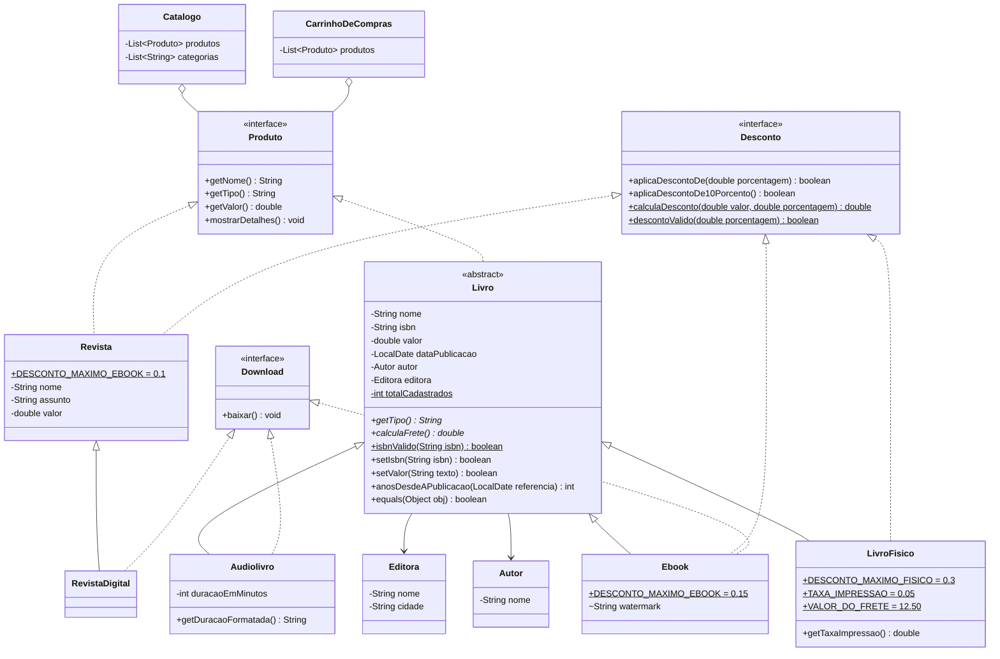

# Projeto de exemplo: Livraria (aulas 10 a 12)

> **Autor:** Murilo Leandro, com análise do Claude, em 07/11/2026.
> **Fonte:** `src.zip` da pasta `Nunes\Aula10-09-10-2026\aula10`, com 18 arquivos `.java` no pacote `br.edu.ifsp.livraria`. É o exercício da Livraria que o professor desenvolve nos slides das aulas 10, 11 e 12 (adaptado de Turini), na versão feita em aula.
> **Para que serve:** mostra como o professor espera ver herança, classe abstrata, interface e polimorfismo, e o que **reaproveitar** e **não repetir** no LogiTech. A seção mais importante é a [10. Checklist de erros a não repetir](#10-checklist-erros-falhas-e-bugs-que-não-podem-se-repetir-no-logitech).

As saídas reproduzidas aqui vêm de uma execução real (JDK 26.0.2, Windows com locale `pt-BR`). Os bugs marcados com **comprovado** foram confirmados executando o código.

---

## 1. O que é e como rodar

Sistema de uma livraria que vende livros físicos, e-books, audiolivros e revistas (impressas e digitais). Tem **catálogo** (cadastro e busca) e **carrinho de compras** (total, descontos, taxas, frete e downloads). Não lê entrada: cada classe de `testes/` tem um `main` que monta os objetos e imprime resultados, em etapas que seguem os exercícios dos slides.

Não existe classe `Main`. São 4 `main`, todos em pacote, então é preciso compilar com `-d` e rodar pelo nome completo:

```bash
# Git Bash, a partir da pasta que contém src/
javac -encoding UTF-8 -d out $(find src -name "*.java")
java -cp out br.edu.ifsp.livraria.testes.CadastroDeLivros
java -cp out br.edu.ifsp.livraria.testes.ExibirLivros
java -cp out br.edu.ifsp.livraria.testes.TiposDeLivro
java -cp out br.edu.ifsp.livraria.testes.teste
```

> **Para o LogiTech:** o enunciado exige `java Main < entrada.txt`. Se usarmos pacotes como aqui, o `docs/COMO_EXECUTAR.md` é obrigatório, com a versão do JDK, a classe principal e esses comandos exatos.

## 2. Estrutura de pacotes

```
src/br/edu/ifsp/livraria/
├── Autor.java                 composição: Livro "tem um" Autor
├── Editora.java               composição: Livro "tem uma" Editora
├── Catalogo.java              List<Produto>: cadastro, buscas, categorias, promoção
├── CarrinhoDeCompras.java     List<Produto>: total, descontos, taxas, frete, downloads
├── produtos/
│   ├── Livro.java             abstrata, implementa Produto
│   ├── LivroFisico.java       extends Livro implements Desconto
│   ├── Ebook.java             extends Livro implements Download, Desconto
│   ├── Audiolivro.java        extends Livro implements Download
│   ├── Revista.java           implements Produto, Desconto (não é Livro)
│   ├── RevistaDigital.java    extends Revista implements Download
│   └── interfaces/
│       ├── Produto.java       getNome, getTipo, getValor, mostrarDetalhes
│       ├── Desconto.java      @FunctionalInterface, com default e static
│       └── Download.java      baixar
└── testes/                    roteiros com main (não são testes unitários)
    ├── CadastroDeLivros.java
    ├── ExibirLivros.java
    ├── TiposDeLivro.java
    └── teste.java
```

## 3. Diagrama de classes



Na notação: `*` é método abstrato, `$` é `static` e `~` é visibilidade de pacote (sem modificador).

## 4. Classe por classe

Os caminhos são relativos a `src/br/edu/ifsp/livraria/`.

### `Autor` e `Editora`
Classes simples de dados. Mostram **composição** (aula 10): `Livro` *tem um* `Autor` (obrigatório, recebido no construtor) e *tem uma* `Editora` (opcional, por setter).
- `Autor` não aplica `trim` no nome. Por isso, em `TiposDeLivro`, a saída mostra `Autor:  Mauricio Aniche ` com espaços.
- `Editora.toString()` devolve `"Casa do Codigo (Sao Paulo)"` com `trim` nos dois campos.

### `Livro` (abstrata) — `produtos/Livro.java`
Superclasse de `LivroFisico`, `Ebook` e `Audiolivro`. Implementa `Produto`.

| Membro | Regra |
|---|---|
| construtor `Livro(Autor)` (l. 25) | obriga as subclasses a chamarem `super(autor)`; incrementa o contador `static totalCadastrados` |
| `setNome` (l. 32) | `trim()` + `toUpperCase()` (`"   java para iniciantes  "` → `"JAVA PARA INICIANTES"`) |
| `isbnValido` (l. 36, `static`) | remove os hifens; exige exatamente 13 caracteres, todos dígitos |
| `setIsbn` (l. 50) | **retorna `boolean`**: `false` e não altera nada se for inválido; guarda o ISBN sem hifens |
| `setValor(String)` (l. 58) | `Double.parseDouble` dentro de `try/catch NumberFormatException`; rejeita negativo; `"59,90"` → `false` (vírgula não é aceita) |
| `setValor(double)` (l. 115) | sem validação (usado pelos descontos) |
| `anosDesdeAPublicacao` (l. 89) | `Period.between(data, referencia).getYears()`; sobrecarga sem parâmetro usa `LocalDate.now()` |
| `getTipo()` e `calculaFrete()` (l. 22–23) | **abstratos**: cada subclasse responde |
| `toString` (l. 128) | monta "Nome / ISBN / Autor / Valor / Data / Editora"; ver bugs 9 e 11 |
| `equals` (l. 160) | dois livros são iguais se o ISBN for igual |

### `LivroFisico` — `produtos/LivroFisico.java`
`extends Livro implements Desconto`. Constantes: desconto máximo de **30%**, taxa de impressão de **5%** do valor e frete fixo de **R$ 12,50**.
- `getTaxaImpressao()` = valor × 0,05.
- `aplicaDescontoDe(p)`: se `p > 0,3`, imprime "Desconto acima do permitido" e retorna `false`; senão reduz o valor e retorna `true`.
- `equals` só aceita outro `LivroFisico` (depois delega para `Livro.equals`).
- `mostraValor()` imprime o valor sem formatação.

### `Ebook` — `produtos/Ebook.java`
`extends Livro implements Download, Desconto`. Desconto máximo de **15%**. Tem `watermark` (marca d'água).
- Frete `0.0`. `baixar()` imprime "Baixando livro … com marca d'agua: …".
- `toString` acrescenta a marca d'água; `mostrarDetalhes` acrescenta uma linha em branco.

### `Audiolivro` — `produtos/Audiolivro.java`
`extends Livro implements Download`. **Não** implementa `Desconto`, então descontos em lote o ignoram.
- `getDuracaoFormatada()`: 395 min → `"6h35min de audio"` (`/ 60` e `% 60`, com `%02d`).
- Frete `0.0`.

### `Revista` e `RevistaDigital` — `produtos/Revista.java`, `produtos/RevistaDigital.java`
`Revista implements Produto, Desconto`, **sem** herdar de `Livro`: um produto que não é livro entra no carrinho só por implementar `Produto` (aula 12). Desconto máximo de **10%**. Não tem `calculaFrete`.
`RevistaDigital extends Revista implements Download`: herda o desconto e acrescenta `baixar()` ("… em PDF").

### `Catalogo` — `Catalogo.java`
| Método | O que faz |
|---|---|
| `cadastra(Livro)` | adiciona na `List<Produto>` (só aceita `Livro`) |
| `buscaPorTitulo` | primeiro com nome igual, ignorando maiúsculas, com `trim` na busca; faz cast para `Livro`; `null` se não achar |
| `buscaPorTrecho` | todos cujo nome contém o trecho, ignorando maiúsculas |
| `publicadosAntes(LocalDate)` | só os `Livro` com data e anteriores ao limite |
| `adicionaCategoria` | padroniza (`trim` + minúsculas) e **evita duplicata com `List.contains`**, sem `Set` |
| `aplicaPromocaoParaAntigos` ("Bônus") | desconto para livros com N anos ou mais desde a publicação; ver bug 2 |

### `CarrinhoDeCompras` — `CarrinhoDeCompras.java`
| Método | O que faz |
|---|---|
| `adiciona(Produto)`, `remove(int)`, `remove(Livro)` | `remove(Livro)` usa `equals`, então uma **cópia com o mesmo ISBN** remove o original |
| `getTotal()` | soma `getValor()` de todos, **por polimorfismo** (o modelo a seguir) |
| `getBaixaveis()` | filtra os `Download` com `instanceof` |
| `aplicaDescontoEmTodos(p)` | aplica em quem é `Desconto` e conta os aceitos |
| `getTotalDeTaxasDeImpressao()` | soma a taxa dos `LivroFisico` (`instanceof` + cast) |
| `getTotalComFrete()` ("Bônus") | total + frete dos `LivroFisico`; ver bug 1 |

## 5. Interfaces

| Interface | Conteúdo | Ponto da aula 12 |
|---|---|---|
| `Produto` | `getNome`, `getTipo`, `getValor`, `mostrarDetalhes` | interface como **tipo comum**: `List<Produto>` guarda livros e revistas |
| `Desconto` | `aplicaDescontoDe` (abstrato), `aplicaDescontoDe10Porcento` (`default`, chama o abstrato com 0,1), `calculaDesconto` e `descontoValido` (`static`) | `default`, `static`, `@FunctionalInterface` (só um método abstrato) |
| `Download` | `baixar` | `implements` múltiplo (`Ebook implements Download, Desconto`) |

**Quem implementa o quê:**

| Classe | Herda de | `Produto` | `Desconto` (limite) | `Download` | Frete |
|---|---|---|---|---|---|
| `LivroFisico` | `Livro` | sim | 30% | — | R$ 12,50 |
| `Ebook` | `Livro` | sim | 15% | sim | 0 |
| `Audiolivro` | `Livro` | sim | — | sim | 0 |
| `Revista` | — | sim | 10% | — | não tem o método |
| `RevistaDigital` | `Revista` | sim | 10% (herdado) | sim | não tem o método |

O limite é testado com `>`, então o próprio limite é aceito: 15% em `Ebook` e 10% em `Revista` passam.

## 6. Roteiros de teste (`testes/`) e saída real

Os roteiros não são testes unitários: imprimem valores e quem confere é a pessoa (ver bug 20).

### `CadastroDeLivros` — aulas 9 e 10 (texto, validação, data, listas)
| Etapa | O que exercita | Saída relevante |
|---|---|---|
| início | `Livro.getTotalCadastrados()`, `carrinho.getTotal()` | `Livros cadastrados: 2`, `Total do carrinho: 148.9` (sem formatação) |
| 1 | `setNome` com `trim`/maiúsculas; `setIsbn` válido e inválido; `setValor(String)` | `[JAVA PARA INICIANTES]`, `true false false`, `9788566250466`, `true false false`, `59.9` |
| 2 | `anosDesdeAPublicacao` (2014-01-15) | `12` (ref. 2026-10-01) e `9` (ref. 2024-01-14, um dia antes de completar 10) |
| 3 | `remove(int)`, `remove(Livro)` | `3 / 208.8 / 2 / 148.9 / 1 / USE A CABECA! JAVA` |
| 4 | buscas, `publicadosAntes`, categorias sem duplicata | `3`, `DESBRAVANDO JAVA`, `null`, `3`, `1`, `true false true`, `[programacao, java]` |
| Bônus | `aplicaPromocaoParaAntigos` | **retorna `3` com 2 descontos recusados** e depois **`1` com o único desconto recusado** (bug 2) |

### `ExibirLivros` — aula 11 (sobrescrita, `equals`, polimorfismo)
| Etapa | O que exercita | Saída relevante |
|---|---|---|
| início | `mostrarDetalhes` sobrescrito | `Taxa de impressao: 4.45` (sem formatação) |
| 1 | descontos com limite | `Desconto acima do permitido` / `false`, `true`, `27.0` |
| 2 | `==` × `equals` | `fisico == copia` → `false`; `equals` → `true`; com outro tipo, `String` ou `null` → `false`; `remove(copia)` deixa `0`; `"livro" == new String("livro")` → `false` |
| 3 | desconto em lote, taxas, `instanceof` + cast | `1` (só o físico aceitou 20%), `115.0`, `R$ 2,40` |
| 4 | polimorfismo `getTipo()` | `Ebook`, `Livro Fisico`, `Audio Livro` |
| Bônus | frete | `0.0`, `12.5`, `127.5` (só 1 livro físico, então o bug 1 não aparece aqui) |

### `TiposDeLivro` — aula 10 (herança, `super`, composição com `Editora`)
| O que exercita | Saída relevante |
|---|---|
| `Ebook` com desconto de 15% sobre R$ 29,90 | `Valor: R$ 25,42` |
| `Editora` no livro físico | `Editora: Editora: Casa do Codigo (Sao Paulo)` (rótulo duplicado, bug 11) |
| taxa sem arredondar | `Taxa de impressao: 2.995` |
| "Gancho para aula 11": **mesmo desconto de 15% outra vez** | `true`, `21.60275`: **o desconto acumula** (bug 21) |
| polimorfismo no carrinho | `mostrarDetalhes()` + `getTipo()` de cada item |

### `teste` — aula 12 (interfaces)
| Etapa | O que exercita | Saída relevante |
|---|---|---|
| 1 | `Revista` no carrinho como `Produto` | `4`, `150.0` |
| 2 | desconto de 10% em todos; `Desconto` como tipo; `instanceof` de interface | `3`, `139.0`; 50% na revista → `false`; `true` / `false` |
| 3 | `getBaixaveis()` + `baixar()` | `Baixando livroTEST - DRIVEN DEVELOPMENT(6h35min de audio)` (texto colado, bug 11) |
| 4 | método `default` e métodos `static` | `true`, `13.5`, `true`, `false` |

Em `teste.java:28`, `audio.setIsbn(" 978 -85 -5519 -025 -5 ")` tem espaços, é rejeitado e o retorno `false` é ignorado: o audiolivro fica com ISBN `null` sem ninguém perceber (bug 2).

<details>
<summary>Saída completa dos 4 roteiros</summary>

```text
################ CadastroDeLivros
Livros cadastrados: 2
Total do carrinho: 148.9

--- Etapa 1 ---
[JAVA PARA INICIANTES]
true
false
false
9788566250466
true
false
false
59.9
--- Etapa 2 ---
12
9

Nome: JAVA PARA INICIANTES
ISBN: 9788566250466
Autor: Herbert Schildt
Valor: R$ 59,90
Data: Publicado em: 15/01/2014
Editora: 
Marca d'agua: null

--- Etapa 3 ---
3
208.8
2
148.9
1
USE A CABECA! JAVA
--- Etapa 4 ---
3
DESBRAVANDO JAVA
null
3
1
true
false
true
[programacao, java]
--- Bonus ---
Desconto acima do permitido
Desconto acima do permitido
3
Desconto acima do permitido
1
59.9
################ ExibirLivros

Nome: DESBRAVANDO JAVA
ISBN: null
Autor: Rodrigo Turini
Valor: R$ 59,90
Data: 
Editora: 
Marca d'agua: IFSP Araraquara


Nome: USE A CABECA! JAVA
ISBN: null
Autor: Kathy Sierra
Valor: R$ 89,00
Data: 
Editora: 
Taxa de impressao: 4.45

89.0
Livros Cadastrados: 2
 --- Etapa 1 ---

Nome: TEST - DRIVEN DEVELOPMENT
ISBN: 9788555190248
Autor: Mauricio Aniche
Valor: R$ 30,00
Data: 
Editora: 
Marca d'agua:  aluno@ifsp . edu .br


Nome: TEST - DRIVEN DEVELOPMENT
ISBN: 9788555190231
Autor: Mauricio Aniche
Valor: R$ 60,00
Data: 
Editora: 
Taxa de impressao: 3.0


Nome: TEST - DRIVEN DEVELOPMENT
ISBN: 9788555190255
Autor: Mauricio Aniche
Valor: R$ 40,00
Data: 
Editora: 
Duração: 6h35min de audio
Desconto acima do permitido
false
true
27.0
 --- Etapa 2 ---
false
true
false
false
false
0
false
true
Ebook

 --- Etapa 3 ---
3
Desconto acima do permitido
1
115.0
R$ 2,40
Desconto acima do permitido
false
teste

 --- Etapa 4 ---
Ebook
Livro Fisico
Audio Livro

 --- Bonus ---
0.0
12.5
127.5
################ TiposDeLivro

Nome: TEST - DRIVEN DEVELOPMENT
ISBN: 9788555190248
Autor:  Mauricio Aniche 
Valor: R$ 25,42
Data: 
Editora: 
Marca d'agua: aluno@ifsp.edu.br

Marca d’agua: aluno@ifsp.edu.br
Taxa de impressao: R$3,00
Livros cadastrados: 2

Nome: TEST - DRIVEN DEVELOPMENT
ISBN: 9788555190248
Autor:  Mauricio Aniche 
Valor: R$ 59,90
Data: 
Editora: Editora: Casa do Codigo (Sao Paulo)
Taxa de impressao: 2.995


----------
Audio Livro
DESBRAVANDO JAVA: 6h35min de audio

----------
Gancho para aula 11
true
21.60275


Livros no Carrinhos


Nome: TEST - DRIVEN DEVELOPMENT
ISBN: 9788555190248
Autor:  Mauricio Aniche 
Valor: R$ 21,60
Data: 
Editora: 
Marca d'agua: aluno@ifsp.edu.br

Ebook

Nome: TEST - DRIVEN DEVELOPMENT
ISBN: 9788555190248
Autor:  Mauricio Aniche 
Valor: R$ 59,90
Data: 
Editora: Editora: Casa do Codigo (Sao Paulo)
Taxa de impressao: 2.995

Livro Fisico

Nome: DESBRAVANDO JAVA
ISBN: null
Autor: Rodrigo Turini
Valor: R$ 0,00
Data: 
Editora: 
Duração: 6h35min de audio
Audio Livro
################ teste
 --- Etapa 1 ---
4
150.0
Java Magazine
TEST - DRIVEN DEVELOPMENT: R$ 30,00
TEST - DRIVEN DEVELOPMENT: R$ 60,00
TEST - DRIVEN DEVELOPMENT: R$ 40,00
Java Magazine: R$ 20,00
 --- Etapa 2 ---
3
139.0
Desconto acima do permitido
false
true
false
--- Etapa 3 ---
Baixando livro TEST - DRIVEN DEVELOPMENT com marca d'agua: aluno@ifsp.edu.br
Baixando livroTEST - DRIVEN DEVELOPMENT(6h35min de audio)
Baixando:  Programar em PDF
 --- Etapa 4 ---
true
13.5
true
false
```

</details>

### Sonda extra (fora do zip)
Para confirmar o que os roteiros não mostram, rodamos uma classe extra com 2 livros físicos (R$ 10 e R$ 20), fora do repositório:

```text
total=30.0 totalComFrete=42.5 esperado=55.0          ← bug 1: só um frete foi somado
quantidade apos getProdutos().clear(): 0             ← bug 7: quem chama o getter apaga o carrinho
equals sem ISBN: NullPointerException                ← bug 13
String.format sem Locale, default US: R$ 25.42       ← bug 12: na máquina com locale US sai ponto
```

## 7. Conceitos de aula e onde aparecem

| Aula | Conceito | Onde está no exemplo |
|---|---|---|
| 3 | setter que valida e retorna `boolean` | `Livro.setIsbn`, `Livro.setValor(String)` |
| 6 | pacotes e `import` | `produtos`, `produtos.interfaces`, `testes` |
| 6 | `static final` (constantes) e `static` (contador, utilitário) | `LivroFisico.VALOR_DO_FRETE`; `Livro.totalCadastrados`; `Livro.isbnValido` |
| 9 | `LocalDate`, `Period`, `DateTimeFormatter`, `List`/`ArrayList` | `Livro.anosDesdeAPublicacao`, `Livro.toString`, `Catalogo` |
| 10 | composição ("tem um") | `Livro` → `Autor`, `Editora` |
| 10 | herança, `extends`, `super(autor)`, ordem dos construtores | `LivroFisico`/`Ebook`/`Audiolivro extends Livro`; `RevistaDigital extends Revista` |
| 11 | `@Override`, `toString`, `equals` × `==` | `Livro.toString`, `Livro.equals`; `ExibirLivros` Etapa 2 |
| 11 | polimorfismo | `CarrinhoDeCompras.getTotal()` e o laço de `getTipo()` |
| 11 | `instanceof` e casting | `CarrinhoDeCompras`, `Catalogo`, `ExibirLivros` Etapa 3 |
| 11 | classe e método `abstract` | `Livro`, `getTipo()`, `calculaFrete()` |
| 12 | `interface`, `implements` múltiplo, interface como tipo | `Produto`, `Desconto`, `Download`; `Desconto promocional = revista` |
| 12 | `default` e `static` em interface, `@FunctionalInterface` | `Desconto` |
| — | `try/catch` (não aparece nos slides disponíveis) | `Livro.setValor(String)` |
| — | `instanceof` com padrão (Java 16+, nos slides só como "curiosidade") | `CarrinhoDeCompras.getBaixaveis`, `aplicaDescontoEmTodos`; `Catalogo.aplicaPromocaoParaAntigos` |

## 8. Resumo dos problemas encontrados

O exemplo é didático: foi escrito para mostrar um conceito por vez, e vários "atalhos" fazem sentido na aula, mas **não** no LogiTech, que tem restrições mais duras e é corrigido por um stress test automático. Os problemas estão em três grupos, detalhados na seção 10:

- **Bugs de lógica (comprovados):** frete conta só o último livro (1); promoção conta desconto recusado (2); desconto acumula a cada chamada (21); `equals` quebra com ISBN nulo (13).
- **Violações das regras do LogiTech:** `instanceof` + cast para decidir comportamento (3, 4); getter expõe a lista (7); atributo sem `private` (8); regra duplicada (5); formato sem `Locale` (12).
- **Qualidade e saída:** `println` no domínio e no `toString` (9, 10); rótulos duplicados e texto colado (11); nomes (6, 18); `trim` inconsistente (22); método de interface vazio (23); sem testes com asserção (20).

## 9. O que levar para o LogiTech

### Reaproveitar

| No exemplo | No LogiTech |
|---|---|
| `List<Produto>` guarda tipos diferentes e `getTotal()` soma por polimorfismo | `List` de transportes; frete, tempo e CO₂ calculados chamando o modal e o perfil pela abstração, sem saber a classe concreta |
| `Livro` abstrata com `calculaFrete()` abstrato, uma resposta por subclasse | cada modal (rodoviário, aéreo, aquaviário) responde pelos próprios parâmetros; novo modal = classe nova |
| `RevistaDigital`: um tipo novo com uma classe pequena, sem mexer em nada | é o que o professor vai pedir ao vivo (ferroviário, PREMIUM, SMS…), em até 5 minutos |
| `Revista` entra no carrinho só por implementar `Produto`, sem herdar de `Livro` | interface para o que é comum entre classes sem parentesco (ex.: interessados que recebem avisos) |
| `setIsbn`/`setValor(String)` validam e retornam `boolean`; `try/catch NumberFormatException` | camada de entrada valida cada campo e transforma erro em "linha inválida + motivo", sem derrubar o lote |
| `adicionaCategoria` evita duplicata com `List.contains` | substituto de `Set` permitido (só `List`/arrays) |
| constantes `static final` com nome | parâmetros fixos (sobretaxa, limites) em constantes nomeadas, num único lugar |
| `Desconto` como tipo (`Desconto promocional = revista`) | variáveis e atributos declarados pela interface (`Modal modal`, `Perfil perfil`) |

### Cuidado: o que fica fácil ou difícil de mudar
Os cenários da defesa precisam caber em **5 minutos**. No exemplo:
- **Fácil (bom projeto):** acrescentar `RevistaDigital` exigiu uma classe de 10 linhas, sem alterar nada.
- **Difícil (contraexemplo):** um novo produto com frete (ex.: uma "Caixa de livros" com frete de R$ 20) **exigiria mexer no `CarrinhoDeCompras`**, porque o frete é decidido por `instanceof LivroFisico`. O motivo de projeto: `calculaFrete()` está em `Livro`, e não em `Produto`, então o carrinho não consegue chamá-lo de forma polimórfica. **Lição:** o método que todos precisam responder tem que estar na abstração que o cliente usa.

## 10. Checklist: erros, falhas e bugs que NÃO podem se repetir no LogiTech

**Antes de abrir PR, conferir esta lista.** As linhas citadas são do zip (relativas a `src/br/edu/ifsp/livraria/`).

| # | Erro no exemplo (onde) | O que acontece | Regra do LogiTech | Como fazer no LogiTech |
|---|---|---|---|---|
| 1 | **Acumulador sobrescrito:** `frete = ...` em vez de `frete += ...` (`CarrinhoDeCompras.java:83`) | **Comprovado:** 2 livros físicos → frete 12,50 em vez de 25,00 (total 42,5 em vez de 55,0) | valores iguais ao gabarito (±0,01) | somar com `+=`; ter teste unitário com **2 ou mais itens** (o caso de 1 item esconde o bug, como em `ExibirLivros`) |
| 2 | **Retorno de validação ignorado:** `comDesconto++` mesmo quando `aplicaDescontoDe` devolve `false` (`Catalogo.java:74-76`); `setIsbn` inválido ignorado (`teste.java:28`) | **Comprovado:** promoção retorna 3 com só 1 desconto aplicado, e 1 com nenhum; audiolivro fica com ISBN `null` | auditoria e avisos só contam o que aconteceu (ex.: CANCELADO não soma nada) | sempre testar o `boolean` devolvido; contar só o que foi aceito; transição de status recusada não gera aviso nem soma |
| 3 | **`instanceof` + cast para decidir comportamento:** `getTotalComFrete`, `getTotalDeTaxasDeImpressao`, `aplicaDescontoEmTodos`, `getBaixaveis` (`CarrinhoDeCompras.java:34, 56, 68, 82`), `publicadosAntes` e `aplicaPromocaoParaAntigos` (`Catalogo.java:45, 72`) | cada tipo novo obriga a mexer no carrinho e no catálogo | **proibido** `instanceof`, `switch` e comparação de código fora da camada de entrada | a variação mora no objeto: `modal.calcular...()`, `perfil.aplicar...()`; quem usa não pergunta o tipo |
| 4 | **Ignora o polimorfismo que já existe:** `calculaFrete()` é abstrato em `Livro`, mas o carrinho testa `LivroFisico` (`CarrinhoDeCompras.java:82-83`) | o método polimórfico existe e não é usado; Revista nem tem o método | variação resolvida por polimorfismo | o método que o cliente precisa fica na abstração que ele usa (interface do modal/perfil), e o cliente chama só ela |
| 5 | **Regra duplicada:** `aplicaDescontoDe` copiado em `Ebook.java:29`, `LivroFisico.java:51`, `Revista.java:55`; só o limite muda | corrigir a regra exige alterar 3 arquivos | sobretaxa de carga pesada em **um único ponto**, valendo para todos os modais | regra comum em um lugar só (classe ou método da abstração); as subclasses fornecem só o parâmetro que muda (o professor pede "sobretaxa 8% acima de 2000 kg" ao vivo) |
| 6 | **Constante com nome errado (copiar e colar):** `Revista.DESCONTO_MAXIMO_EBOOK` (`Revista.java:7`) | confunde quem lê e quem altera ao vivo | alta coesão, código defensável na arguição | nomear pelo significado; revisar nomes de constantes no PR |
| 7 | **Getter expõe a lista interna:** `getProdutos()` (`CarrinhoDeCompras.java:50`), `getCategorias()` (`Catalogo.java:65`) | **Comprovado:** `carrinho.getProdutos().clear()` esvazia o carrinho por fora | getters não expõem estado mutável | devolver `Collections.unmodifiableList(lista)` ou `new ArrayList<>(lista)` |
| 8 | **Atributo sem `private`:** `String watermark` (`Ebook.java:9`) | qualquer classe do pacote altera sem passar pelo setter | todos os atributos de instância `private` | `private` sempre; conferir no PR |
| 9 | **Efeito colateral no `toString`:** `System.out.println()` (`Livro.java:130`) | cada `toString()` imprime uma linha em branco, até em `cabeca.toString();` solto (`CadastroDeLivros.java:32`), o que sujaria a saída do lote | saída no formato exato | `toString` e cálculos **não imprimem**; só a camada de saída imprime |
| 10 | **`println` dentro do domínio:** "Desconto acima do permitido" em `aplicaDescontoDe`; `mostrarDetalhes`; `baixar` | o domínio decide o texto e o momento de imprimir; não dá para testar nem reaproveitar | núcleo de cálculo não lê nem escreve; relatório separado | o núcleo devolve valores e motivo de rejeição; a classe de relatório monta o texto |
| 11 | **Texto com rótulo duplicado e palavras coladas:** `"Data: " + "Publicado em: ..."`, `"Editora: " + "Editora: ..."` (`Livro.java:136, 143, 154`); `"Baixando livro" + nome` (`Audiolivro.java:52`); `nome + "em PDF"` (`RevistaDigital.java:12`) | **Comprovado:** `Editora: Editora: Casa do Codigo`, `Baixando livroTEST` | o texto é conferido **exatamente** no stress test | cada linha da saída montada num único método, com teste unitário comparando a `String` esperada caractere a caractere |
| 12 | **Número sem `Locale` e sem formatação:** `String.format("R$ %.2f", ...)` (`Livro.java:152` e outros); `148.9`, `4.45`, `2.995` impressos crus | **Comprovado:** com locale US sai `25.42`, não `25,42`; o resultado depende da máquina da banca | vírgula decimal, 2 casas | sempre `String.format(Locale.forLanguageTag("pt-BR"), "%.2f", v)`, num único método de formatação |
| 13 | **`NullPointerException` em potencial:** `this.isbn.equals(...)` com ISBN nulo (`Livro.java:164`); `setNome(null)` (`Livro.java:32`); `anosDesdeAPublicacao` sem data (`Livro.java:90`); `buscaPorTitulo(null)` | **Comprovado** no `equals` | **nenhuma exceção não tratada**; linha inválida nunca interrompe o lote | validar campo vazio ou nulo na entrada antes de criar o objeto; comparar com a constante à esquerda ou checar `null` |
| 14 | **`equals` sobrescrito sem `hashCode`** (`Livro.java:160`) | contrato de `Object` quebrado | qualidade OO | só sobrescrever `equals` se precisar; se sobrescrever, sobrescrever `hashCode` também |
| 15 | **`parseDouble` com vírgula falha:** `setValor("59,90")` → `false` (`Livro.java:60`) | entrada "brasileira" rejeitada | entrada usa **ponto decimal**; saída usa vírgula | ler com ponto; `NumberFormatException` vira linha inválida com o motivo correto da tabela de validação |
| 16 | **Parâmetro pelo tipo concreto:** `cadastra(Livro)` (`Catalogo.java:15`) e `remove(Livro)` (`CarrinhoDeCompras.java:23`) numa `List<Produto>`; cast `(Livro)` em `buscaPorTitulo` (`Catalogo.java:26`) | uma `Revista` não pode ser cadastrada nem removida por objeto | baixo acoplamento: depender de abstrações | parâmetros, atributos e retornos declarados pela interface |
| 17 | **Recurso não ensinado:** `instanceof Tipo variavel` (Java 16+) (`CarrinhoDeCompras.java:34, 56`; `Catalogo.java:74`); `@FunctionalInterface` sem uso de lambda (`Desconto.java:3`) | difícil de defender na arguição | usar só o que foi ensinado (ver `contexto/slides/README.md`) | construções simples; em dúvida, perguntar antes |
| 18 | **Nome de classe fora da convenção:** `public class teste` (`teste.java:10`) | foge da convenção Java | identificadores na convenção Java | classes em `PascalCase`, métodos e atributos em `camelCase` |
| 19 | **Contador `static` mutável:** `totalCadastrados++` no construtor (`Livro.java:27`) | conta todo `new` (até cópias de teste) e nunca zera; o resultado depende da ordem dos testes | testes unitários independentes | sem estado `static` mutável no núcleo; contadores e totais no objeto do relatório ou do lote |
| 20 | **"Testes" só com `main` + `println`** (`testes/`) | ninguém percebe o erro sem conferir à mão (o bug 2 passa despercebido) | testes unitários obrigatórios, incluindo o gabarito | JUnit com asserções; cada bug desta lista vira um caso de teste |
| 21 | **Valor original sobrescrito pelo cálculo:** desconto grava o novo valor por cima (`Ebook.java:35`, `LivroFisico.java:57`, `Revista.java:61`) | **Comprovado:** 15% duas vezes → 29,90 → 25,42 → 21,60; o preço original se perde | trocar ou **simular** perfil sem alterar o perfil ativo nem recriar o transporte | guardar os dados de entrada (peso, distância) imutáveis e **calcular** frete, tempo e CO₂ a partir deles a cada pedido, sem gravar o resultado por cima |
| 22 | **Normalização de texto espalhada e inconsistente:** `Livro.setNome` faz `trim`, `Autor` não (`Autor.java:17`), `Revista` não | **Comprovado:** `Autor:  Mauricio Aniche ` com espaços | entrada lida em uma camada só | `trim` e padronização de todos os campos **uma vez**, na camada de entrada |
| 23 | **Método de interface implementado vazio:** `Revista.mostrarDetalhes()` não faz nada | o contrato existe, mas a revista não mostra nada e ninguém é avisado | polimorfismo real, sem "buracos" | toda classe que implementa a interface cumpre o contrato; se não faz sentido para ela, a interface está grande demais e deve ser dividida |

### Resumo para lembrar
1. **Polimorfismo, nunca `instanceof`**, fora da entrada.
2. **Um único ponto** para cada regra, para a formatação e para a normalização da entrada.
3. **Calcular, não sobrescrever:** dados de entrada imutáveis, resultados calculados.
4. **Conferir todo `boolean` de validação**; nenhuma exceção escapa.
5. **Domínio não imprime**; a saída sai em `pt-BR`, no formato exato.
6. **Testes com asserção**, com mais de um item e casos de borda.
