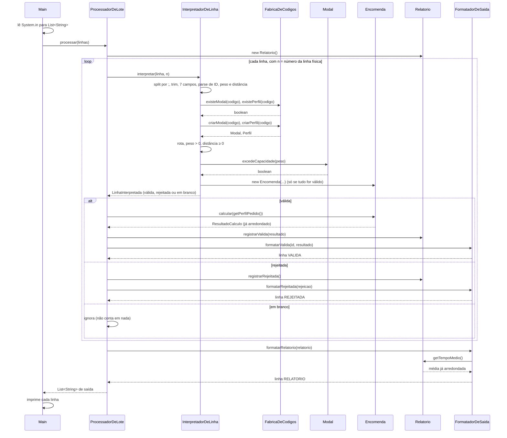

# Documento de Projeto: Sistema LogiTech

**Disciplina:** Introdução à Orientação a Objetos (IFSP) · **Etapa 1** (entrega em 27/11, sem código)
**Grupo:** Liliane, Murilo e Alexandre

> **Documento oficial do grupo, em construção (desde 2026-11-10).** Este arquivo é a versão oficial do Documento de
> Projeto. **Não pode ser apagado nem substituído por outro arquivo, apenas editado**, por PR, seção por seção.
>
> | Seção | Cartão | Responsável | Situação |
> |---|---|---|---|
> | 1. Análise do problema | T07 | Murilo | Escrita |
> | 2. Catálogo de classes e interfaces | T08 | Alexandre | Escrita |
> | 6.1 Fluxo: processamento de uma linha do lote | T12 | Murilo | Escrita |
> | 8. Plano de testes | T19 | Murilo | Escrita, em revisão |
> | 3 a 5, 6.2, 6.3 e 7 | T09 a T11 e T13 a T18 | Ver `docs/divisao-projeto.md` | A fazer |
>
> A seção 1 diz **quais conceitos existem e o que cada um é**. Nomes de classes, a escolha entre interface e classe
> abstrata e os padrões adotados ficam para o T08 (catálogo), o T10 (estratégia de resolução) e o T11 (padrões).

## 1. Análise do problema

A LogiTech recebe encomendas em lote, calcula frete, tempo e CO₂ conforme o **modal** e o **perfil de precificação**,
acompanha o **transporte** de cada encomenda, **avisa** os interessados quando o status ou a posição mudam e emite um
**relatório consolidado**.

### 1.1 Método

Usamos a técnica que o enunciado cita: levantar os **substantivos e verbos** do texto do problema e decidir o que
cada um vira.

1. **Levantamento:** substantivos e verbos das regras de negócio (`contexto/regras-negocio.md`, seções 1 a 11).
2. **Classificação:** cada substantivo responde a 4 perguntas, nesta ordem. A primeira resposta "sim" decide o
   destino.

   | Pergunta | Se sim | Base nas aulas |
   |---|---|---|
   | Tem comportamento próprio ou varia entre tipos? | **Classe** ou, se varia, **hierarquia** | Aula 11 (classe abstrata como o que os tipos têm em comum) e aula 12 (interface como tipo comum) |
   | É uma parte que outro conceito "tem" e que vale como um todo? | **Composição** | Aula 10 ("tem um" × "é um") |
   | Só descreve outro conceito, como um número ou um texto? | **Atributo** de quem descreve | Aula 2 (classe × objeto) e aula 3 (encapsulamento) |
   | É contexto, ator externo ou sinônimo de outro conceito? | **Descartado** | — |

3. **Responsabilidades:** cada verbo é ligado a quem deve fazê-lo. É uma hipótese que o catálogo (T08) confirma.
4. **Pontos de variação:** marcamos onde o enunciado diz que algo novo vai surgir (os 12 cenários de evolução) e
   citamos o padrão **candidato** para cada um. A escolha é do T11.

**Alternativa descartada:** começar pelos padrões e encaixar os conceitos neles. Isso inverte a ordem que o enunciado
avalia (análise, depois projeto, depois estratégia) e leva a usar padrão sem justificativa, o que não rende pontos.

### 1.2 Substantivos: o que vira classe e o que é descartado

"Hierarquia" quer dizer uma abstração (interface ou classe abstrata, a decidir no T08) com um tipo concreto para
cada variação. A coluna "Onde aparece" indica a seção de `contexto/regras-negocio.md` (RN) ou de
`contexto/especificacoes-tecnicas.md` (ET).

| Conceito | Onde aparece | Destino | Motivo |
|---|---|---|---|
| Modal (rodoviário, aéreo, aquaviário) | RN 1, 2 | **Hierarquia** | Cada modal tem custos, velocidade, manuseio, emissão e capacidade próprios. O cenário do **ferroviário** exige um modal novo sem reescrever o que existe, então ninguém pode perguntar qual é o modal. |
| Perfil de precificação (econômico, rápido, ecológico) | RN 1, 4 | **Hierarquia** | Cada perfil aplica multiplicadores diferentes e pode ser trocado em execução. Os cenários **corporativo** e **PREMIUM** exigem perfis novos sem alterar os existentes. O perfil não depende do modal. |
| Encomenda | RN 1, 10 | **Classe** | Reúne os dados do pedido. Existe antes de qualquer transporte: é ela que se valida e que se simula. Seus dados não mudam depois de criada. |
| Transporte | RN 1, 7 | **Classe** | A entrega em andamento. Tem estado que muda (status, posição e perfil vigente). Separar da encomenda permite trocar o perfil ou simular **sem gravar o resultado por cima dos dados originais**. |
| Status (aguardando, em trânsito, entregue) | RN 7 | **Hierarquia** | Cada status aceita transições diferentes e decide se a troca de perfil é permitida. O cenário **CANCELADO** exige um status novo. O enunciado proíbe `enum`. |
| Posição | RN 7 | **Composição** (o transporte tem uma posição) | Latitude e longitude só valem juntas: se um valor sai do intervalo, o par inteiro é rejeitado. O próprio par concentra essa validação. Começa ausente. |
| Interessado (central de controle, auditoria ambiental, cliente) | RN 1, 8 | **Hierarquia** | Cada um reage ao aviso de um jeito. Os cenários do **SMS por região** e da **troca de assinatura** exigem acrescentar e remover interessados em execução, sem alterar o transporte. |
| Resultado do cálculo (frete, tempo e CO₂) | RN 3 a 5, 11 | **Classe** | Os três valores nascem juntos, já arredondados, e andam juntos na saída, na simulação e no relatório. |
| Rejeição (ID e motivo) | RN 6, 11 | **Classe** | A encomenda inválida é registrada com o ID (ou `LINHA<n>`) e o motivo e não interrompe o lote. Um objeto de rejeição evita usar exceção para o fluxo normal da validação. |
| Relatório consolidado | RN 9 | **Classe** | Acumula custo, tempo, CO₂, válidas e rejeitadas em uma única passagem e calcula a média só no final. |
| Entrada (lote lido de `System.in`) | RN 10 | **Classe** (camada de entrada) | A leitura fica fora do núcleo, que recebe uma `List<String>`. É o único lugar que conhece os códigos de texto e o separador. |
| Saída | RN 11 | **Classe** (camada de saída) | Monta cada linha no formato exato, com vírgula decimal. O núcleo não imprime. |
| Aviso (evento de mudança) | RN 8 | **A decidir (T14)** | Pode ser só os parâmetros da notificação ou um objeto com ID, status e coordenadas. A resposta depende do fluxo de avisos. |
| Sobretaxa de carga pesada | RN 3, ET 4 | **Regra em um único ponto (lugar a decidir no T10)** | Vale igual para todos os modais e o cenário dos **8% acima de 2000 kg** a altera em um só lugar. Não pode ser copiada em cada modal. |
| Linha do lote | RN 10 | **Descartado como classe** | É só um texto até ser interpretada. Depois vira encomenda ou rejeição. |
| Cliente (como classe à parte) | RN 8 | **Descartado** | Já é um tipo de interessado. Uma segunda classe "Cliente" duplicaria o conceito. |
| Operador | RN 1, ET 4 | **Descartado** | Ator externo: troca o perfil e pede simulações chamando o núcleo, mas não tem estado no sistema. |
| Operadora LogiTech | RN 1 | **Descartado** | É o contexto do problema, não um objeto com comportamento. |
| Lote | RN 1, 10 | **Descartado como classe** | É a lista de linhas que a entrada entrega. Seu processamento é uma responsabilidade (ver 1.4), não um conceito com estado próprio. |

### 1.3 Atributos

| Atributo | De quem | Observação |
|---|---|---|
| ID | Encomenda | Inteiro, único no lote. |
| Peso (kg) e distância (km) | Encomenda | Números finitos, lidos com ponto decimal. |
| Origem e destino | Encomenda | Texto sem espaços nas pontas e não vazio. Origem igual ao destino é válida. |
| Custo por km, custo por kg, velocidade média, tempo de manuseio, fator de emissão, capacidade máxima | Modal | Constantes de cada modal, com nome próprio. |
| Multiplicadores de frete, tempo e CO₂ | Perfil | Constantes de cada perfil. |
| **Código de texto** (`RODOVIARIO`, `ECONOMICO`…) | **Só a entrada** | Fora da entrada, ninguém compara o código: o objeto é quem responde. |
| Status atual, posição atual e perfil vigente | Transporte | Os três podem mudar. A posição começa ausente. |
| Interessados | Transporte | Lista privada. Nenhum getter devolve a lista original. |
| Latitude e longitude | Posição | Latitude em [-90, 90] e longitude em [-180, 180], ambas finitas. |
| CO₂ auditado acumulado | Auditoria ambiental | Soma só ao receber `ENTREGUE`. |
| Linhas de log | Central de controle | Uma por evento (ID, status, coordenadas). |
| Mensagens recebidas | Cliente | Uma por mudança de **status**. |
| Custo total, soma dos tempos, CO₂ total, válidas e rejeitadas | Relatório | Somados a partir dos valores já arredondados. |
| Número da linha física | Entrada | Para o `LINHA<n>`, contando as linhas em branco. |

### 1.4 Verbos: responsabilidades

| Verbo | Quem faz (hipótese) | Regra que limita |
|---|---|---|
| Ler a entrada padrão | Entrada | O núcleo não lê dados. |
| Separar os campos e traduzir os códigos em objetos | Entrada | Único lugar com comparação de código e com o separador `;`. |
| Validar a encomenda | Validação, na ordem da tabela | Vale o primeiro motivo. Nenhuma exceção escapa. |
| Rejeitar e registrar | Processamento do lote | A linha inválida não interrompe o lote nem entra nos totais. |
| Calcular os valores base | Modal | Dependem só do modal e da encomenda. |
| Aplicar a sobretaxa | Um único ponto, comum a todos os modais | Alterável em um só lugar. |
| Aplicar os multiplicadores | Perfil | O mesmo para qualquer modal. |
| Arredondar | Um único ponto do cálculo | 2 casas, HALF_UP, depois do perfil. |
| Criar o transporte | A partir de uma encomenda válida | Nasce `AGUARDANDO` e sem posição. |
| Mudar o status | Transporte, com o status vigente decidindo | Só `AGUARDANDO → EM_TRANSITO → ENTREGUE`. Repetir o status é rejeitado. |
| Atualizar a posição | Transporte, com a posição validando o par | Permitido em qualquer status. A primeira posição conta como mudança. |
| Trocar o perfil | Transporte | Sem recriar o transporte. Rejeitado depois de `ENTREGUE`. |
| Simular outro perfil | Transporte, reaproveitando o cálculo | Não altera o perfil vigente e não gera aviso. |
| Avisar os interessados | Transporte (só notifica) | Só quando o valor realmente muda. Operação rejeitada não avisa ninguém. |
| Reagir ao aviso | Cada interessado | Log, soma de CO₂ ou mensagem. |
| Consolidar o relatório | Relatório | Uma passagem, O(n). Lista vazia dá zeros, sem divisão por zero. |
| Formatar e imprimir | Saída | Formatação em um único método, `pt-BR`, 2 casas. O domínio não imprime. |

### 1.5 Pontos de variação e padrões candidatos

Cada cenário de evolução (`contexto/especificacoes-tecnicas.md`, seção 4) cai em um ponto de variação. Os padrões
abaixo são **candidatos**: a escolha, com a alternativa descartada, é do T11 e o mecanismo é do T10.

| Ponto de variação | Cenários que o exigem | Padrão candidato |
|---|---|---|
| Parâmetros e cálculo base do modal | ferroviário | Strategy, ou Template Method com a fórmula comum numa classe abstrata |
| Multiplicadores do perfil e troca em execução | corporativo, PREMIUM, troca de perfil, simulação | Strategy. Para o piso de R$ 50,00 do PREMIUM, avaliar também o Decorator. |
| Regra da sobretaxa | sobretaxa de 8% acima de 2000 kg | Template Method (a regra fica no esqueleto comum) ou uma classe só para ela |
| Transições do status | CANCELADO | State |
| Reação de cada interessado | SMS por região, troca de assinatura, CANCELADO sem soma na auditoria | Observer |
| Criação de modal e perfil a partir do código | código vindo de configuração externa | Simple Factory na entrada |
| Formato da linha | separador `,` | Nenhum padrão: isolado na entrada |
| Regras de validação | peso mínimo de 0,5 kg | Nenhum padrão obrigatório: a regra nova entra na sequência da validação, logo depois de `peso invalido` |

### 1.6 Lições do projeto de exemplo (Livraria)

O checklist de `contexto/projeto-exemplo.md` (seção 10) orientou estas decisões de análise:

- **Item 3 (`instanceof` para decidir comportamento):** modal, perfil, status e interessado viram hierarquias porque
  quem os usa não pode perguntar o tipo.
- **Item 5 (regra copiada em várias classes):** a sobretaxa é tratada como regra única, e não como atributo de cada
  modal.
- **Item 7 (getter que expõe a lista):** os interessados do transporte são uma lista privada, sem acesso direto.
- **Item 13 (exceção não tratada):** a rejeição é um conceito próprio, e não uma exceção que interrompe o lote.
- **Item 21 (cálculo gravado por cima do dado):** encomenda e transporte são separados. Os dados de entrada não
  mudam, e frete, tempo e CO₂ são recalculados a cada pedido, o que permite trocar de perfil e simular.

### 1.7 Dúvidas para o grupo

As dúvidas resolvidas continuam na tabela, para registro. A resposta fica na seção indicada, e esta análise não foi
reescrita. As duas últimas linhas foram apontadas na revisão do PR #16.

| Dúvida | Onde se resolve | Situação |
|---|---|---|
| A sobretaxa mora na abstração comum dos modais ou numa classe própria? | T08 e T10 (Alexandre) | **Resolvida em 2.1.1** |
| O aviso é um objeto próprio ou só parâmetros? | T14 (Alexandre) | **Resolvida em 2.1.4** (objeto próprio). O fluxo dos avisos continua no T14 |
| A operação rejeitada devolve um valor ou lança uma exceção? | T12 (Murilo) e T14 (Alexandre) | **Resolvida para o lote em 6.1** (valor). No `Status` e no `Transporte`, segue aberta para o T14 |
| Onde mora o arredondamento, para que o cálculo normal e a simulação usem o mesmo ponto? | T10 (Alexandre) | **Resolvida em 2.1.2** |
| Quem guarda o modal, se ele não aparece na encomenda nem no transporte (1.3)? Com qual perfil começa o perfil vigente? | T08 (Alexandre) | **Resolvida em 2.1.3** |
| Como a auditoria soma o CO₂ do perfil vigente, se o aviso (1.2) só traz ID, status e coordenadas? | T08 e T14 (Alexandre) | **Resolvida em 2.1.4** |

## 2. Catálogo de classes e interfaces

> **Em revisão (T08, Alexandre).** A 2.1 resolve as dúvidas da seção 1.7 que travavam o catálogo, e a 2.2 traz cada
> classe e interface com responsabilidade, atributos, métodos e colaboradores. As decisões só valem depois da revisão
> do PR pelos 3, e as abstrações `Modal` e `Perfil` são combinadas entre os 3 antes de qualquer código.

### 2.1 Decisões que destravam o catálogo

#### 2.1.1 A sobretaxa fica na fórmula do frete, dentro da abstração dos modais

- **Regra (RN 3):** se o peso passa de 1000 kg, o frete base é multiplicado por 1,05, em todos os modais e inclusive
  com distância 0. O cenário "8% acima de 2000 kg" exige trocar a regra em um único ponto.
- **Decisão:** `Modal` é uma **classe abstrata** que contém a fórmula do frete base, com a sobretaxa dentro dela. A
  fórmula chama etapas abstratas (custo por km, custo por kg, velocidade, manuseio, fator de emissão e capacidade),
  e cada modal concreto só implementa essas etapas com os próprios números (Template Method, 2.2.1). O limite e o
  fator ficam em duas constantes `static final` com nome, declaradas uma vez em `Modal`: `LIMITE_CARGA_PESADA_KG`
  (1000) e `FATOR_SOBRETAXA` (1,05).
- **Por quê:** a regra existe uma vez só e vale para qualquer modal novo, como o ferroviário, sem ele precisar saber
  dela. O cenário dos 8% vira a troca de duas constantes num único arquivo. Evita o erro 5 da Livraria (regra copiada
  em cada subclasse).
- **Alternativa descartada:** uma classe própria `SobretaxaCargaPesada`, chamada depois do frete base. Ela também
  deixa a regra num ponto só, mas só compensaria se a sobretaxa variasse (por perfil, por exemplo), e o enunciado não
  pede isso. Seria uma classe e um colaborador a mais sem ganho.
- **Em aberto:** marcar o método da fórmula como `final` impediria que uma subclasse o reescrevesse. Nos slides,
  `final` aparece só em atributo (aula 6), então o grupo pergunta antes de usar. Sem `final`, a garantia é a combinação
  do grupo mais os testes.

#### 2.1.2 O arredondamento fica no resultado final, e os valores base não são arredondados

- **Regra (RN 5):** frete, tempo e CO₂ são arredondados para 2 casas, HALF_UP, **depois** do perfil. Os agregados
  somam os valores já arredondados.
- **Decisão:** a regra de arredondamento (2 casas, HALF_UP) fica num único método `static`,
  `ResultadoCalculo.arredondar(valor)`, chamado em dois momentos:
  - no construtor do `ResultadoCalculo` (frete, tempo e CO₂). Todo resultado passa por ali, então o lote, o
    transporte e a simulação arredondam no mesmo ponto;
  - no `Relatorio.getTempoMedio()`, que arredonda a média só no fim, como pede a RN 5.

  Os **valores base** (antes do perfil) não usam essa classe e andam sem arredondar. Se o grupo trocar a forma de
  arredondar (ver "Em aberto"), a mudança é feita num só método.
- **Por quê:** arredondar a base antes do perfil sai do gabarito. Exemplo com a encomenda 1 (rodoviário, 1000 km,
  ECONOMICO):

  | Caminho | Conta | Tempo final |
  |---|---|---|
  | Certo | 18,6667 × 1,25 = 23,3333 | **23,33** (gabarito) |
  | Arredondando a base | 18,67 × 1,25 = 23,3375 | 23,34 |

- **Alternativa descartada:** arredondar só na saída, com `String.format`. A auditoria e o relatório somam valores já
  arredondados por encomenda, então eles também precisam do valor arredondado, e não só do texto impresso.
- **Em aberto:** o HALF_UP exato é feito com `BigDecimal` e `RoundingMode.HALF_UP`. Nenhum dos dois aparece nos
  slides, e `RoundingMode` é um `enum` da biblioteca do Java (o grupo proibiu **declarar** `enum`), então o grupo
  pergunta antes de usar. A alternativa sem enum é `Math.round(valor * 100) / 100.0`, que pode errar casos como 1,005
  pela representação do `double`. A tolerância de ±0,01 cobre essa diferença.

#### 2.1.3 A encomenda guarda o modal e o perfil pedido, e o transporte guarda o perfil vigente

- **Problema:** o modal não aparece na encomenda nem no transporte (1.3), e o lote calcula sem criar transporte
  (RN 7: o lote "só calcula e imprime").
- **Decisão:**
  - A `Encomenda` guarda o **modal** e o **perfil pedido**, que vêm da linha da entrada. A validação de capacidade
    pergunta ao modal, **antes** de criar a encomenda, se o peso excede a capacidade, sem testar qual modal é. Assim
    nunca existe uma `Encomenda` inválida.
  - A `Encomenda` tem o cálculo completo, que recebe o perfil a usar e devolve um `ResultadoCalculo`. O lote o chama
    com o perfil pedido.
  - O `Transporte` guarda a encomenda e o **perfil vigente**, que **começa igual ao perfil pedido da encomenda**.
    Para os valores atuais, ele chama o cálculo da encomenda com o perfil vigente. Para simular, chama com o perfil
    pedido na simulação, sem alterar o vigente.
- **Por quê:** a regra de cálculo existe uma vez só e é reaproveitada pelo lote, pelo transporte e pela simulação,
  como pede o cenário da simulação. A encomenda já tem todos os dados do cálculo.
- **Alternativas descartadas:**
  - O transporte guardar o modal: o lote não cria transporte, então o modal ficaria sem lugar no lote.
  - Uma classe de serviço `CalculadoraFrete` à parte: funciona, mas a encomenda já tem os dados, e a classe a mais
    não traria ganho.

#### 2.1.4 O aviso é um objeto imutável que já leva o CO₂ do perfil vigente

- **Problema:** a auditoria soma o CO₂ com o perfil vigente no momento do `ENTREGUE` (RN 8), mas o aviso descrito em
  1.2 só traz ID, status e coordenadas.
- **Decisão:** o aviso é uma classe própria (`Aviso`), **imutável**, com ID, status, posição e o **CO₂ calculado com o
  perfil vigente no instante do aviso**. Quem monta o aviso, e calcula esse CO₂, é o transporte. A central de controle
  e o cliente não usam o campo do CO₂.
- **Por quê:** a auditoria recebe o valor certo sem precisar conhecer o transporte, e o valor não muda depois de
  enviado, mesmo que o perfil mude.
- **Alternativa descartada:** o aviso levar uma referência ao transporte, e a auditoria perguntar o CO₂ a ele. Isso
  prende os interessados ao transporte e dá a eles acesso a métodos que mudam o estado: um interessado poderia mudar
  o status no meio do aviso.
- **Fica para o T11 e o T14:** a auditoria precisa saber se o aviso é de entrega sem comparar o texto do status. A
  saída é polimórfica: o próprio status responde se aquele aviso conta para a auditoria. No cenário CANCELADO, o
  status novo responde que não, e a auditoria não soma nada.

### 2.2 Classes e interfaces

São **31 tipos** em 6 grupos. Atributos são sempre `private`, e as constantes são `static final` com nome. As
operações que podem ser rejeitadas aparecem como "aceita ou rejeita": o mecanismo (valor de retorno ou exceção) foi
resolvido para o lote na 6.1 e, para o `Status` e o `Transporte`, se resolve no T14.

```
Modal (classe abstrata)                    ← Rodoviario, Aereo, Aquaviario
Perfil (interface)
  └── PerfilPorMultiplicadores (abstrata)  ← Economico, Rapido, Ecologico
Status (classe abstrata)                   ← Aguardando, EmTransito, Entregue
InteressadoEmStatus (interface)            ← CentralDeControle, AuditoriaAmbiental, Cliente
InteressadoEmPosicao (interface)           ← CentralDeControle

Encomenda, Transporte, Posicao, ResultadoCalculo, Aviso, Rejeicao, Relatorio
Main, ProcessadorDeLote, InterpretadorDeLinha, LinhaInterpretada, FabricaDeCodigos, FormatadorDeSaida
```

#### 2.2.1 Cálculo

| Classe | Responsabilidade | Principais atributos | Principais métodos | Colaboradores |
|---|---|---|---|---|
| `Modal` (abstrata) | Calcula os valores base de um modal, com a sobretaxa em um único ponto (2.1.1) | nenhum de instância; constantes `LIMITE_CARGA_PESADA_KG` e `FATOR_SOBRETAXA` | `freteBase(peso, distancia)` (com a sobretaxa), `tempoBase(distancia)`, `co2Base(peso, distancia)`, `excedeCapacidade(peso)`; etapas abstratas `protected`: `custoPorKm()`, `custoPorKg()`, `velocidade()`, `manuseio()`, `fatorEmissao()`, `capacidadeMaxima()` | — |
| `Rodoviario`, `Aereo`, `Aquaviario` | Fornecem os parâmetros do seu modal | nenhum próprio | as seis etapas de `Modal`, cada uma devolvendo um número da RN 2 | `Modal` |
| `Perfil` (interface) | Contrato de um perfil de precificação | — | `aplicarFrete(base)`, `aplicarTempo(base)`, `aplicarCo2(base)` | — |
| `PerfilPorMultiplicadores` (abstrata, `implements Perfil`) | Aplica três multiplicadores, escrevendo a multiplicação uma vez só | nenhum de instância | os três métodos de `Perfil`; etapas abstratas `protected`: `multiplicadorFrete()`, `multiplicadorTempo()`, `multiplicadorCo2()` | — |
| `Economico`, `Rapido`, `Ecologico` | Fornecem os multiplicadores do seu perfil | nenhum próprio | as três etapas de `PerfilPorMultiplicadores`, cada uma devolvendo um número da RN 4 | `PerfilPorMultiplicadores` |
| `ResultadoCalculo` | Guarda frete, tempo e CO₂ finais, já arredondados (2.1.2) | frete, tempo, CO₂ | construtor (que arredonda), getters e `static arredondar(valor)`, o único ponto do arredondamento | — |

- **Template Method:** em `Modal`, o método-modelo é a fórmula (`freteBase`, `tempoBase` e `co2Base`), e as etapas
  adiadas para as filhas são os seis parâmetros. Em `PerfilPorMultiplicadores`, o método-modelo é cada `aplicar...`,
  e as etapas são os três multiplicadores. É o desenho do `Livro.calculaFrete()` abstrato da aula 11: cada filha
  responde pelo próprio valor. O padrão é justificado no T11.
- **Modal novo e perfil novo:** o ferroviário é uma classe que implementa as seis etapas, e o corporativo, uma classe
  que implementa as três. Se faltar uma etapa, o código não compila, e o IntelliJ lista o que falta ("Implement
  methods"). O PREMIUM estende `PerfilPorMultiplicadores`, implementa as três etapas e sobrescreve `aplicarFrete`,
  chamando `super.aplicarFrete(base)` e aplicando o piso de R$ 50,00. Nenhum deles altera o que já existe.
- **Critério para interface ou classe abstrata:** há interface quando o colaborador troca a implementação em
  execução ou quando existe mais de um jeito de implementar o contrato.
  - O **perfil** tem as duas coisas: troca no transporte e na simulação (Strategy, a justificar no T11), e o PREMIUM
    muda comportamento, não só números. Por isso `Encomenda` e `Transporte` dependem do contrato `Perfil`, como a
    Livraria faz com `Produto`, e a multiplicação fica escrita uma vez na classe abstrata, como a Livraria faz com
    `Livro`.
  - O **modal** não tem nenhuma das duas: é fixo na encomenda, e todo modal calcula do mesmo jeito, só com números
    diferentes. A `Encomenda` depende da abstração `Modal`, e não de `Rodoviario`, então o baixo acoplamento se
    mantém sem um segundo contrato.
- **Alternativas descartadas para o perfil:**
  - Só a interface: cada perfil repetiria `base × fator` nos três métodos (erro 5 da Livraria).
  - Só a classe abstrata: os colaboradores dependeriam de uma classe e não de um contrato, e todo perfil seria
    obrigado a ter multiplicadores.
- **Alternativas descartadas para o modal:**
  - Parâmetros recebidos pelo construtor de `Modal`, com cada filha só chamando `super(...)`: não há etapa abstrata,
    então não é Template Method, e um construtor de seis `double` aceita dois números trocados (custo por km no lugar
    do custo por kg) sem erro de compilação.
  - Uma `Modal` concreta, sem subclasses, com os números passados pela `FabricaDeCodigos`: o cenário do ferroviário
    pede que ele entre "criando classes novas", os números da RN 2 (regra de negócio) passariam a morar na camada de
    entrada, e não haveria polimorfismo a mostrar.
- **Alternativa descartada:** uma classe `ValoresBase` para levar os três valores até o perfil. Com três métodos
  `aplicar...`, os valores base andam como `double`, sem arredondar, e a classe a mais não é necessária.
- **Encapsulamento:** as etapas são `protected` (aula 6: "default + filhas"), e o modal não tem getter público dos
  parâmetros. Quem precisa saber da capacidade chama `excedeCapacidade(peso)`.

#### 2.2.2 Encomenda e transporte

| Classe | Responsabilidade | Principais atributos | Principais métodos | Colaboradores |
|---|---|---|---|---|
| `Encomenda` | Guarda os dados do pedido e calcula frete, tempo e CO₂ para um perfil (2.1.3) | id, modal, peso, distância, origem, destino e perfil pedido, que não mudam depois de criados | `calcular(perfil)` → `ResultadoCalculo`, getters | `Modal`, `Perfil`, `ResultadoCalculo` |
| `Transporte` | Acompanha a entrega (status, posição e perfil vigente) e avisa os interessados | encomenda, status (começa `Aguardando`), posição (começa ausente), perfil vigente (começa igual ao pedido), uma lista de interessados em status e outra de interessados em posição | `iniciarTransito()`, `entregar()`, `atualizarPosicao(lat, lon)` e `trocarPerfil(perfil)` (aceitam ou rejeitam); `simular(perfil)` e `calcularAtual()` → `ResultadoCalculo`; adicionar e remover interessado em cada lista; getters, sem devolver as listas | `Encomenda`, `Status`, `Posicao`, `Perfil`, `Aviso`, `InteressadoEmStatus`, `InteressadoEmPosicao` |
| `Posicao` | Guarda um par válido de latitude e longitude | latitude, longitude | `static posicaoValida(lat, lon)` → `boolean`, que confere os intervalos da RN 7; `mesmaPosicao(outra)`, getters | — |

- **Validar antes de criar:** a `Encomenda` e a `Posicao` só são criadas com dados válidos. O
  `InterpretadorDeLinha` chama `modal.excedeCapacidade(peso)` antes de criar a encomenda, e o transporte chama
  `Posicao.posicaoValida(lat, lon)` antes de criar a posição, como o `Livro.isbnValido` da aula 6. Assim nenhuma das
  duas depende de exceção para recusar um dado, e nunca existe um objeto inválido, nem por um instante.
- `simular` e `calcularAtual` só chamam `encomenda.calcular(...)`: um com o perfil recebido, o outro com o vigente.
  A regra de cálculo existe uma vez só.
- `trocarPerfil` pergunta ao status atual se a troca é permitida, sem testar qual status é.
- O transporte só avisa quando o valor muda de fato: um status novo aceito, ou uma posição que não é a
  `mesmaPosicao` da atual. A primeira posição sempre conta como mudança.

#### 2.2.3 Status

| Classe | Responsabilidade | Principais métodos | Colaboradores |
|---|---|---|---|
| `Status` (abstrata) | Decide quais transições e operações o transporte aceita no estado atual | `iniciarTransito()` e `entregar()`, que devolvem o próximo status ou indicam rejeição (por padrão, rejeitam); `permiteTrocaDePerfil()` (por padrão, sim); `contaParaAuditoria()` (por padrão, não); `getNome()`, usado só no texto do log e da mensagem | — |
| `Aguardando` | Aceita só iniciar o trânsito | sobrescreve `iniciarTransito()` | `EmTransito` |
| `EmTransito` | Aceita só a entrega | sobrescreve `entregar()` | `Entregue` |
| `Entregue` | Não aceita transição nem troca de perfil, e conta para a auditoria | sobrescreve `permiteTrocaDePerfil()` (não) e `contaParaAuditoria()` (sim) | — |

- **Por quê:** repetir o status atual ou pular uma etapa já sai rejeitado pelo comportamento padrão de `Status`, sem
  nenhum `if` sobre qual é o status atual. O padrão (State) é justificado no T11.
- **Fica para o T12 e o T14:** `iniciarTransito()` e `entregar()` devolvem um `Status`, então a rejeição não pode
  ser um `boolean`. Devolver `null` repete o risco do erro 13 da Livraria. As saídas possíveis são uma exceção ou um
  método à parte que pergunta se a operação é aceita. Esse desenho já restringe o mecanismo em aberto na 1.7.
- **Cenário CANCELADO:** cria-se a classe `Cancelado` e entra um método `cancelar()` em `Status`, que rejeita por
  padrão. `Aguardando` e `EmTransito` o sobrescrevem. `Cancelado` não permite troca de perfil e não conta para a
  auditoria. O `Transporte` também é alterado, porque ganha o `cancelar()` que o operador chama. Classes criadas:
  `Cancelado`. Classes alteradas: `Status`, `Aguardando`, `EmTransito` e `Transporte` (para o T15 e o T16).
- **Alternativa descartada:** um método genérico `mudarStatus(Status novo)`. Para saber se a transição vale, o
  status atual precisaria descobrir o tipo de `novo`, o que exige `instanceof` ou comparação de texto.

#### 2.2.4 Avisos

| Classe | Responsabilidade | Principais atributos | Principais métodos | Colaboradores |
|---|---|---|---|---|
| `Aviso` | Retrato imutável de uma mudança (2.1.4) | id, status, posição (pode estar ausente), CO₂ do perfil vigente | getters | `Status`, `Posicao` |
| `InteressadoEmStatus` (interface) | Recebe os avisos de mudança de status | — | `statusMudou(aviso)` | `Aviso` |
| `InteressadoEmPosicao` (interface) | Recebe os avisos de mudança de posição | — | `posicaoMudou(aviso)` | `Aviso` |
| `CentralDeControle` (implementa as duas) | Registra uma linha de log por evento | lista de linhas | `statusMudou` e `posicaoMudou` escrevem no log (ID, status e coordenadas, ou a falta delas); `getLog()` devolve uma cópia | `Aviso` |
| `AuditoriaAmbiental` (implementa `InteressadoEmStatus`) | Soma o CO₂ das entregas | CO₂ auditado | `statusMudou` soma `aviso.getCo2()` quando `aviso.getStatus().contaParaAuditoria()`; getter | `Aviso`, `Status` |
| `Cliente` (implementa `InteressadoEmStatus`) | Recebe uma mensagem por mudança de status | lista de mensagens | `statusMudou` guarda a mensagem; `getMensagens()` devolve uma cópia | `Aviso` |

- **Por que duas interfaces:** cada interessado assina só o que lhe interessa, e nenhum implementa um método vazio
  (erro 23 da Livraria). O SMS por região vira uma classe nova que implementa só `InteressadoEmPosicao`. O padrão
  (Observer) é justificado no T11, e o fluxo dos avisos é o T14.
- **Alternativas descartadas:**
  - Uma interface só, com os dois métodos: `Cliente` e `AuditoriaAmbiental` teriam `posicaoMudou` vazio (erro 23).
  - Uma interface só, com um método e um campo "tipo do evento" no aviso: cada interessado teria que testar esse
    campo.

#### 2.2.5 Lote e relatório

| Classe | Responsabilidade | Principais atributos | Principais métodos | Colaboradores |
|---|---|---|---|---|
| `Rejeicao` | Guarda o identificador (ID ou `LINHA<n>`) e o motivo de uma linha inválida | identificador, motivo | getters | — |
| `Relatorio` | Acumula os totais em uma única passagem | custo total, soma dos tempos, CO₂ total, válidas, rejeitadas | `registrarValida(resultado)`, `registrarRejeitada()`, `getTempoMedio()` (0 sem válidas; arredonda só no fim, com `ResultadoCalculo.arredondar`), getters | `ResultadoCalculo` |

#### 2.2.6 Camada de entrada e saída

| Classe | Responsabilidade | Principais métodos | Colaboradores |
|---|---|---|---|
| `Main` | Lê `System.in` para uma `List<String>`, chama o processador e imprime o que ele devolve | `main(String[] args)` | `ProcessadorDeLote` |
| `ProcessadorDeLote` | Percorre as linhas uma vez: interpreta, calcula, acumula e monta as linhas de saída | `processar(linhas)` → `List<String>` (o núcleo não imprime) | `InterpretadorDeLinha`, `LinhaInterpretada`, `Encomenda`, `ResultadoCalculo`, `Relatorio`, `FormatadorDeSaida` |
| `InterpretadorDeLinha` | Separa os campos e valida na ordem da tabela da RN 6 | `interpretar(linha, numeroFisico)` → `LinhaInterpretada` | `FabricaDeCodigos`, `Modal` (capacidade, antes de criar a encomenda), `Encomenda`, `Rejeicao` |
| `LinhaInterpretada` | Leva o resultado de uma linha: uma encomenda, uma rejeição ou uma linha em branco | `ehValida()`, `ehEmBranco()`, `getEncomenda()`, `getRejeicao()` | `Encomenda`, `Rejeicao` |
| `FabricaDeCodigos` | Traduz o código de texto em objeto; é o **único** lugar que compara código (Simple Factory, que não é um dos 11 padrões do enunciado nem o Factory Method; o T11 a justifica como padrão de fora da lista) | `existeModal(codigo)` e `existePerfil(codigo)` → `boolean`; `criarModal(codigo)` e `criarPerfil(codigo)`, com a pré-condição de que `existe*` devolveu `true` (se violada, lançam `IllegalArgumentException`; ver 6.1). Os quatro consultam a mesma lista de códigos conhecidos | modais e perfis concretos |
| `FormatadorDeSaida` | Monta as linhas `VALIDA`, `REJEITADA` e `RELATORIO` | `formatarValida(...)`, `formatarRejeitada(...)`, `formatarRelatorio(...)`; `numero(valor)` privado, o único com `String.format` em `pt-BR` | `ResultadoCalculo`, `Rejeicao`, `Relatorio` |

- **Alternativa descartada para a `LinhaInterpretada`:** lançar uma exceção quando a linha é inválida. A seção 1.2 já
  descartou isso: a rejeição é um conceito, e não uma exceção no fluxo normal do lote.
- **Lista única de códigos na `FabricaDeCodigos`:** `existe*` e `criar*` consultam a mesma lista de códigos
  conhecidos. Um modal ou perfil novo (como o ferroviário) é **uma entrada nova** nessa lista, num único lugar.
  - Alternativa descartada: cada método com as próprias comparações. Esquecer uma delas faria `existeModal` dizer
    `true` e `criarModal` lançar a exceção, um risco a mais para a alteração ao vivo da defesa.
- **Conferida pelo Murilo no T12:** os nomes e as responsabilidades deste grupo foram usados no fluxo do lote (6.1). A
  única mudança foi na `FabricaDeCodigos`, que ganhou `existeModal` e `existePerfil` para indicar o código inexistente
  sem `null` nem exceção (ver a decisão na 6.1). Na revisão do PR #19, o Alexandre (dono da 2.2.6) definiu a
  pré-condição do `criar*` e a lista única de códigos.

## 6. Fluxos principais

> As seções 3 a 5 (T09 a T11) entram antes desta. A 6.2 (troca de perfil, T13) e a 6.3 (mudança de status e avisos,
> T14) entram depois da 6.1.

### 6.1 Processamento de uma linha do lote

O caminho de cada linha, da leitura até a saída. O lote só calcula e imprime: não cria transporte nem gera aviso
(RN 7 e RN 11).



O diagrama mostra o caminho completo de uma linha válida. Numa linha inválida, o `InterpretadorDeLinha` para no
primeiro motivo (passo 5) e não chama o que vem depois.

#### Passo a passo

| # | Passo | Quem | Regra que limita |
|---|---|---|---|
| 1 | Lê `System.in` com `Scanner`, monta uma `List<String>` e chama `processar(linhas)` | `Main` | O núcleo não lê dados (RN 10) nem imprime |
| 2 | Cria um `Relatorio` e uma lista de saída e percorre as linhas **uma vez**, com `n` = posição na lista + 1 | `ProcessadorDeLote` | Uma passagem, O(n). `n` conta também as linhas em branco (RN 11) |
| 3 | Linha vazia ou só com espaços vira uma `LinhaInterpretada` em branco | `InterpretadorDeLinha` | Ignorada: não sai na saída e não entra em nenhuma contagem (RN 6) |
| 4 | Separa com `split(";", -1)` e faz `trim` em cada campo. Escolhe o identificador de uma eventual rejeição: o ID, se o 1º campo for um inteiro; senão, `LINHA<n>` | `InterpretadorDeLinha` | O separador `;` existe só aqui. O ID vale **mesmo quando o número de campos está errado** (`5;AEREO` → `REJEITADA;5;formato invalido`) |
| 5 | Valida na ordem da RN 6 e para no primeiro motivo: (a) 7 campos, ID inteiro, peso e distância numéricos e finitos → `formato invalido`; (b) `existeModal` e `existePerfil` → `codigo inexistente`; (c) origem e destino não vazios → `rota invalida`; (d) peso > 0 → `peso invalido`; (e) distância ≥ 0 → `distancia invalida`; (f) `modal.excedeCapacidade(peso)` → `capacidade excedida` | `InterpretadorDeLinha`, `FabricaDeCodigos`, `Modal` | Os números são lidos **antes** dos códigos, porque o formato vem primeiro. A capacidade pergunta ao modal, sem testar qual é (2.2.2) |
| 6 | Tudo válido: cria a `Encomenda` com o modal e o perfil pedido e devolve uma `LinhaInterpretada` válida. Inválida: devolve uma `LinhaInterpretada` com a `Rejeicao` (identificador e motivo) | `InterpretadorDeLinha` | Nunca existe `Encomenda` inválida (2.2.2) |
| 7 | Linha válida: `encomenda.calcular(encomenda.getPerfilPedido())` devolve o `ResultadoCalculo`, que vai para `relatorio.registrarValida(resultado)` e para `formatarValida` | `ProcessadorDeLote`, `Encomenda`, `Relatorio`, `FormatadorDeSaida` | O resultado já vem arredondado (2.1.2), e o relatório soma esses valores (RN 5) |
| 8 | Linha rejeitada: `relatorio.registrarRejeitada()` e `formatarRejeitada(rejeicao)` | `ProcessadorDeLote`, `Relatorio`, `FormatadorDeSaida` | Não entra nos totais e não interrompe o lote (RN 6) |
| 9 | Depois do laço: `formatarRelatorio(relatorio)` entra no fim da lista, que volta para o `Main`, e o `Main` imprime cada linha | `ProcessadorDeLote`, `FormatadorDeSaida`, `Relatorio`, `Main` | A média é arredondada só aqui, por `relatorio.getTempoMedio()` com `ResultadoCalculo.arredondar` (2.1.2), e vale 0 sem válidas (RN 5 e RN 6). O `FormatadorDeSaida` não arredonda: só escreve em `pt-BR` com 2 casas, num único método (2.2.6) |

#### Decisão: no lote, a rejeição é um valor, não uma exceção

Resolve, para o lote, a dúvida da 1.7. A parte do `Status` e do `Transporte` continua com o T14.

- **Decisão:** o `InterpretadorDeLinha` sempre devolve uma `LinhaInterpretada`. A linha inválida leva uma `Rejeicao`
  com o identificador e o motivo, e nenhuma exceção sai do `InterpretadorDeLinha`.
  - **Números:** `Integer.parseInt` e `Double.parseDouble` lançam `NumberFormatException` quando o texto não é um
    número. Essa é a única exceção que o lote encontra: ela é capturada ali mesmo, campo a campo, e vira
    `formato invalido`, como no `setValor` da Livraria (`contexto/projeto-exemplo.md`). `NaN` e `Infinity` passam no
    `parseDouble`, então são barrados à parte, com `Double.isFinite`.
  - **Códigos:** a `FabricaDeCodigos` responde `existeModal(codigo)` e `existePerfil(codigo)` antes de criar o objeto.
    É o mesmo "validar antes de criar" de `Posicao.posicaoValida` e `modal.excedeCapacidade` (2.2.2).
  - **Contrato do `criar*`:** `criarModal` e `criarPerfil` têm como **pré-condição** que `existe*` já devolveu `true`.
    Se alguém os chamar com um código inexistente, lançam `IllegalArgumentException`. Isso é um erro de programação,
    não uma linha inválida, e nunca acontece no lote, porque o `InterpretadorDeLinha` sempre pergunta antes. Por isso
    não contradiz a regra de que nenhuma exceção sai do `InterpretadorDeLinha`: a exceção existe para denunciar um uso
    errado da fábrica, e não para rejeitar linhas.
- **Por quê:** o enunciado exige que nenhuma exceção fique sem tratamento e que a linha inválida nunca interrompa o
  lote. Com a rejeição como valor, o lote segue em frente sem `try/catch` no `ProcessadorDeLote`, e o motivo chega
  pronto ao `FormatadorDeSaida`.
- **Alternativas descartadas:**
  - A fábrica devolver `null` para o código inexistente: quem esquecesse de testar o `null` causaria uma
    `NullPointerException` (erro 13 da Livraria).
  - Deixar sem definição o que o `criar*` faz com um código inexistente: o erro de quem pulou o `existe*` só
    apareceria longe dali.
  - O `InterpretadorDeLinha` lançar uma exceção para a linha inválida: já descartado na 1.2 e na 2.2.6, porque a
    rejeição faz parte do fluxo normal do lote.
  - Uma `LinhaInterpretada` polimórfica, com uma subclasse para cada tipo de linha, cada uma se registrando no
    relatório e na saída: o `if (linha.ehValida())` do `ProcessadorDeLote` testa o **resultado da linha**, e não o
    modal nem o perfil, então não fere a restrição de extensibilidade (ET 3.2). Três classes a mais não trariam ganho.

#### Exemplo da RN 11 percorrido

| Linha física | Conteúdo | Onde para | Saída |
|---|---|---|---|
| 1 | `1;RODOVIARIO;500;1000;Curitiba;Recife;ECONOMICO` | Válida (passo 7) | `VALIDA;1;1445,00;23,33;31,00` |
| 2 | `2;AEREO;-5;1000;Sao Paulo;Manaus;RAPIDO` | Passo 5(d) | `REJEITADA;2;peso invalido` |
| 3 | (em branco) | Passo 3 | nenhuma, mas o `n` avança |
| 4 | `abc` | Passo 5(a): 1 campo, e o 1º campo não é inteiro | `REJEITADA;LINHA4;formato invalido` |
| 5 | `3;AQUAVIARIO;2000;3000;Santos;Belem;ECOLOGICO` | Válida (passo 7) | `VALIDA;3;2425,50;136,40;67,20` |
| fim | — | Passo 9 | `RELATORIO;3870,50;79,87;98,20;2;2` |

O tempo médio é (23,33 + 136,40) / 2 = 79,865, arredondado só no fim para 79,87.

#### Casos de borda do fluxo

Servem também de base para o plano de testes (T19).

| Entrada | Resultado | Por quê |
|---|---|---|
| `5;AEREO` | `REJEITADA;5;formato invalido` | Campos a menos, mas o 1º campo é inteiro, então sai o ID |
| `7;RODOVIARIO;10;10;A;B;ECONOMICO;` | `REJEITADA;7;formato invalido` | 8 campos: o `split(";", -1)` mantém o campo vazio do fim |
| `x;RODOVIARIO;10;10;A;B;ECONOMICO` | `REJEITADA;LINHA<n>;formato invalido` | ID não inteiro |
| `7;ZZZ;NaN;10;A;B;ECONOMICO` | `REJEITADA;7;formato invalido` | O formato vem antes do código inexistente |
| `7;RODOVIARIO;Infinity;10;A;B;ECONOMICO` | `REJEITADA;7;formato invalido` | Passa no `parseDouble`, mas não é finito |
| `7;RODOVIARIO;10,5;10;A;B;ECONOMICO` | `REJEITADA;7;formato invalido` | A entrada usa ponto decimal (RN 10) |
| `7;rodoviario;10;10;A;B;ECONOMICO` | `REJEITADA;7;codigo inexistente` | Os códigos diferenciam maiúsculas de minúsculas |
| `7;RODOVIARIO;10;10;   ;B;ECONOMICO` | `REJEITADA;7;rota invalida` | Origem vazia depois do `trim` |
| `7;RODOVIARIO;0;10;A;B;ECONOMICO` | `REJEITADA;7;peso invalido` | Peso ≤ 0 |
| `7;RODOVIARIO;10;-1;A;B;ECONOMICO` | `REJEITADA;7;distancia invalida` | Distância < 0 |
| `7;AQUAVIARIO;2000;0;A;B;ECONOMICO` | `VALIDA;7;267,75;30,00;0,00` | Distância 0 é válida, com sobretaxa (RN 12) |
| `7;AEREO;5000;10;A;B;ECONOMICO` | `VALIDA;7;11191,95;7,52;30,10` | Peso igual à capacidade é válido. Em `double`, o frete dá `11191.949999999999`, que vira 11191,95 com qualquer um dos métodos da 2.1.2, porque o terceiro decimal já é 9 |
| `7;AEREO;5001;10;A;B;ECONOMICO` | `REJEITADA;7;capacidade excedida` | Acima da capacidade do aéreo |
| entrada vazia | só `RELATORIO;0,00;0,00;0,00;0;0` | Lista vazia, sem divisão por zero |

#### Eficiência

Uma única passagem pela lista, O(n). Cada linha custa um tempo fixo: são 7 campos, e a fábrica percorre uma lista de
tamanho fixo (os códigos conhecidos). Não há varredura aninhada nem ordenação.

#### Onde os cenários de evolução tocam este fluxo

Ganchos para os cenários (T16 e T17), que dizem as classes criadas e alteradas:

- **Novo modal ou perfil (como o ferroviário):** as classes novas e uma entrada nova na lista de códigos da
  `FabricaDeCodigos`. O resto do fluxo não muda.
- **Separador `,` na entrada:** muda só o separador do passo 4, no `InterpretadorDeLinha`.
- **Peso mínimo de 0,5 kg:** uma verificação nova no passo 5, logo depois de `peso invalido`.
- **Modal vindo de configuração externa:** muda só a `FabricaDeCodigos`. O resto do fluxo recebe um `Modal` e não
  sabe de onde ele veio.

## 8. Plano de testes

> A seção 7 (cenários de evolução, T16 e T17) entra antes desta.

O plano lista o que a Etapa 2 vai testar e o resultado esperado de cada caso. Cobre o que o enunciado exige dos testes
unitários (ET 7, item 2): cálculos com o gabarito, bordas da validação, troca de perfil em tempo de execução e avisos
automáticos. Cobre também o que o stress test observa (ET 8.1): peso zero, distância zero, distâncias grandes, lista
vazia e entradas inválidas.

### 8.1 Como os testes são feitos

**Dois níveis:**

| Nível | O que testa | Como roda | Cartão |
|---|---|---|---|
| Unidade | Cada classe do catálogo (seção 2.2), sozinha ou com poucos colaboradores | JUnit 5, uma classe `...Test` por classe testada, no pacote `testes` | T21 configura; cada cartão de código traz os seus testes |
| Lote | O programa inteiro, como a banca vai rodar | `java Main < entrada.txt`, com a saída comparada com um arquivo `saida_esperada.txt` (`fc` no Windows, `diff` no Linux) | T41 |

O nível do lote é o "checkpoint" das aulas 11 e 12 ("rode o teste e compare com a saída esperada"), mas com a
comparação feita por um comando, e não pelo olho.

**Regras para escrever os testes**, tiradas do checklist da Livraria (`contexto/projeto-exemplo.md`, seção 10):

- O valor esperado é escrito **antes**, tirado do gabarito (RN 12) ou de uma conta feita à mão com as tabelas da RN 2
  e da RN 4. **Nunca é copiado da saída do programa**, porque um teste assim só confirma o erro.
- Números: `assertEquals(esperado, obtido, 0.01)`, a tolerância da RN 5. Texto: comparação exata, caractere a
  caractere (bug 11 da Livraria).
- **Exceção: casos de arredondamento** usam tolerância `1e-9`. Neles o valor certo e o errado diferem por um centavo
  (23,33 e 23,34, por exemplo), e com 0,01 essa diferença pode passar ou falhar só pelo erro de representação do
  `double`: 23,34 − 23,33 dá 0,0100000000000016 (falha), mas 2,13 − 2,12 dá 0,0099999999999998 (passa). Na 8.2,
  esses casos estão marcados com "tolerância `1e-9`".
- Todo acumulador é testado com **2 ou mais itens**. Com 1 item, o `=` no lugar do `+=` passa despercebido (bug 1).
- Toda operação que pode ser rejeitada tem o resultado conferido no teste (bug 2).
- Os testes não dependem da ordem em que rodam: cada um cria os próprios objetos, e o núcleo não tem estado `static`
  mutável (bug 19).
- Nenhum teste só imprime: todo caso termina numa asserção (bug 20).
- Os testes ficam no pacote `testes`, separado do código (aula 6). Assim eles só usam o que é `public`, como qualquer
  outro cliente das classes. As etapas `protected` do `Modal` e do `PerfilPorMultiplicadores` são testadas pelos
  métodos públicos que as chamam.
- **Testes de regressão:** num cenário de evolução, inclusive o da defesa ao vivo, todos os testes que já existem
  continuam passando. Isso prova que a mudança só criou classes, sem reescrever a lógica que já existia (ET 3.2).

**Decisão: JUnit 5**

- **Por quê:** o enunciado pede testes unitários, com o gabarito conferido automaticamente. O JUnit dá a asserção
  pronta e roda todos os testes pelo IntelliJ com um clique, mostrando qual falhou e o valor obtido.
- **Alternativa descartada:** o estilo das aulas, com uma classe de teste com `main` no pacote `testes` (aula 6) e um
  método nosso `confere(esperado, obtido)` que imprime OK ou FALHOU e conta as falhas. Ele usa só o que foi ensinado,
  mas reescreve à mão o que o JUnit já faz.
- **Em aberto:** o JUnit não aparece nos slides. O grupo avisa o professor que vai usá-lo, antes do T21.

**Fica para outros cartões:** o mecanismo da operação rejeitada no `Status` e no `Transporte` (valor de retorno ou
exceção, T14). Os casos da 8.5 a 8.7 conferem o **efeito** da rejeição: quem pediu fica sabendo, o estado não muda e
ninguém é avisado. Quando o T14 escolher o mecanismo, cada caso ganha a asserção correspondente.

### 8.2 Cálculo

Classes: `Modal` e filhas, `Perfil` e filhas, `Encomenda`, `ResultadoCalculo` e `Relatorio`. Testes: `ModalTest`,
`PerfilTest`, `EncomendaTest`, `ResultadoCalculoTest` e `RelatorioTest`.

**Gabarito (RN 12).** Para cada encomenda, os valores base (antes do perfil, sem arredondar) e os finais:

| Encomenda | Frete base | Tempo base | CO₂ base | Frete final | Tempo final | CO₂ final |
|---|---|---|---|---|---|---|
| Rodoviário, 500 kg, 1000 km, ECONOMICO | 1700,00 | 18,6667 | 31,00 | 1445,00 | 23,33 | 31,00 |
| Aéreo, 500 kg, 1000 km, RAPIDO | 5250,00 | 7,25 | 301,00 | 7350,00 | 5,80 | 346,15 |
| Aquaviário, 2000 kg, 3000 km, ECOLOGICO | 2205,00 | 124,00 | 96,00 | 2425,50 | 136,40 | 67,20 |

**Relatório das três** (2 ou mais itens, bug 1): custo total 11220,50, tempo médio 55,18 (165,53 / 3 = 55,1767),
CO₂ total 444,35, 3 válidas e 0 rejeitadas.

**Sobretaxa (2.1.1), arredondamento (2.1.2) e capacidade:**

| Caso | Esperado | O que prova |
|---|---|---|
| Rodoviário, 1000 kg, 100 km, ECONOMICO | 467,50 / 4,58 / 6,20 | 1000 kg exatos não têm sobretaxa (`>`, e não `>=`) |
| Rodoviário, 1001 kg, 100 km, ECONOMICO | 491,23 / 4,58 / 6,21 | Acima de 1000 kg: (150 + 400,4) × 1,05 × 0,85 |
| Aquaviário, 2000 kg, 0 km, ECONOMICO | 267,75 / 30,00 / 0,00 | A sobretaxa vale com distância 0 |
| Rodoviário, 500 kg, 1000 km, ECONOMICO | tempo 23,33, e não 23,34 | O arredondamento é feito depois do perfil, e não na base. Tolerância `1e-9` |
| `ResultadoCalculo.arredondar` com 2,125 | 2,13 | HALF_UP: o 5 sobe. 2,125 é exato em `double`, então o resultado é o mesmo com qualquer método da 2.1.2. Tolerância `1e-9` |
| `ResultadoCalculo.arredondar` com 79,865 | 79,87, **depende do T29** | O `double` guarda `79.8649999999999948…`: `BigDecimal.valueOf` dá 79,87, mas `new BigDecimal(double)` e `Math.round(valor * 100) / 100.0` dão 79,86. É o caso que decide o método da 2.1.2 ("Em aberto"). No exemplo da RN 11, a média calculada é `79.86500000000001`, e o resultado oficial 79,87 sai com qualquer método: só o 79,865 escrito direto no teste separa os métodos. Tolerância `1e-9` |
| `Relatorio` sem nenhuma válida | tempo médio 0 | Sem divisão por zero |
| `excedeCapacidade` no limite | 5000 no aéreo, 20000 no rodoviário e 100000 no aquaviário → não excede | Peso igual à capacidade é válido |
| `excedeCapacidade` logo acima | 5000,01 no aéreo → excede | Limite com `>` |

**Perfil independente do modal (RN 4).** Cada perfil, aplicado à base 100, dá o mesmo resultado em qualquer modal:

| Perfil | Frete | Tempo | CO₂ |
|---|---|---|---|
| ECONOMICO | 85 | 125 | 100 |
| RAPIDO | 140 | 80 | 115 |
| ECOLOGICO | 110 | 110 | 70 |

**A mesma encomenda com os três perfis** (rodoviário, 500 kg, 1000 km): ECONOMICO 1445,00 / 23,33 / 31,00; RAPIDO
2380,00 / 14,93 / 35,65; ECOLOGICO 1870,00 / 20,53 / 21,70. Esses valores são usados de novo na 8.6 e na 8.7.

### 8.3 Validação

Classes: `InterpretadorDeLinha` e `FabricaDeCodigos`. Testes: `InterpretadorDeLinhaTest` e `FabricaDeCodigosTest`.
Os casos da tabela "Casos de borda do fluxo" (6.1) também entram nos testes, e esta seção os completa. Nas linhas
abaixo, `<n>` é o número da linha física.

**Um caso por motivo (RN 6):**

| Entrada | Saída |
|---|---|
| `7;RODOVIARIO;10;10;A;B` (6 campos) | `REJEITADA;7;formato invalido` |
| `7;ZZZ;10;10;A;B;ECONOMICO` | `REJEITADA;7;codigo inexistente` |
| `7;RODOVIARIO;10;10;A;B;LUXO` | `REJEITADA;7;codigo inexistente` |
| `7;RODOVIARIO;10;10;A;;ECONOMICO` | `REJEITADA;7;rota invalida` (destino vazio) |
| `7;RODOVIARIO;-5;10;A;B;ECONOMICO` | `REJEITADA;7;peso invalido` |
| `7;RODOVIARIO;10;-1;A;B;ECONOMICO` | `REJEITADA;7;distancia invalida` |
| `7;AEREO;6000;10;A;B;RAPIDO` | `REJEITADA;7;capacidade excedida` |

**Ordem da validação:** com mais de um problema na mesma linha, vale o primeiro motivo da tabela da RN 6.

| Entrada | Saída | Problemas na linha |
|---|---|---|
| `x;ZZZ;-1;-1;;;ECONOMICO` | `REJEITADA;LINHA<n>;formato invalido` | Todos. O ID não é inteiro, então sai `LINHA<n>` |
| `7;ZZZ;-1;10;;B;ECONOMICO` | `REJEITADA;7;codigo inexistente` | Código, rota e peso |
| `7;AEREO;-1;10; ;B;RAPIDO` | `REJEITADA;7;rota invalida` | Rota e peso |
| `7;AEREO;-1;-5;A;B;RAPIDO` | `REJEITADA;7;peso invalido` | Peso e distância |
| `7;AEREO;6000;-5;A;B;RAPIDO` | `REJEITADA;7;distancia invalida` | Distância e capacidade |

**Bordas de formato:**

| Entrada | Saída | Por quê |
|---|---|---|
| `7;RODOVIARIO;10;10;A;B;ECONOMICO;X` | `REJEITADA;7;formato invalido` | 8 campos |
| `7;RODOVIARIO;10;10;A;B;ECONOMICO;` | `REJEITADA;7;formato invalido` | O `;` no fim cria um 8º campo vazio, que o `split(";", -1)` mantém |
| `7;RODOVIARIO;10;10;A;B;` | `REJEITADA;7;codigo inexistente` | 7 campos, com o perfil vazio |
| `1.5;RODOVIARIO;10;10;A;B;ECONOMICO` | `REJEITADA;LINHA<n>;formato invalido` | ID com decimal não é inteiro |
| `2147483648;RODOVIARIO;10;10;A;B;ECONOMICO` | `REJEITADA;LINHA<n>;formato invalido` | ID acima do maior `int`: o `parseInt` falha |
| `7;RODOVIARIO;NaN;10;A;B;ECONOMICO` | `REJEITADA;7;formato invalido` | Passa no `parseDouble`, mas não é finito |
| `7;RODOVIARIO;10;Infinity;A;B;ECONOMICO` e `-Infinity` | `REJEITADA;7;formato invalido` | Não é finito, mesmo sendo negativo |
| `7;RODOVIARIO;10,5;10;A;B;ECONOMICO` | `REJEITADA;7;formato invalido` | A entrada usa ponto decimal (RN 10) |
| `7;RODOVIARIO;1e3;10;A;B;ECONOMICO` | `VALIDA;7;...` (peso 1000) | O `parseDouble` aceita notação científica, e a RN 10 manda usá-lo |
| `  7 ; RODOVIARIO ; 10 ; 10 ; A ; B ; ECONOMICO ` | `VALIDA;7;...` | O `trim` de cada campo tira os espaços das pontas |

**Bordas de valor:**

| Entrada | Saída | Por quê |
|---|---|---|
| `7;RODOVIARIO;0;10;A;B;ECONOMICO` e peso `-0` | `REJEITADA;7;peso invalido` | Peso ≤ 0. `-0` vira `-0.0`, que também é ≤ 0 |
| `7;RODOVIARIO;10;-0.0;A;B;ECONOMICO` | `VALIDA;7;3,40;2,50;0,00` | `-0.0` não é < 0, então a distância é válida. O CO₂ dá `-0.0`, e o `String.format` imprimiria `-0,00`: o teste exige `0,00` |
| `7;Rodoviario;10;10;A;B;economico` | `REJEITADA;7;codigo inexistente` | Os códigos diferenciam maiúsculas de minúsculas |
| `7;RODOVIARIO;10;10;Recife;Recife;ECONOMICO` | `VALIDA;7;...` | Origem igual ao destino é válida |
| `7;AEREO;5000.01;10;A;B;ECONOMICO` | `REJEITADA;7;capacidade excedida` | Logo acima do limite |

**`FabricaDeCodigos`:** `existeModal` e `existePerfil` dão `true` para os seis códigos da RN 2 e da RN 4 e `false`
para o texto vazio, para os códigos em minúsculas e para os desconhecidos. `criarModal` e `criarPerfil` devolvem a
classe certa: o teste confere isso pelo cálculo (ex.: `criarModal("AEREO")` com 500 kg e 1000 km dá frete base
5250), sem `instanceof`.

O contrato da 2.2.6 também é testado:

- `criarModal("ZZZ")` e `criarPerfil("ZZZ")`, que violam a pré-condição, lançam `IllegalArgumentException`.
- Para cada um dos seis códigos, `existe*` devolve `true` e `criar*` não lança. Esse caso protege a lista única de
  códigos: um código que entre só num dos métodos faz o teste falhar. No cenário do modal ou perfil novo, o código
  novo entra também nesse teste.

### 8.4 Lote e saída

Classes: `ProcessadorDeLote` e `FormatadorDeSaida`. Testes: `ProcessadorDeLoteTest` e `FormatadorDeSaidaTest`, mais
os arquivos do nível do lote (8.1).

| Caso | Esperado | O que prova |
|---|---|---|
| O exemplo completo da RN 11 (5 linhas, a 3ª em branco) | As 5 linhas de saída da RN 11, iguais caractere a caractere | Ordem de leitura, linha em branco ignorada, `LINHA4` e o relatório |
| `LINHA<n>` depois de 2 linhas em branco | `n` conta as linhas em branco | `n` é a linha física (RN 11) |
| `5;AEREO` | `REJEITADA;5;formato invalido` | ID legível com campos a menos: sai o ID (6.1, passo 4) |
| Uma linha só com espaços | Nenhuma saída, e as contagens não mudam | Linha em branco (RN 6) |
| Entrada vazia (`List` vazia) | Só `RELATORIO;0,00;0,00;0,00;0;0` | Lista vazia, sem divisão por zero |
| Linha inválida entre duas válidas | As duas válidas aparecem, e o relatório soma só as duas | Uma linha inválida não interrompe o lote nem entra nos totais |
| Lote só com linhas inválidas, de todos os motivos | Nenhuma exceção, `RELATORIO;0,00;0,00;0,00;0;<k>` | Nenhuma exceção não tratada |
| `9;RODOVIARIO;1;1000000;A;B;ECONOMICO` | `VALIDA;9;1275000,34;20835,83;62,00` | Distância grande, sem separador de milhar |
| `formatarValida` com 1445,0 | `1445,00` | Vírgula decimal e 2 casas, em `pt-BR` |
| `formatarRelatorio` das 3 do gabarito | `RELATORIO;11220,50;55,18;444,35;3;0` | O formato exato da linha |

**Eficiência (O(n)):** o teste não mede tempo. A garantia é o próprio desenho (6.1): um laço só, e nada de laço
aninhado. A revisão do PR do T33 confere isso no código.

### 8.5 Rastreamento

Classes: `Transporte`, `Status` e filhas, e `Posicao`. Testes: `TransporteTest`, `StatusTest` e `PosicaoTest`.

**Status:**

| Caso | Esperado |
|---|---|
| Transporte novo | `AGUARDANDO` e sem posição |
| `iniciarTransito()` em `AGUARDANDO` | Aceita, e o status passa a `EM_TRANSITO` |
| `entregar()` em `EM_TRANSITO` | Aceita, e o status passa a `ENTREGUE` |
| `entregar()` em `AGUARDANDO` | Rejeitada (pula uma etapa) |
| `iniciarTransito()` em `EM_TRANSITO` | Rejeitada (repete o status atual) |
| `iniciarTransito()` ou `entregar()` em `ENTREGUE` | Rejeitadas (voltar ou repetir) |

Em toda rejeição, o teste confere três coisas: quem pediu fica sabendo, o status continua o mesmo e nenhum
interessado recebe aviso. Não há operação para voltar de `EM_TRANSITO` para `AGUARDANDO`: o desenho de `Status`
(2.2.3) não a oferece.

**Posição:**

| Caso | Esperado |
|---|---|
| (90, 180) e (-90, -180) | Aceitas: os limites são inclusivos |
| (90.0001, 0) | Rejeitada |
| (0, 180.5) | Rejeitado o **par inteiro**: a latitude 0 também não é gravada, e a posição anterior continua |
| `NaN` ou `Infinity` em qualquer dos dois | Rejeitada |
| Atualizar a posição com o transporte em `ENTREGUE` | Aceita: a posição pode mudar em qualquer status |
| `Posicao.posicaoValida` | `true` e `false` nos mesmos limites acima, sem criar objeto |

### 8.6 Troca de perfil em tempo de execução (exigido)

Classe: `Transporte`. Teste: `TransporteTest`. Encomenda de exemplo: rodoviário, 500 kg, 1000 km, pedida em
ECONOMICO (valores na 8.2).

| Caso | Esperado |
|---|---|
| O perfil vigente começa igual ao pedido | `calcularAtual()` = 1445,00 / 23,33 / 31,00 |
| `trocarPerfil(RAPIDO)` em `AGUARDANDO` | Aceita. `calcularAtual()` = 2380,00 / 14,93 / 35,65 |
| `trocarPerfil(ECOLOGICO)` em `EM_TRANSITO` | Aceita. `calcularAtual()` = 1870,00 / 20,53 / 21,70 |
| `trocarPerfil(...)` em `ENTREGUE` | Rejeitada. O perfil vigente e o `calcularAtual()` não mudam |
| `simular(RAPIDO)` com o vigente ECONOMICO | Devolve 2380,00 / 14,93 / 35,65, e o `calcularAtual()` continua 1445,00 / 23,33 / 31,00 |
| `simular(...)` em `ENTREGUE` | Permitida |
| `simular(...)` e `trocarPerfil(...)` | Nenhum aviso a ninguém: o perfil não é status nem posição |
| Dois transportes da mesma encomenda | Trocar o perfil de um não muda o outro: o perfil não fica em atributo `static` |

### 8.7 Avisos automáticos (exigido)

Classes: `Transporte`, `CentralDeControle`, `AuditoriaAmbiental` e `Cliente`. Teste: `AvisosTest`. Um transporte da
encomenda de exemplo da 8.6, com os três interessados assinando.

| Passo | Ação | Central (linhas de log) | Cliente (mensagens) | Auditoria (CO₂) |
|---|---|---|---|---|
| 1 | `atualizarPosicao(-23.5, -46.6)`, a primeira posição | 1 | 0 | 0 |
| 2 | `atualizarPosicao(-23.5, -46.6)` de novo | 1 (não é mudança) | 0 | 0 |
| 3 | `iniciarTransito()` | 2 | 1 | 0 |
| 4 | `iniciarTransito()` de novo (rejeitada) | 2 | 1 | 0 |
| 5 | `trocarPerfil(RAPIDO)` | 2 | 1 | 0 |
| 6 | `entregar()` | 3 | 2 | 35,65 (CO₂ do perfil **vigente**, e não 31,00 do pedido) |
| 7 | `atualizarPosicao(-8.0, -34.9)` depois da entrega | 4 | 2 (posição não avisa o cliente) | 35,65 |

**Outros casos:**

- **Dois transportes entregues:** a auditoria soma os dois. Exemplo: encomendas 1 (ECONOMICO) e 3 (ECOLOGICO) do
  gabarito → 31,00 + 67,20 = 98,20 (bug 1).
- **Conteúdo do log:** a linha da central traz o ID, o status e as coordenadas. Na mudança de status antes de
  qualquer posição, indica que não há posição.
- **Interessado removido:** não recebe mais nada.
- **Cópias:** alterar a lista devolvida por `getLog()` ou `getMensagens()` não muda o que o interessado guardou.
- **Aviso imutável (2.1.4):** depois do aviso de `ENTREGUE`, uma simulação com outro perfil não muda o valor que a
  auditoria já somou.

### 8.8 Rastreabilidade

| Exigência | Onde o plano cobre | Testes |
|---|---|---|
| Cálculos com o gabarito da RN 12 (ET 7, item 2) | 8.2 | `ModalTest`, `PerfilTest`, `EncomendaTest`, `ResultadoCalculoTest`, `RelatorioTest` |
| Bordas da validação (ET 6, item 8, e ET 7, item 2) | 8.3 | `InterpretadorDeLinhaTest`, `FabricaDeCodigosTest` |
| Troca de perfil em tempo de execução (ET 7, item 2) | 8.6 | `TransporteTest` |
| Avisos automáticos (ET 7, item 2) | 8.7 | `AvisosTest` |
| Rastreamento e operação rejeitada (RN 7) | 8.5 | `TransporteTest`, `StatusTest`, `PosicaoTest` |
| Formato exato da saída (RN 11) | 8.4 | `FormatadorDeSaidaTest`, `ProcessadorDeLoteTest` e o nível do lote |
| Stress test: peso zero, distância zero, distâncias grandes, lista vazia, entradas inválidas (ET 8.1) | 8.3 e 8.4 | `InterpretadorDeLinhaTest`, `ProcessadorDeLoteTest` e o nível do lote (T41) |
| Nenhuma exceção não tratada (ET 8.1) | 8.4 | `ProcessadorDeLoteTest` |
| Novo modal ou perfil sem reescrever a lógica (ET 3.2) | 8.1 (testes de regressão) | Todos |
