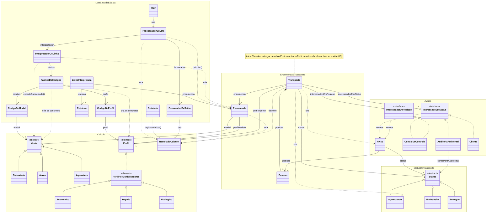
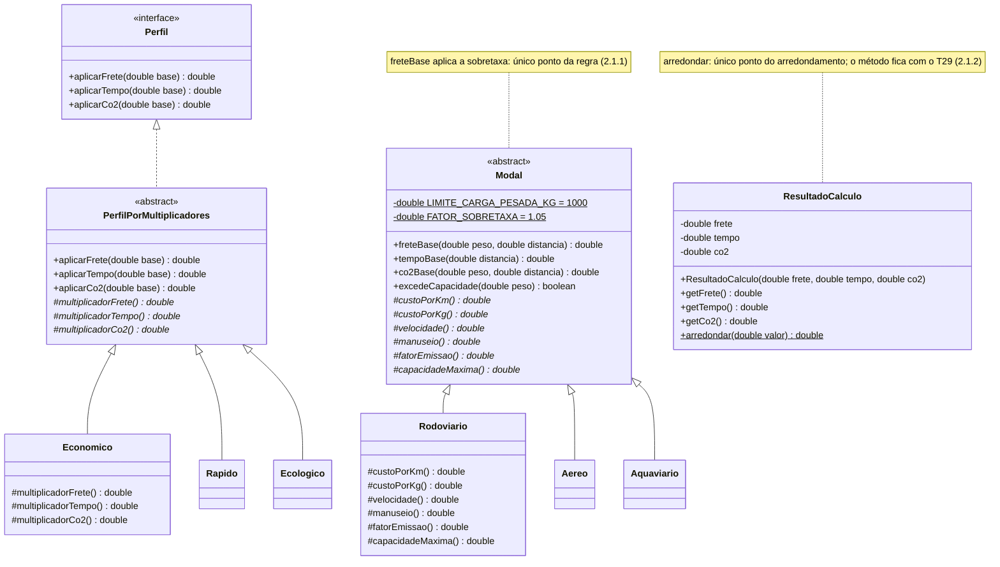
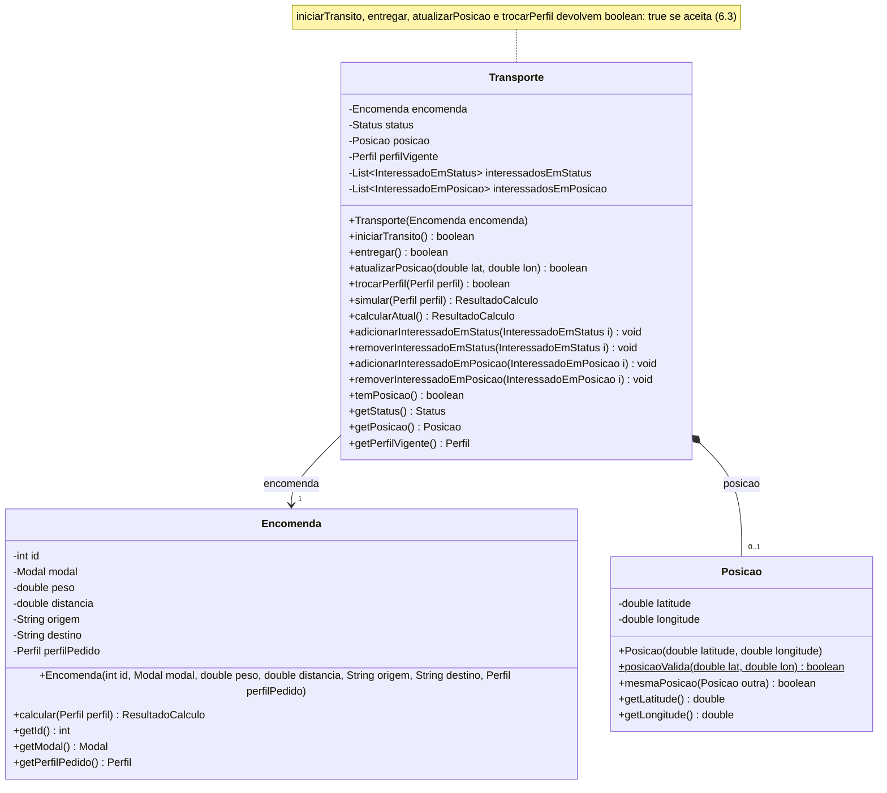
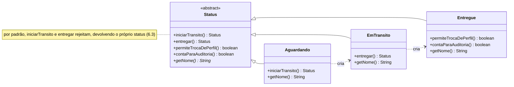
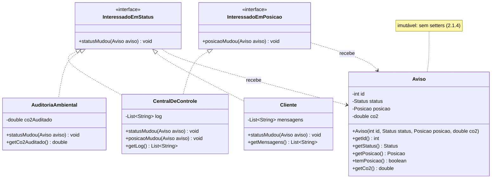
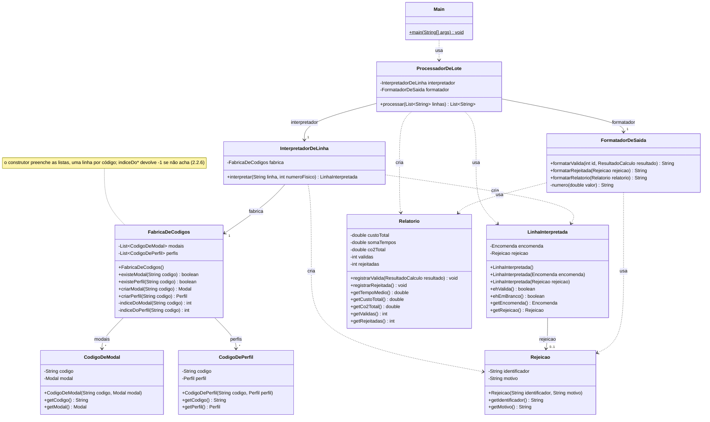
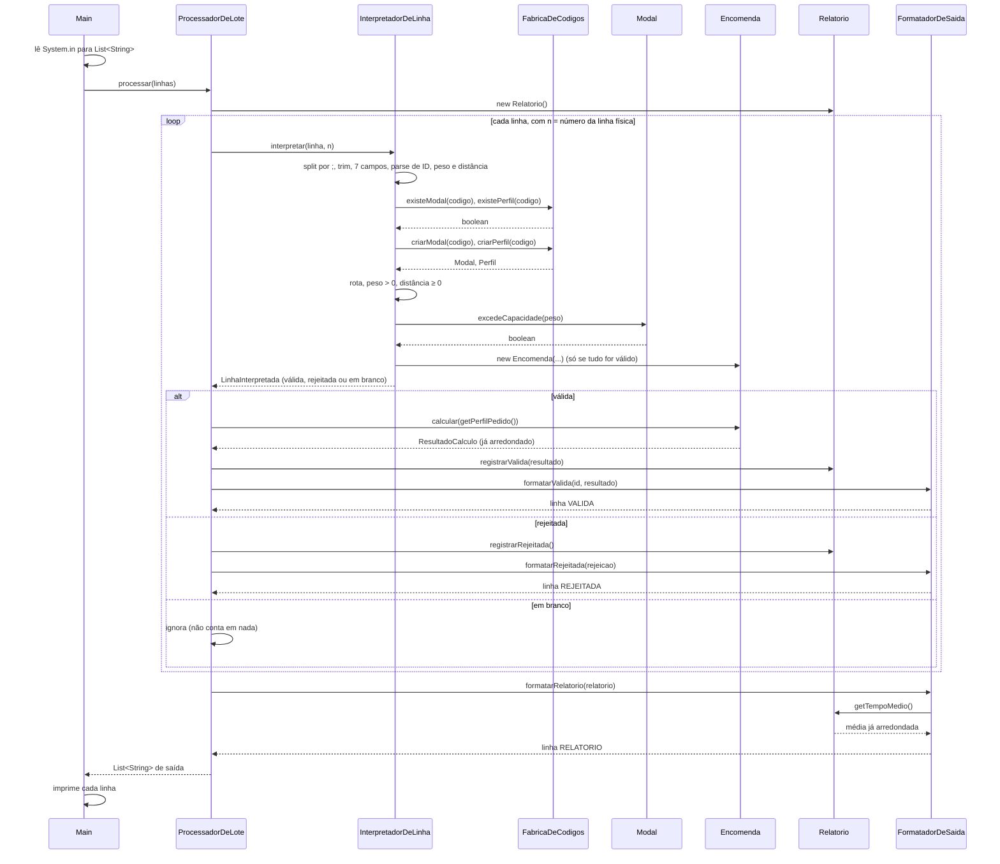
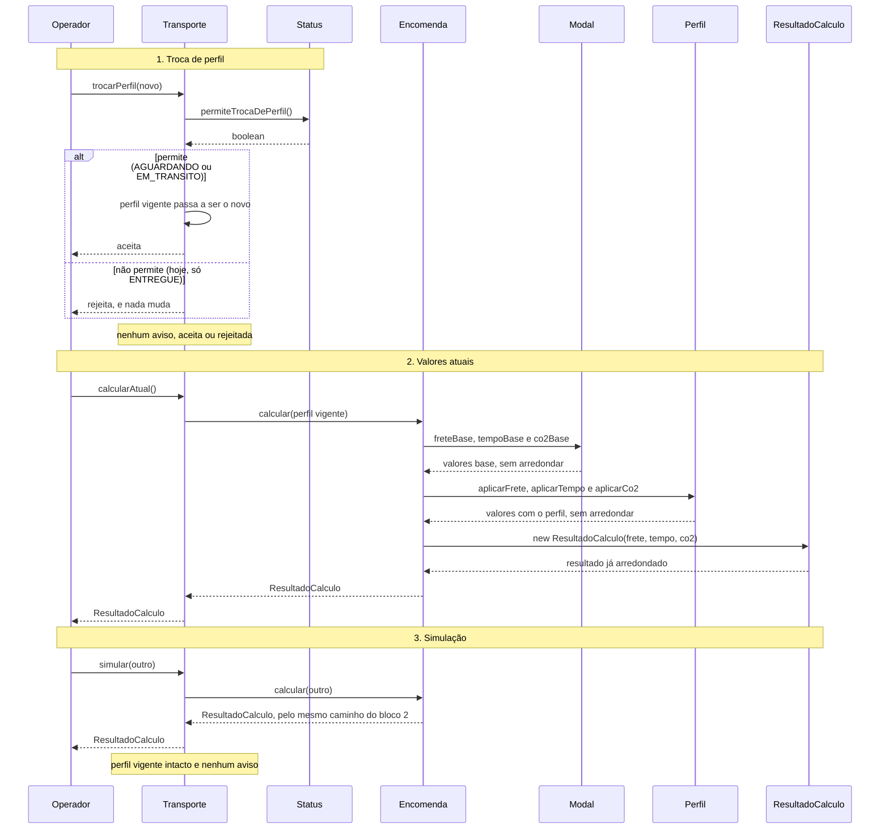
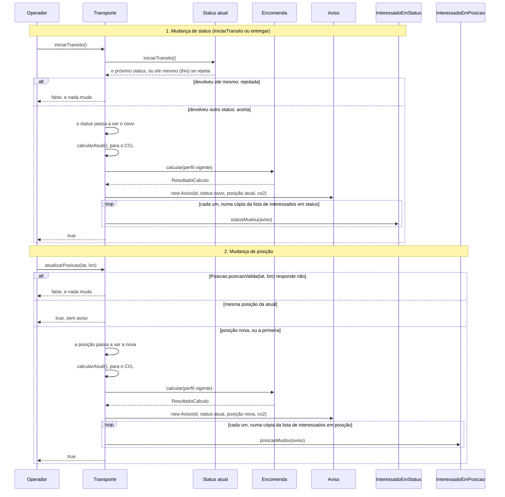

# Documento de Projeto: Sistema LogiTech

**Disciplina:** Introdução à Orientação a Objetos (IFSP) · **Etapa 1** (entrega em 27/11, sem código)
**Grupo:** Liliane, Murilo e Alexandre

> **Documento oficial do grupo, em construção (desde 2026-11-10).** Este arquivo é a versão oficial do Documento de
> Projeto. **Não pode ser apagado nem substituído por outro arquivo, apenas editado**, por PR, seção por seção.
>
> | Seção | Cartão | Responsável | Situação |
> |---|---|---|---|
> | 1. Análise do problema | T07 | Murilo | Escrita |
> | 2. Catálogo de classes e interfaces | T08 | Alexandre | Escrita |
> | 3. Diagrama de classes UML | T09 | Liliane | Escrita, em revisão |
> | 4. Estratégia de resolução dos pontos de variação | T10 | Alexandre | Escrita, em revisão |
> | 5. Padrões e mecanismos escolhidos | T11 | Alexandre | Escrita |
> | 6.1 Fluxo: processamento de uma linha do lote | T12 | Murilo | Escrita |
> | 6.2 Fluxo: troca de perfil em tempo de execução | T13 | Murilo | Escrita |
> | 6.3 Fluxo: mudança de status e avisos | T14 | Alexandre | Escrita |
> | 7.1 a 7.4 Cenários de evolução 1 a 4 | T15 | Alexandre | Escrita, em revisão |
> | 7.5 a 7.12 e conferência dos 5 minutos | T16 a T18 | Ver `docs/divisao-projeto.md` | A fazer |
> | 8. Plano de testes | T19 | Murilo | Escrita, em revisão |
>
> A seção 1 diz **quais conceitos existem e o que cada um é**. Nomes de classes, a escolha entre interface e classe
> abstrata e os padrões adotados ficam para o T08 (catálogo), o T10 (estratégia de resolução) e o T11 (padrões).

## 1. Análise do problema

A LogiTech recebe encomendas em lote, calcula frete, tempo e CO₂ conforme o **modal** e o **perfil de precificação**,
acompanha o **transporte** de cada encomenda, **avisa** os interessados quando o status ou a posição mudam e emite um
**relatório consolidado**.

### 1.1 Método

Usamos a técnica que o enunciado cita: levantar os **substantivos e verbos** do texto do problema e decidir o que
cada um vira.

1. **Levantamento:** substantivos e verbos das regras de negócio (`contexto/regras-negocio.md`, seções 1 a 11).
2. **Classificação:** cada substantivo responde a 4 perguntas, nesta ordem. A primeira resposta "sim" decide o
   destino.

   | Pergunta | Se sim | Base nas aulas |
   |---|---|---|
   | Tem comportamento próprio ou varia entre tipos? | **Classe** ou, se varia, **hierarquia** | Aula 11 (classe abstrata como o que os tipos têm em comum) e aula 12 (interface como tipo comum) |
   | É uma parte que outro conceito "tem" e que vale como um todo? | **Composição** | Aula 10 ("tem um" × "é um") |
   | Só descreve outro conceito, como um número ou um texto? | **Atributo** de quem descreve | Aula 2 (classe × objeto) e aula 3 (encapsulamento) |
   | É contexto, ator externo ou sinônimo de outro conceito? | **Descartado** | — |

3. **Responsabilidades:** cada verbo é ligado a quem deve fazê-lo. É uma hipótese que o catálogo (T08) confirma.
4. **Pontos de variação:** marcamos onde o enunciado diz que algo novo vai surgir (os 12 cenários de evolução) e
   citamos o padrão **candidato** para cada um. A escolha é do T11.

**Alternativa descartada:** começar pelos padrões e encaixar os conceitos neles. Isso inverte a ordem que o enunciado
avalia (análise, depois projeto, depois estratégia) e leva a usar padrão sem justificativa, o que não rende pontos.

### 1.2 Substantivos: o que vira classe e o que é descartado

"Hierarquia" quer dizer uma abstração (interface ou classe abstrata, a decidir no T08) com um tipo concreto para
cada variação. A coluna "Onde aparece" indica a seção de `contexto/regras-negocio.md` (RN) ou de
`contexto/especificacoes-tecnicas.md` (ET).

| Conceito | Onde aparece | Destino | Motivo |
|---|---|---|---|
| Modal (rodoviário, aéreo, aquaviário) | RN 1, 2 | **Hierarquia** | Cada modal tem custos, velocidade, manuseio, emissão e capacidade próprios. O cenário do **ferroviário** exige um modal novo sem reescrever o que existe, então ninguém pode perguntar qual é o modal. |
| Perfil de precificação (econômico, rápido, ecológico) | RN 1, 4 | **Hierarquia** | Cada perfil aplica multiplicadores diferentes e pode ser trocado em execução. Os cenários **corporativo** e **PREMIUM** exigem perfis novos sem alterar os existentes. O perfil não depende do modal. |
| Encomenda | RN 1, 10 | **Classe** | Reúne os dados do pedido. Existe antes de qualquer transporte: é ela que se valida e que se simula. Seus dados não mudam depois de criada. |
| Transporte | RN 1, 7 | **Classe** | A entrega em andamento. Tem estado que muda (status, posição e perfil vigente). Separar da encomenda permite trocar o perfil ou simular **sem gravar o resultado por cima dos dados originais**. |
| Status (aguardando, em trânsito, entregue) | RN 7 | **Hierarquia** | Cada status aceita transições diferentes e decide se a troca de perfil é permitida. O cenário **CANCELADO** exige um status novo. O enunciado proíbe `enum`. |
| Posição | RN 7 | **Composição** (o transporte tem uma posição) | Latitude e longitude só valem juntas: se um valor sai do intervalo, o par inteiro é rejeitado. O próprio par concentra essa validação. Começa ausente. |
| Interessado (central de controle, auditoria ambiental, cliente) | RN 1, 8 | **Hierarquia** | Cada um reage ao aviso de um jeito. Os cenários do **SMS por região** e da **troca de assinatura** exigem acrescentar e remover interessados em execução, sem alterar o transporte. |
| Resultado do cálculo (frete, tempo e CO₂) | RN 3 a 5, 11 | **Classe** | Os três valores nascem juntos, já arredondados, e andam juntos na saída, na simulação e no relatório. |
| Rejeição (ID e motivo) | RN 6, 11 | **Classe** | A encomenda inválida é registrada com o ID (ou `LINHA<n>`) e o motivo e não interrompe o lote. Um objeto de rejeição evita usar exceção para o fluxo normal da validação. |
| Relatório consolidado | RN 9 | **Classe** | Acumula custo, tempo, CO₂, válidas e rejeitadas em uma única passagem e calcula a média só no final. |
| Entrada (lote lido de `System.in`) | RN 10 | **Classe** (camada de entrada) | A leitura fica fora do núcleo, que recebe uma `List<String>`. É o único lugar que conhece os códigos de texto e o separador. |
| Saída | RN 11 | **Classe** (camada de saída) | Monta cada linha no formato exato, com vírgula decimal. O núcleo não imprime. |
| Aviso (evento de mudança) | RN 8 | **A decidir (T14)** | Pode ser só os parâmetros da notificação ou um objeto com ID, status e coordenadas. A resposta depende do fluxo de avisos. |
| Sobretaxa de carga pesada | RN 3, ET 4 | **Regra em um único ponto (lugar a decidir no T10)** | Vale igual para todos os modais e o cenário dos **8% acima de 2000 kg** a altera em um só lugar. Não pode ser copiada em cada modal. |
| Linha do lote | RN 10 | **Descartado como classe** | É só um texto até ser interpretada. Depois vira encomenda ou rejeição. |
| Cliente (como classe à parte) | RN 8 | **Descartado** | Já é um tipo de interessado. Uma segunda classe "Cliente" duplicaria o conceito. |
| Operador | RN 1, ET 4 | **Descartado** | Ator externo: troca o perfil e pede simulações chamando o núcleo, mas não tem estado no sistema. |
| Operadora LogiTech | RN 1 | **Descartado** | É o contexto do problema, não um objeto com comportamento. |
| Lote | RN 1, 10 | **Descartado como classe** | É a lista de linhas que a entrada entrega. Seu processamento é uma responsabilidade (ver 1.4), não um conceito com estado próprio. |

### 1.3 Atributos

| Atributo | De quem | Observação |
|---|---|---|
| ID | Encomenda | Inteiro, único no lote. |
| Peso (kg) e distância (km) | Encomenda | Números finitos, lidos com ponto decimal. |
| Origem e destino | Encomenda | Texto sem espaços nas pontas e não vazio. Origem igual ao destino é válida. |
| Custo por km, custo por kg, velocidade média, tempo de manuseio, fator de emissão, capacidade máxima | Modal | Constantes de cada modal, com nome próprio. |
| Multiplicadores de frete, tempo e CO₂ | Perfil | Constantes de cada perfil. |
| **Código de texto** (`RODOVIARIO`, `ECONOMICO`…) | **Só a entrada** | Fora da entrada, ninguém compara o código: o objeto é quem responde. |
| Status atual, posição atual e perfil vigente | Transporte | Os três podem mudar. A posição começa ausente. |
| Interessados | Transporte | Lista privada. Nenhum getter devolve a lista original. |
| Latitude e longitude | Posição | Latitude em [-90, 90] e longitude em [-180, 180], ambas finitas. |
| CO₂ auditado acumulado | Auditoria ambiental | Soma só ao receber `ENTREGUE`. |
| Linhas de log | Central de controle | Uma por evento (ID, status, coordenadas). |
| Mensagens recebidas | Cliente | Uma por mudança de **status**. |
| Custo total, soma dos tempos, CO₂ total, válidas e rejeitadas | Relatório | Somados a partir dos valores já arredondados. |
| Número da linha física | Entrada | Para o `LINHA<n>`, contando as linhas em branco. |

### 1.4 Verbos: responsabilidades

| Verbo | Quem faz (hipótese) | Regra que limita |
|---|---|---|
| Ler a entrada padrão | Entrada | O núcleo não lê dados. |
| Separar os campos e traduzir os códigos em objetos | Entrada | Único lugar com comparação de código e com o separador `;`. |
| Validar a encomenda | Validação, na ordem da tabela | Vale o primeiro motivo. Nenhuma exceção escapa. |
| Rejeitar e registrar | Processamento do lote | A linha inválida não interrompe o lote nem entra nos totais. |
| Calcular os valores base | Modal | Dependem só do modal e da encomenda. |
| Aplicar a sobretaxa | Um único ponto, comum a todos os modais | Alterável em um só lugar. |
| Aplicar os multiplicadores | Perfil | O mesmo para qualquer modal. |
| Arredondar | Um único ponto do cálculo | 2 casas, HALF_UP, depois do perfil. |
| Criar o transporte | A partir de uma encomenda válida | Nasce `AGUARDANDO` e sem posição. |
| Mudar o status | Transporte, com o status vigente decidindo | Só `AGUARDANDO → EM_TRANSITO → ENTREGUE`. Repetir o status é rejeitado. |
| Atualizar a posição | Transporte, com a posição validando o par | Permitido em qualquer status. A primeira posição conta como mudança. |
| Trocar o perfil | Transporte | Sem recriar o transporte. Rejeitado depois de `ENTREGUE`. |
| Simular outro perfil | Transporte, reaproveitando o cálculo | Não altera o perfil vigente e não gera aviso. |
| Avisar os interessados | Transporte (só notifica) | Só quando o valor realmente muda. Operação rejeitada não avisa ninguém. |
| Reagir ao aviso | Cada interessado | Log, soma de CO₂ ou mensagem. |
| Consolidar o relatório | Relatório | Uma passagem, O(n). Lista vazia dá zeros, sem divisão por zero. |
| Formatar e imprimir | Saída | Formatação em um único método, `pt-BR`, 2 casas. O domínio não imprime. |

### 1.5 Pontos de variação e padrões candidatos

Cada cenário de evolução (`contexto/especificacoes-tecnicas.md`, seção 4) cai em um ponto de variação. Os padrões
abaixo são **candidatos**: a escolha, com a alternativa descartada, é do T11 e o mecanismo é do T10.

> A escolha final está na seção 5 (T11). O Decorator, citado abaixo para o PREMIUM, foi descartado (5.3).

| Ponto de variação | Cenários que o exigem | Padrão candidato |
|---|---|---|
| Parâmetros e cálculo base do modal | ferroviário | Strategy, ou Template Method com a fórmula comum numa classe abstrata |
| Multiplicadores do perfil e troca em execução | corporativo, PREMIUM, troca de perfil, simulação | Strategy. Para o piso de R$ 50,00 do PREMIUM, avaliar também o Decorator. |
| Regra da sobretaxa | sobretaxa de 8% acima de 2000 kg | Template Method (a regra fica no esqueleto comum) ou uma classe só para ela |
| Transições do status | CANCELADO | State |
| Reação de cada interessado | SMS por região, troca de assinatura, CANCELADO sem soma na auditoria | Observer |
| Criação de modal e perfil a partir do código | código vindo de configuração externa | Simple Factory na entrada |
| Formato da linha | separador `,` | Nenhum padrão: isolado na entrada |
| Regras de validação | peso mínimo de 0,5 kg | Nenhum padrão obrigatório: a regra nova entra na sequência da validação, logo depois de `peso invalido` |

### 1.6 Lições do projeto de exemplo (Livraria)

O checklist de `contexto/projeto-exemplo.md` (seção 10) orientou estas decisões de análise:

- **Item 3 (`instanceof` para decidir comportamento):** modal, perfil, status e interessado viram hierarquias porque
  quem os usa não pode perguntar o tipo.
- **Item 5 (regra copiada em várias classes):** a sobretaxa é tratada como regra única, e não como atributo de cada
  modal.
- **Item 7 (getter que expõe a lista):** os interessados do transporte são uma lista privada, sem acesso direto.
- **Item 13 (exceção não tratada):** a rejeição é um conceito próprio, e não uma exceção que interrompe o lote.
- **Item 21 (cálculo gravado por cima do dado):** encomenda e transporte são separados. Os dados de entrada não
  mudam, e frete, tempo e CO₂ são recalculados a cada pedido, o que permite trocar de perfil e simular.

### 1.7 Dúvidas para o grupo

As dúvidas resolvidas continuam na tabela, para registro. A resposta fica na seção indicada, e esta análise não foi
reescrita. As duas últimas linhas foram apontadas na revisão do PR #16.

| Dúvida | Onde se resolve | Situação |
|---|---|---|
| A sobretaxa mora na abstração comum dos modais ou numa classe própria? | T08 e T10 (Alexandre) | **Resolvida em 2.1.1** |
| O aviso é um objeto próprio ou só parâmetros? | T14 (Alexandre) | **Resolvida em 2.1.4** (objeto próprio). O fluxo dos avisos está na 6.3 |
| A operação rejeitada devolve um valor ou lança uma exceção? | T12 (Murilo) e T14 (Alexandre) | **Resolvida para o lote em 6.1** (valor) **e para o `Status` e o `Transporte` em 6.3** (valor: o status devolve a si mesmo, e o transporte devolve `boolean`) |
| Onde mora o arredondamento, para que o cálculo normal e a simulação usem o mesmo ponto? | T10 (Alexandre) | **Resolvida em 2.1.2** |
| Quem guarda o modal, se ele não aparece na encomenda nem no transporte (1.3)? Com qual perfil começa o perfil vigente? | T08 (Alexandre) | **Resolvida em 2.1.3** |
| Como a auditoria soma o CO₂ do perfil vigente, se o aviso (1.2) só traz ID, status e coordenadas? | T08 e T14 (Alexandre) | **Resolvida em 2.1.4** |

## 2. Catálogo de classes e interfaces

> **Em revisão (T08, Alexandre).** A 2.1 resolve as dúvidas da seção 1.7 que travavam o catálogo, e a 2.2 traz cada
> classe e interface com responsabilidade, atributos, métodos e colaboradores. As decisões só valem depois da revisão
> do PR pelos 3, e as abstrações `Modal` e `Perfil` são combinadas entre os 3 antes de qualquer código.

### 2.1 Decisões que destravam o catálogo

#### 2.1.1 A sobretaxa fica na fórmula do frete, dentro da abstração dos modais

- **Regra (RN 3):** se o peso passa de 1000 kg, o frete base é multiplicado por 1,05, em todos os modais e inclusive
  com distância 0. O cenário "8% acima de 2000 kg" exige trocar a regra em um único ponto.
- **Decisão:** `Modal` é uma **classe abstrata** que contém a fórmula do frete base, com a sobretaxa dentro dela. A
  fórmula chama etapas abstratas (custo por km, custo por kg, velocidade, manuseio, fator de emissão e capacidade),
  e cada modal concreto só implementa essas etapas com os próprios números (Template Method, 2.2.1). O limite e o
  fator ficam em duas constantes `static final` com nome, declaradas uma vez em `Modal`: `LIMITE_CARGA_PESADA_KG`
  (1000) e `FATOR_SOBRETAXA` (1,05).
- **Por quê:** a regra existe uma vez só e vale para qualquer modal novo, como o ferroviário, sem ele precisar saber
  dela. O cenário dos 8% vira a troca de duas constantes num único arquivo. Evita o erro 5 da Livraria (regra copiada
  em cada subclasse).
- **Alternativa descartada:** uma classe própria `SobretaxaCargaPesada`, chamada depois do frete base. Ela também
  deixa a regra num ponto só, mas só compensaria se a sobretaxa variasse (por perfil, por exemplo), e o enunciado não
  pede isso. Seria uma classe e um colaborador a mais sem ganho.
- **Em aberto:** marcar o método da fórmula como `final` impediria que uma subclasse o reescrevesse. Nos slides,
  `final` aparece só em atributo (aula 6), então o grupo pergunta antes de usar. Sem `final`, a garantia é a combinação
  do grupo mais os testes.

#### 2.1.2 O arredondamento fica no resultado final, e os valores base não são arredondados

- **Regra (RN 5):** frete, tempo e CO₂ são arredondados para 2 casas, HALF_UP, **depois** do perfil. Os agregados
  somam os valores já arredondados.
- **Decisão:** a regra de arredondamento (2 casas, HALF_UP) fica num único método `static`,
  `ResultadoCalculo.arredondar(valor)`, chamado em dois momentos:
  - no construtor do `ResultadoCalculo` (frete, tempo e CO₂). Todo resultado passa por ali, então o lote, o
    transporte e a simulação arredondam no mesmo ponto;
  - no `Relatorio.getTempoMedio()`, que arredonda a média só no fim, como pede a RN 5.

  Os **valores base** (antes do perfil) não usam essa classe e andam sem arredondar. Se o grupo trocar a forma de
  arredondar (ver "Em aberto"), a mudança é feita num só método.
- **Por quê:** arredondar a base antes do perfil sai do gabarito. Exemplo com a encomenda 1 (rodoviário, 1000 km,
  ECONOMICO):

  | Caminho | Conta | Tempo final |
  |---|---|---|
  | Certo | 18,6667 × 1,25 = 23,3333 | **23,33** (gabarito) |
  | Arredondando a base | 18,67 × 1,25 = 23,3375 | 23,34 |

- **Alternativa descartada:** arredondar só na saída, com `String.format`. A auditoria e o relatório somam valores já
  arredondados por encomenda, então eles também precisam do valor arredondado, e não só do texto impresso.
- **Em aberto:** o HALF_UP exato é feito com `BigDecimal` e `RoundingMode.HALF_UP`. Nenhum dos dois aparece nos
  slides, e `RoundingMode` é um `enum` da biblioteca do Java (o grupo proibiu **declarar** `enum`), então o grupo
  pergunta antes de usar. A alternativa sem enum é `Math.round(valor * 100) / 100.0`, que pode errar casos como 1,005
  pela representação do `double`. A tolerância de ±0,01 cobre essa diferença.

#### 2.1.3 A encomenda guarda o modal e o perfil pedido, e o transporte guarda o perfil vigente

- **Problema:** o modal não aparece na encomenda nem no transporte (1.3), e o lote calcula sem criar transporte
  (RN 7: o lote "só calcula e imprime").
- **Decisão:**
  - A `Encomenda` guarda o **modal** e o **perfil pedido**, que vêm da linha da entrada. A validação de capacidade
    pergunta ao modal, **antes** de criar a encomenda, se o peso excede a capacidade, sem testar qual modal é. Assim
    nunca existe uma `Encomenda` inválida.
  - A `Encomenda` tem o cálculo completo, que recebe o perfil a usar e devolve um `ResultadoCalculo`. O lote o chama
    com o perfil pedido.
  - O `Transporte` guarda a encomenda e o **perfil vigente**, que **começa igual ao perfil pedido da encomenda**.
    Para os valores atuais, ele chama o cálculo da encomenda com o perfil vigente. Para simular, chama com o perfil
    pedido na simulação, sem alterar o vigente.
- **Por quê:** a regra de cálculo existe uma vez só e é reaproveitada pelo lote, pelo transporte e pela simulação,
  como pede o cenário da simulação. A encomenda já tem todos os dados do cálculo.
- **Alternativas descartadas:**
  - O transporte guardar o modal: o lote não cria transporte, então o modal ficaria sem lugar no lote.
  - Uma classe de serviço `CalculadoraFrete` à parte: funciona, mas a encomenda já tem os dados, e a classe a mais
    não traria ganho.

#### 2.1.4 O aviso é um objeto imutável que já leva o CO₂ do perfil vigente

- **Problema:** a auditoria soma o CO₂ com o perfil vigente no momento do `ENTREGUE` (RN 8), mas o aviso descrito em
  1.2 só traz ID, status e coordenadas.
- **Decisão:** o aviso é uma classe própria (`Aviso`), **imutável**, com ID, status, posição e o **CO₂ calculado com o
  perfil vigente no instante do aviso**. Quem monta o aviso, e calcula esse CO₂, é o transporte. A central de controle
  e o cliente não usam o campo do CO₂.
- **Por quê:** a auditoria recebe o valor certo sem precisar conhecer o transporte, e o valor não muda depois de
  enviado, mesmo que o perfil mude.
- **Alternativa descartada:** o aviso levar uma referência ao transporte, e a auditoria perguntar o CO₂ a ele. Isso
  prende os interessados ao transporte e dá a eles acesso a métodos que mudam o estado: um interessado poderia mudar
  o status no meio do aviso.
- **Resolvido no T11 e no T14 (5.2.3 e 6.3):** a auditoria precisa saber se o aviso é de entrega sem comparar o texto do status. A
  saída é polimórfica: o próprio status responde se aquele aviso conta para a auditoria. No cenário CANCELADO, o
  status novo responde que não, e a auditoria não soma nada.

### 2.2 Classes e interfaces

São **33 tipos** em 6 grupos. Atributos são sempre `private`, e as constantes são `static final` com nome. As
operações que podem ser rejeitadas aparecem como "aceita ou rejeita". O mecanismo é um valor de retorno, e não uma
exceção: no lote, decidido na 6.1, e no `Status` e no `Transporte`, na 6.3.

```
Modal (classe abstrata)                    ← Rodoviario, Aereo, Aquaviario
Perfil (interface)
  └── PerfilPorMultiplicadores (abstrata)  ← Economico, Rapido, Ecologico
Status (classe abstrata)                   ← Aguardando, EmTransito, Entregue
InteressadoEmStatus (interface)            ← CentralDeControle, AuditoriaAmbiental, Cliente
InteressadoEmPosicao (interface)           ← CentralDeControle

Encomenda, Transporte, Posicao, ResultadoCalculo, Aviso, Rejeicao, Relatorio
Main, ProcessadorDeLote, InterpretadorDeLinha, LinhaInterpretada, FabricaDeCodigos, CodigoDeModal, CodigoDePerfil,
FormatadorDeSaida
```

#### 2.2.1 Cálculo

| Classe | Responsabilidade | Principais atributos | Principais métodos | Colaboradores |
|---|---|---|---|---|
| `Modal` (abstrata) | Calcula os valores base de um modal, com a sobretaxa em um único ponto (2.1.1) | nenhum de instância; constantes `LIMITE_CARGA_PESADA_KG` e `FATOR_SOBRETAXA` | `freteBase(peso, distancia)` (com a sobretaxa), `tempoBase(distancia)`, `co2Base(peso, distancia)`, `excedeCapacidade(peso)`; etapas abstratas `protected`: `custoPorKm()`, `custoPorKg()`, `velocidade()`, `manuseio()`, `fatorEmissao()`, `capacidadeMaxima()` | — |
| `Rodoviario`, `Aereo`, `Aquaviario` | Fornecem os parâmetros do seu modal | nenhum próprio | as seis etapas de `Modal`, cada uma devolvendo um número da RN 2 | `Modal` |
| `Perfil` (interface) | Contrato de um perfil de precificação | — | `aplicarFrete(base)`, `aplicarTempo(base)`, `aplicarCo2(base)` | — |
| `PerfilPorMultiplicadores` (abstrata, `implements Perfil`) | Aplica três multiplicadores, escrevendo a multiplicação uma vez só | nenhum de instância | os três métodos de `Perfil`; etapas abstratas `protected`: `multiplicadorFrete()`, `multiplicadorTempo()`, `multiplicadorCo2()` | — |
| `Economico`, `Rapido`, `Ecologico` | Fornecem os multiplicadores do seu perfil | nenhum próprio | as três etapas de `PerfilPorMultiplicadores`, cada uma devolvendo um número da RN 4 | `PerfilPorMultiplicadores` |
| `ResultadoCalculo` | Guarda frete, tempo e CO₂ finais, já arredondados (2.1.2) | frete, tempo, CO₂ | construtor (que arredonda), getters e `public static arredondar(valor)`, o único ponto do arredondamento, público porque os testes do pacote `testes` (8.1) o chamam direto | — |

- **Template Method:** em `Modal`, o método-modelo é a fórmula (`freteBase`, `tempoBase` e `co2Base`), e as etapas
  adiadas para as filhas são os seis parâmetros. Em `PerfilPorMultiplicadores`, o método-modelo é cada `aplicar...`,
  e as etapas são os três multiplicadores. É o desenho do `Livro.calculaFrete()` abstrato da aula 11: cada filha
  responde pelo próprio valor. O padrão é justificado no T11.
- **Modal novo e perfil novo:** o ferroviário é uma classe que implementa as seis etapas, e o corporativo, uma classe
  que implementa as três. Se faltar uma etapa, o código não compila, e o IntelliJ lista o que falta ("Implement
  methods"). O PREMIUM estende `PerfilPorMultiplicadores`, implementa as três etapas e sobrescreve `aplicarFrete`,
  chamando `super.aplicarFrete(base)` e aplicando o piso de R$ 50,00. Nenhum deles altera o que já existe.
- **Critério para interface ou classe abstrata:** há interface quando o colaborador troca a implementação em
  execução ou quando existe mais de um jeito de implementar o contrato.
  - O **perfil** tem as duas coisas: troca no transporte e na simulação (Strategy, a justificar no T11), e o PREMIUM
    muda comportamento, não só números. Por isso `Encomenda` e `Transporte` dependem do contrato `Perfil`, como a
    Livraria faz com `Produto`, e a multiplicação fica escrita uma vez na classe abstrata, como a Livraria faz com
    `Livro`.
  - O **modal** não tem nenhuma das duas: é fixo na encomenda, e todo modal calcula do mesmo jeito, só com números
    diferentes. A `Encomenda` depende da abstração `Modal`, e não de `Rodoviario`, então o baixo acoplamento se
    mantém sem um segundo contrato.
- **Alternativas descartadas para o perfil:**
  - Só a interface: cada perfil repetiria `base × fator` nos três métodos (erro 5 da Livraria).
  - Só a classe abstrata: os colaboradores dependeriam de uma classe e não de um contrato, e todo perfil seria
    obrigado a ter multiplicadores.
- **Alternativas descartadas para o modal:**
  - Parâmetros recebidos pelo construtor de `Modal`, com cada filha só chamando `super(...)`: não há etapa abstrata,
    então não é Template Method, e um construtor de seis `double` aceita dois números trocados (custo por km no lugar
    do custo por kg) sem erro de compilação.
  - Uma `Modal` concreta, sem subclasses, com os números passados pela `FabricaDeCodigos`: o cenário do ferroviário
    pede que ele entre "criando classes novas", os números da RN 2 (regra de negócio) passariam a morar na camada de
    entrada, e não haveria polimorfismo a mostrar.
- **Alternativa descartada:** uma classe `ValoresBase` para levar os três valores até o perfil. Com três métodos
  `aplicar...`, os valores base andam como `double`, sem arredondar, e a classe a mais não é necessária.
- **Encapsulamento:** as etapas são `protected` (aula 6: "default + filhas"), e o modal não tem getter público dos
  parâmetros. Quem precisa saber da capacidade chama `excedeCapacidade(peso)`.

#### 2.2.2 Encomenda e transporte

| Classe | Responsabilidade | Principais atributos | Principais métodos | Colaboradores |
|---|---|---|---|---|
| `Encomenda` | Guarda os dados do pedido e calcula frete, tempo e CO₂ para um perfil (2.1.3) | id, modal, peso, distância, origem, destino e perfil pedido, que não mudam depois de criados | `calcular(perfil)` → `ResultadoCalculo`, getters | `Modal`, `Perfil`, `ResultadoCalculo` |
| `Transporte` | Acompanha a entrega (status, posição e perfil vigente) e avisa os interessados | encomenda, status (começa `Aguardando`), posição (começa ausente), perfil vigente (começa igual ao pedido), uma lista de interessados em status e outra de interessados em posição | `iniciarTransito()`, `entregar()`, `atualizarPosicao(lat, lon)` e `trocarPerfil(perfil)` → `boolean` (`true` se aceita, 6.3); `simular(perfil)` e `calcularAtual()` → `ResultadoCalculo`; adicionar e remover interessado em cada lista; getters, sem devolver as listas | `Encomenda`, `Status`, `Posicao`, `Perfil`, `Aviso`, `InteressadoEmStatus`, `InteressadoEmPosicao` |
| `Posicao` | Guarda um par válido de latitude e longitude | latitude, longitude | `static posicaoValida(lat, lon)` → `boolean`, que confere os intervalos da RN 7; `mesmaPosicao(outra)`, getters | — |

- **Validar antes de criar:** a `Encomenda` e a `Posicao` só são criadas com dados válidos. O
  `InterpretadorDeLinha` chama `modal.excedeCapacidade(peso)` antes de criar a encomenda, e o transporte chama
  `Posicao.posicaoValida(lat, lon)` antes de criar a posição, como o `Livro.isbnValido` da aula 6. Assim nenhuma das
  duas depende de exceção para recusar um dado, e nunca existe um objeto inválido, nem por um instante.
- `simular` e `calcularAtual` só chamam `encomenda.calcular(...)`: um com o perfil recebido, o outro com o vigente.
  A regra de cálculo existe uma vez só.
- `trocarPerfil` pergunta ao status atual se a troca é permitida, sem testar qual status é.
- O transporte só avisa quando o valor muda de fato: um status novo aceito, ou uma posição que não é a
  `mesmaPosicao` da atual. A primeira posição sempre conta como mudança.

#### 2.2.3 Status

| Classe | Responsabilidade | Principais métodos | Colaboradores |
|---|---|---|---|
| `Status` (abstrata) | Decide quais transições e operações o transporte aceita no estado atual | `iniciarTransito()` e `entregar()`, que devolvem o próximo status ou, ao rejeitar, o próprio status (`this`); por padrão, rejeitam (6.3); `permiteTrocaDePerfil()` (por padrão, sim); `contaParaAuditoria()` (por padrão, não); `getNome()`, usado só no texto do log e da mensagem e nos testes, que conferem o status por ele, sem `instanceof` (8.5) | — |
| `Aguardando` | Aceita só iniciar o trânsito | sobrescreve `iniciarTransito()` | `EmTransito` |
| `EmTransito` | Aceita só a entrega | sobrescreve `entregar()` | `Entregue` |
| `Entregue` | Não aceita transição nem troca de perfil, e conta para a auditoria | sobrescreve `permiteTrocaDePerfil()` (não) e `contaParaAuditoria()` (sim) | — |

- **Por quê:** repetir o status atual ou pular uma etapa já sai rejeitado pelo comportamento padrão de `Status`, sem
  nenhum `if` sobre qual é o status atual. O padrão (State) é justificado no T11.
- **Rejeição (decidida no T14, 6.3):** `iniciarTransito()` e `entregar()` devolvem um `Status`, então a rejeição não
  pode ser um `boolean`, e devolver `null` repete o risco do erro 13 da Livraria. Ao rejeitar, o status devolve a si
  mesmo (`this`), e o `Transporte` compara a resposta com `==` e devolve `false`. A exceção e o método à parte que
  pergunta antes foram descartados na 6.3 (decisão 1).
- **Cenário CANCELADO:** cria-se a classe `Cancelado` e entra um método `cancelar()` em `Status`, que rejeita por
  padrão. `Aguardando` e `EmTransito` o sobrescrevem. `Cancelado` não permite troca de perfil e não conta para a
  auditoria. O `Transporte` também é alterado, porque ganha o `cancelar()` que o operador chama. Classes criadas:
  `Cancelado`. Classes alteradas: `Status`, `Aguardando`, `EmTransito` e `Transporte` (para o T16).
- **Alternativa descartada:** um método genérico `mudarStatus(Status novo)`. Para saber se a transição vale, o
  status atual precisaria descobrir o tipo de `novo`, o que exige `instanceof` ou comparação de texto.

#### 2.2.4 Avisos

| Classe | Responsabilidade | Principais atributos | Principais métodos | Colaboradores |
|---|---|---|---|---|
| `Aviso` | Retrato imutável de uma mudança (2.1.4) | id, status, posição (pode estar ausente), CO₂ do perfil vigente | getters | `Status`, `Posicao` |
| `InteressadoEmStatus` (interface) | Recebe os avisos de mudança de status | — | `statusMudou(aviso)` | `Aviso` |
| `InteressadoEmPosicao` (interface) | Recebe os avisos de mudança de posição | — | `posicaoMudou(aviso)` | `Aviso` |
| `CentralDeControle` (implementa as duas) | Registra uma linha de log por evento | lista de linhas | `statusMudou` e `posicaoMudou` escrevem no log (ID, status e coordenadas, ou a falta delas); `getLog()` devolve uma cópia | `Aviso` |
| `AuditoriaAmbiental` (implementa `InteressadoEmStatus`) | Soma o CO₂ das entregas | CO₂ auditado | `statusMudou` soma `aviso.getCo2()` quando `aviso.getStatus().contaParaAuditoria()`; getter | `Aviso`, `Status` |
| `Cliente` (implementa `InteressadoEmStatus`) | Recebe uma mensagem por mudança de status | lista de mensagens | `statusMudou` guarda a mensagem; `getMensagens()` devolve uma cópia | `Aviso` |

- **Por que duas interfaces:** cada interessado assina só o que lhe interessa, e nenhum implementa um método vazio
  (erro 23 da Livraria). O SMS por região vira uma classe nova que implementa só `InteressadoEmPosicao`. O padrão
  (Observer) é justificado no T11, e o fluxo dos avisos está na 6.3.
- **Alternativas descartadas:**
  - Uma interface só, com os dois métodos: `Cliente` e `AuditoriaAmbiental` teriam `posicaoMudou` vazio (erro 23).
  - Uma interface só, com um método e um campo "tipo do evento" no aviso: cada interessado teria que testar esse
    campo.

#### 2.2.5 Lote e relatório

| Classe | Responsabilidade | Principais atributos | Principais métodos | Colaboradores |
|---|---|---|---|---|
| `Rejeicao` | Guarda o identificador (ID ou `LINHA<n>`) e o motivo de uma linha inválida | identificador, motivo | getters | — |
| `Relatorio` | Acumula os totais em uma única passagem | custo total, soma dos tempos, CO₂ total, válidas, rejeitadas | `registrarValida(resultado)`, `registrarRejeitada()`, `getTempoMedio()` (0 sem válidas; arredonda só no fim, com `ResultadoCalculo.arredondar`), getters | `ResultadoCalculo` |

#### 2.2.6 Camada de entrada e saída

| Classe | Responsabilidade | Principais métodos | Colaboradores |
|---|---|---|---|
| `Main` | Lê `System.in` para uma `List<String>`, chama o processador e imprime o que ele devolve | `main(String[] args)` | `ProcessadorDeLote` |
| `ProcessadorDeLote` | Percorre as linhas uma vez: interpreta, calcula, acumula e monta as linhas de saída | `processar(linhas)` → `List<String>` (o núcleo não imprime) | `InterpretadorDeLinha`, `LinhaInterpretada`, `Encomenda`, `ResultadoCalculo`, `Relatorio`, `FormatadorDeSaida` |
| `InterpretadorDeLinha` | Separa os campos e valida na ordem da tabela da RN 6 | `interpretar(linha, numeroFisico)` → `LinhaInterpretada` | `FabricaDeCodigos`, `Modal` (capacidade, antes de criar a encomenda), `Encomenda`, `Rejeicao` |
| `LinhaInterpretada` | Leva o resultado de uma linha: uma encomenda, uma rejeição ou uma linha em branco | `ehValida()`, `ehEmBranco()`, `getEncomenda()`, `getRejeicao()` | `Encomenda`, `Rejeicao` |
| `FabricaDeCodigos` | Traduz o código de texto em objeto; é o **único** lugar que compara código (Simple Factory, que divide com o Factory Method a mesma linha da lista do enunciado, mas não é o Factory Method; ver 5.2.5) | `existeModal(codigo)` e `existePerfil(codigo)` → `boolean`; `criarModal(codigo)` e `criarPerfil(codigo)`, com a pré-condição de que `existe*` devolveu `true` (se violada, lançam `IllegalArgumentException`; ver 6.1). Os quatro consultam a mesma lista de códigos conhecidos: guarda `List<CodigoDeModal>` e `List<CodigoDePerfil>`, e a busca fica nos privados `indiceDoModal(codigo)` e `indiceDoPerfil(codigo)` → `int` (`-1` se não acha) | `CodigoDeModal`, `CodigoDePerfil`, modais e perfis concretos |
| `CodigoDeModal` | Liga um código de modal da entrada ao objeto `Modal` pronto | construtor `(codigo, modal)`; `getCodigo()`, `getModal()` | `Modal` |
| `CodigoDePerfil` | Liga um código de perfil da entrada ao objeto `Perfil` pronto | construtor `(codigo, perfil)`; `getCodigo()`, `getPerfil()` | `Perfil` |
| `FormatadorDeSaida` | Monta as linhas `VALIDA`, `REJEITADA` e `RELATORIO` | `formatarValida(...)`, `formatarRejeitada(...)`, `formatarRelatorio(...)`; `numero(valor)` privado, o único com `String.format` em `pt-BR` | `ResultadoCalculo`, `Rejeicao`, `Relatorio` |

- **Alternativa descartada para a `LinhaInterpretada`:** lançar uma exceção quando a linha é inválida. A seção 1.2 já
  descartou isso: a rejeição é um conceito, e não uma exceção no fluxo normal do lote.
- **Lista única de códigos na `FabricaDeCodigos`:** `existe*` e `criar*` consultam a mesma lista de códigos
  conhecidos. Um modal ou perfil novo (como o ferroviário) é **uma entrada nova** nessa lista, num único lugar.
  - **Por dentro (decisão do Murilo, 19/11):** a fábrica guarda **pares código + objeto**, uma
    `List<CodigoDeModal>` e uma `List<CodigoDePerfil>`, preenchidas no construtor com uma linha por código
    (`RODOVIARIO`, `AEREO`, `AQUAVIARIO`; `ECONOMICO`, `RAPIDO`, `ECOLOGICO`). `indiceDoModal(codigo)` percorre a
    lista comparando com `equals`, porque o código diferencia maiúsculas de minúsculas (RN 4), e devolve `-1` se não
    acha. `existeModal` responde `indiceDoModal(codigo) >= 0`. `criarModal` lança `IllegalArgumentException` quando o
    índice é `-1` e, senão, devolve o `Modal` do par. Os perfis funcionam do mesmo jeito.
  - **Objeto compartilhado:** `criar*` devolve sempre a mesma instância para o mesmo código. É seguro porque os
    modais e os perfis não têm atributos de instância (2.2.1), e nenhuma encomenda ou transporte altera o objeto
    recebido.
  - **Caso novo:** a classe nova mais uma linha no construtor da fábrica, por exemplo
    `modais.add(new CodigoDeModal("FERROVIARIO", new Ferroviario()))`.
  - Alternativa descartada: cada método com as próprias comparações. Esquecer uma delas faria `existeModal` dizer
    `true` e `criarModal` lançar a exceção, um risco a mais para a alteração ao vivo da defesa.
  - Alternativa descartada: arrays paralelos (um `String[]` de códigos e um `Modal[]` na mesma ordem). Não pedem
    classe nova, mas o caso novo mexe em dois arrays, e uma ordem trocada faz `AEREO` devolver o `Rodoviario` sem
    erro de compilação.
  - Alternativa descartada: `getCodigo()` em `Modal` e `Perfil`, com a fábrica guardando só os objetos. Levaria o
    texto da entrada para o núcleo de cálculo, que não usa o código, já que a saída (RN 11) não imprime modal nem
    perfil.
- **Conferida pelo Murilo no T12:** os nomes e as responsabilidades deste grupo foram usados no fluxo do lote (6.1). A
  única mudança foi na `FabricaDeCodigos`, que ganhou `existeModal` e `existePerfil` para indicar o código inexistente
  sem `null` nem exceção (ver a decisão na 6.1). Na revisão do PR #19, o Alexandre (dono da 2.2.6) definiu a
  pré-condição do `criar*` e a lista única de códigos.

## 3. Diagrama de classes UML

Os 33 tipos do catálogo (2.2) aparecem em seis diagramas: uma **visão geral**, com só os nomes, as hierarquias e as
dependências entre os grupos, e um diagrama **por grupo** da 2.2, com atributos e métodos tipados. Um diagrama único
com os 33 tipos completos ficava ilegível no PDF e difícil de explicar na defesa.

**Como ler:**

| Notação | Significado |
|---|---|
| `-` / `#` / `+` | `private` / `protected` / `public` |
| `*` depois do método | método abstrato |
| `$` depois do membro | membro `static` |
| `A <\|-- B` (seta cheia, ponta vazada) | B herda de A |
| `A <\|.. B` (tracejada, ponta vazada) | B implementa a interface A |
| `A --> B` (seta cheia) | associação: A guarda um B num atributo, com a multiplicidade ao lado |
| `A *-- B` (losango cheio) | composição: B faz parte de A (o transporte tem uma posição, 1.2) |
| `A ..> B` (tracejada) | dependência: A usa ou cria um B sem guardá-lo |

Nos diagramas por grupo, alguns getters simples ficam de fora para economizar espaço, e o texto abaixo de cada
diagrama diz quais. Os construtores aparecem quando os parâmetros importam.

### 3.1 Visão geral

As dependências de dentro de cada grupo ficam nos diagramas 3.2 a 3.6. Aqui aparecem as que ligam grupos
diferentes e mais cinco de dentro do grupo: a do `Main`, que ficaria solto; as de `InteressadoEmStatus` e
`InteressadoEmPosicao` para o `Aviso`, que mostram o que os interessados recebem; e as da `FabricaDeCodigos` para
`CodigoDeModal` e `CodigoDePerfil`, que mostram como um código da entrada chega ao `Modal` e ao `Perfil` (2.2.6). A
`FabricaDeCodigos` cria os seis modais e perfis concretos, e o diagrama resume essas seis setas em duas, para `Modal` e
`Perfil`.



### 3.2 Cálculo



`Aereo` e `Aquaviario` implementam as mesmas seis etapas de `Rodoviario`, e `Rapido` e `Ecologico`, as mesmas três de
`Economico`, só com outros números: o diagrama mostra as etapas uma vez em cada hierarquia, para não repetir linhas
iguais. O `ResultadoCalculo` não tem setas porque
não depende de ninguém: quem o cria é a `Encomenda` (3.1).

### 3.3 Encomenda e transporte



A `Encomenda` tem também os getters de peso, distância, origem e destino. As listas de interessados nunca saem do
`Transporte`: não há getter para elas (2.2.2). As setas para `Modal`, `Perfil`, `Status`, os interessados,
`ResultadoCalculo` e `Aviso` ligam grupos diferentes e estão na visão geral (3.1).

### 3.4 Status



Cada filha sobrescreve só o que muda nela (2.2.3). O `getNome()` é o único método abstrato.

### 3.5 Avisos



`getLog()` e `getMensagens()` devolvem uma cópia da lista (2.2.4).

### 3.6 Lote, entrada e saída



O `FabricaDeCodigos()` aparece porque é nele que um modal ou perfil novo ganha a sua linha (2.2.6). As setas de
`CodigoDeModal` para `Modal` e de `CodigoDePerfil` para `Perfil`, e as da fábrica para os concretos, ligam grupos
diferentes e estão na visão geral (3.1).

### 3.7 Decisões do diagrama

O catálogo (2.2) não trazia os tipos dos atributos e dos retornos. Estes vieram do próprio documento: o `id` é `int`
(1.3), o identificador da `Rejeicao` é `String` porque pode ser `LINHA4`, os números são `double` e os contadores são
`int`. As decisões abaixo são do T09.

1. **As operações do `Transporte` que aceitam ou rejeitam devolvem `boolean`** (`true` = aceita). Era provisório e
   foi confirmado no T14 (6.3, decisão 2).
   - Por quê: o `Status` não pode usar `boolean`, porque devolve o próximo status (2.2.3). O `Transporte` não tem essa
     limitação, e o `boolean` deixa o diagrama completo.
   - Alternativa descartada: deixar o retorno sem tipo até o T14.
2. **A posição ausente é `null` por dentro, e `temPosicao()` responde se ela existe**, no `Transporte` e no `Aviso`.
   - Por quê: quem usa a posição pergunta antes, em vez de receber um `null` de surpresa (erro 13 da Livraria).
   - Alternativa descartada: só o getter, devolvendo `null` sem aviso.
3. **`getNome()` é abstrato em `Status`**, e cada status escreve o próprio nome, no mesmo padrão das etapas de `Modal`.
   - Por quê: um status novo, como o `Cancelado`, não compila se esquecer o nome.
   - Alternativa descartada: um atributo `nome` em `Status`, passado com `super("AGUARDANDO")`.
4. **As classes do lote guardam os colaboradores em atributos**, criados no construtor: o `ProcessadorDeLote` guarda o
   `InterpretadorDeLinha` e o `FormatadorDeSaida`, e o `InterpretadorDeLinha` guarda a `FabricaDeCodigos`.
   - Por quê: são objetos, e o diagrama mostra a associação.
   - Alternativa descartada: métodos `static`, mais curtos, mas sem objeto.
5. **`LinhaInterpretada` tem dois atributos e três construtores sobrecarregados:** `()` para a linha em branco,
   `(Encomenda)` para a válida e `(Rejeicao)` para a rejeitada. A linha em branco é a que não tem nenhum dos dois.
   - Por quê: nenhum par de construtores tem os mesmos tipos de parâmetro, então a sobrecarga não é ambígua.
   - Alternativa descartada: métodos estáticos `valida()`, `rejeitada()` e `emBranco()`, que seriam a escolha se dois
     construtores tivessem os mesmos tipos.
   - **Para a implementação:** os construtores com parâmetro rejeitam `null` com `Objects.requireNonNull`, porque uma
     variável valendo `null` passa pelo compilador. `Objects` (`java.util`) não aparece nos slides, então o grupo
     confirma antes de usar, como o `final` (2.1.1) e o `BigDecimal` (2.1.2).
6. **A lista única de códigos da `FabricaDeCodigos` aparece por inteiro:** os atributos `List<CodigoDeModal>` e
   `List<CodigoDePerfil>`, os privados `indiceDoModal` e `indiceDoPerfil` e as classes de par `CodigoDeModal` e
   `CodigoDePerfil`, com associação `*` da fábrica para cada par e `1` de cada par para `Modal` ou `Perfil`. A
   estrutura foi decidida na 2.2.6 (PR #43), onde estão as alternativas descartadas para ela.
   - Por quê: o cenário do ferroviário passa pela fábrica, e o diagrama mostra onde entra a linha nova.
   - Alternativa descartada: mostrar só os quatro métodos públicos, com uma nota de que a estrutura interna ficava
     para depois. Era a versão anterior deste diagrama, de antes da decisão da 2.2.6.

## 4. Estratégia de resolução dos pontos de variação

> **Em revisão (T10, Alexandre).** Esta seção diz **como** o projeto isola o que muda entre modais, entre perfis e entre
> interessados (ET 6, item 4). A fronteira com as seções vizinhas é esta:
>
> - a seção 4 descreve o **mecanismo** de cada ponto de variação;
> - a seção 5 (T11) dá o **nome do padrão** de cada mecanismo, com a alternativa descartada;
> - a seção 7 (T15 a T17) lista as **classes criadas e alteradas** em cada cenário de evolução.
>
> A sobretaxa (2.1.1) e o arredondamento (2.1.2) já foram decididos no catálogo, e aqui só são citados. Os cenários
> são numerados na ordem da tabela de `contexto/especificacoes-tecnicas.md`, seção 4 (1 = ferroviário, 12 = separador).

### 4.1 Três regras que valem para todos os pontos

1. **O que varia fica atrás de uma abstração, e quem usa depende só dela.** A `Encomenda` conhece `Modal` e `Perfil`,
   e não `Rodoviario` nem `Rapido`. O `Transporte` conhece `Status`, `Perfil` e as duas interfaces de interessado. É o
   polimorfismo das aulas 11 e 12: a chamada é a mesma, e cada objeto responde do seu jeito.
2. **A regra comum é escrita uma vez, na abstração.** As fórmulas e a sobretaxa ficam em `Modal`, a multiplicação em
   `PerfilPorMultiplicadores`, a rejeição padrão em `Status` e o arredondamento em `ResultadoCalculo`. As classes
   concretas só dizem o que as diferencia: números, uma transição aceita ou uma reação ao aviso (erro 5 da Livraria).
3. **O tipo concreto é escolhido em poucos lugares, todos conhecidos, e nenhum outro lugar pergunta o tipo.** Criar o
   objeto não é testar o tipo. Depois de criado, ninguém usa `instanceof`, `switch` nem comparação de código ou de
   texto para decidir comportamento (ET 3.2). A lista completa desses lugares está na 4.3.

### 4.2 Cada ponto de variação

| Ponto | O que muda | O que fica igual, e onde | Mecanismo | Quem depende só da abstração | Cenários |
|---|---|---|---|---|---|
| **Modal** | Os seis parâmetros da RN 2: custo por km, custo por kg, velocidade, manuseio, fator de emissão e capacidade | As fórmulas de frete, tempo e CO₂ base, a sobretaxa e a verificação de capacidade, em `Modal` | Classe abstrata com as fórmulas, que chamam seis etapas abstratas `protected`. Cada modal concreto implementa só as etapas, com os seus números (2.2.1) | `Encomenda` (cálculo) e `InterpretadorDeLinha` (`excedeCapacidade`) | 1 (ferroviário) |
| **Perfil** | Os três multiplicadores da RN 4. No PREMIUM, também o comportamento do frete (piso de R$ 50,00) | A multiplicação `base × fator`, em `PerfilPorMultiplicadores` | Interface `Perfil` mais uma classe abstrata com a multiplicação. O perfil é **passado como objeto**: `Encomenda.calcular(perfil)` o recebe, e o `Transporte` guarda a referência do perfil vigente. Trocar o perfil é trocar essa referência, e simular é passar outro objeto (2.1.3 e 6.2) | `Encomenda` e `Transporte` | 2 (corporativo), 3 (troca), 5 (simulação), 11 (PREMIUM) |
| **Status** | Quais transições o transporte aceita, se a troca de perfil é permitida e se a entrega conta para a auditoria | A resposta padrão de cada pergunta (rejeitar a transição, permitir a troca, não contar), em `Status` | Classe abstrata com o comportamento padrão. Cada status sobrescreve só o que aceita. O status atual devolve o próximo, e o `Transporte` troca o objeto que guarda. Ao rejeitar, o status devolve a si mesmo, e o `Transporte` devolve `false` (6.3) | `Transporte` (transições e troca de perfil) e `AuditoriaAmbiental` (`contaParaAuditoria`) | 7 (CANCELADO) |
| **Interessados** | A reação a cada aviso: linha de log, soma de CO₂, mensagem ao cliente e, no cenário, SMS por região | Montar o `Aviso` uma vez e percorrer a lista, no `Transporte` | Duas interfaces (`InteressadoEmStatus` e `InteressadoEmPosicao`) e duas listas no `Transporte`, com adicionar e remover em execução. O aviso é imutável e já leva o CO₂ do perfil vigente (2.1.4 e 2.2.4) | `Transporte` | 4 (SMS), 7 (auditoria não soma o CANCELADO), 8 (troca de assinatura) |
| **Sobretaxa** | Limite e percentual da carga pesada | A regra, num único ponto: `Modal.freteBase`, com as constantes `LIMITE_CARGA_PESADA_KG` e `FATOR_SOBRETAXA` (2.1.1) | Uma regra só na abstração, que vale para todos os modais, inclusive os novos | Todos os modais, sem saber dela | 10 (8% acima de 2000 kg) |
| **Arredondamento** | — (a RN 5 é fixa) | Um único método, `ResultadoCalculo.arredondar`, chamado no construtor do resultado e na média do relatório (2.1.2) | Todo resultado passa pelo mesmo construtor, então o lote, o transporte e a simulação arredondam no mesmo ponto | `Encomenda` (cria o resultado) e `Relatorio` (média) | 5 (a simulação reaproveita o cálculo) |
| **Código → objeto** | O texto da entrada (`AEREO`, `RAPIDO`) e o objeto que ele vira | A lista única de códigos conhecidos, na `FabricaDeCodigos` (2.2.6) | A fábrica é o único lugar que compara código. Um modal ou perfil novo é uma entrada nova nessa lista, e o resto do sistema recebe o objeto pronto | `InterpretadorDeLinha` | 1, 2 e 11 (uma entrada nova), 6 (configuração externa) |
| **Formato da linha e validação** | O separador e a sequência de validações | O separador existe só no `split` do passo 4 da 6.1. As validações estão no `InterpretadorDeLinha`, na ordem da RN 6 | Isolados na camada de entrada, sem padrão. Trocar o separador é mudar uma linha, e uma regra nova entra na posição dela na sequência | `ProcessadorDeLote` recebe a `LinhaInterpretada` pronta | 9 (peso mínimo), 12 (separador `,`) |
| **Formato da saída** | — (a RN 11 é fixa) | Um único método, `FormatadorDeSaida.numero`, com o `String.format` em `pt-BR` (2.2.6) | Isolado na camada de saída, sem padrão | `ProcessadorDeLote` | — |

- **A coluna "Quem depende só da abstração" nas linhas Sobretaxa, Arredondamento e Formato da saída:** nelas não há
  tipo concreto a esconder, porque `ResultadoCalculo` e `FormatadorDeSaida` são classes concretas e a sobretaxa é uma
  regra dentro de `Modal`. Nessas três linhas, a coluna mostra quem usa o ponto único.

- **Por que o perfil é passado, e não herdado pelo modal:** modal e perfil variam de forma independente (RN 4: o
  perfil vale igual para qualquer modal). Com o perfil como objeto separado, 3 modais e 3 perfis são 6 classes
  concretas, e um modal novo é uma classe só. É a composição da aula 10 ("tem um"), usada onde a herança ("é um")
  multiplicaria as classes.
- **Por que o modal é herança, e não um objeto de parâmetros:** o modal não troca em execução e todos calculam do
  mesmo jeito, só com números diferentes. As etapas abstratas fazem o compilador exigir os seis números de um modal
  novo (2.2.1).
- **Separador sem constante própria:** o `;` aparece uma vez só, no `split` do passo 4 da 6.1, e trocar o separador já
  é mudar essa linha.
  - Alternativa descartada: uma constante `SEPARADOR` no `InterpretadorDeLinha`. Ela não reduz o número de pontos a
    alterar, que já é um, e mudaria o passo 4 da 6.1 sem ganho.

### 4.3 Onde o tipo concreto aparece

Esta lista serve de prova da ET 3.2 na defesa: são os **únicos** lugares do código, inclusive os testes, que escrevem o nome de
um modal, perfil ou status concreto. Em todos, o tipo aparece para **criar** o objeto, e nunca para perguntar qual ele
é.

| Lugar | O que cria | Por quê ali |
|---|---|---|
| `FabricaDeCodigos` (camada de entrada) | Os três modais e os três perfis, um por código conhecido | É a camada que a ET 3.2 libera para comparar código |
| Construtor do `Transporte` | O `Aguardando` inicial | Todo transporte começa em `AGUARDANDO` (RN 7). O `Transporte` conhece o `Aguardando` só para criá-lo e, depois, fala com ele apenas como `Status` |
| `Aguardando.iniciarTransito()` e `EmTransito.entregar()` | O próximo status (`EmTransito` e `Entregue`) | Cada status conhece só a sua saída. No cenário CANCELADO, `Aguardando` e `EmTransito` também criam o `Cancelado` |
| Quem monta o transporte: os testes (seção 8) | Os interessados (`CentralDeControle`, `AuditoriaAmbiental`, `Cliente`) e o perfil de uma troca ou simulação | O operador é um ator externo (1.2 e 6.2), e no código quem faz o papel dele são os testes. Eles podem pedir o perfil à fábrica ou criá-lo com `new Rapido()`. Uma demonstração fora dos testes, se for criada, entra nesta linha |

- **Fora dessa lista, só abstrações:** a `Encomenda` chama `Modal` e `Perfil`, o `Transporte` chama `Status`, `Perfil`
  e as interfaces de interessado, e a `AuditoriaAmbiental` pergunta `contaParaAuditoria()` ao status do aviso.
- **O `getNome()` do status não decide comportamento:** ele só escreve o texto do log e da mensagem. Os testes conferem
  o status por ele (8.5), o que é verificar o resultado, e não escolher o que fazer.
- **Como conferir no código (Etapa 2):** uma busca por `instanceof` e `switch` não deve achar nenhum uso sobre
  modal, perfil ou status, e uma busca por `.equals(` deve achar comparação de código de modal ou perfil só na
  `FabricaDeCodigos`. Cada cenário da seção 7 pode acrescentar um lugar a esta tabela, mas só de criação.

### 4.4 Alternativas descartadas para o mecanismo geral

- **Um cálculo único com condicionais sobre o código**, como `if (modal.equals("AEREO"))` ou um `switch` sobre o
  perfil, dentro da encomenda ou de uma calculadora. Fere a ET 3.2. Cada cenário de modal ou perfil novo reescreveria
  esse método, e esquecer um ramo só apareceria na execução.
- **Os parâmetros em arrays indexados pelo modal**, com uma posição por modal e uma classe só para o cálculo. Os
  números da RN 2 passariam a morar na entrada, um índice trocado não daria erro de compilação, e não haveria
  polimorfismo a mostrar (uma alternativa parecida, a `Modal` concreta com os números vindos da fábrica, foi
  descartada na 2.2.1).
- **Uma classe para cada combinação de modal e perfil**, como `RodoviarioEconomico`. São 9 classes hoje. O ferroviário
  pediria 3 classes novas, e o corporativo, mais 4. Também não permitiria trocar o perfil sem recriar o objeto
  (cenário 3).

## 5. Padrões e mecanismos escolhidos

> **Em revisão (T11, Alexandre).** Esta seção dá nome ao mecanismo de cada ponto de variação da seção 4 (ET 6, item
> 5). Para cada padrão usado, ela traz o problema que ele resolve aqui, as classes que o compõem e uma alternativa
> descartada. Para cada padrão da lista do enunciado que não foi usado, diz onde ele poderia entrar e por que ficou de
> fora. A ET 5 diz que nenhum padrão é obrigatório e que um padrão sem justificativa não rende pontos, então a seção
> não força um padrão em cada ponto: a 5.4 lista os pontos resolvidos sem padrão.
>
> Referência: FREEMAN et al., *Use a cabeça! Padrões de projetos* (ET 5), e as notas de `contexto/padroes-projeto/`.
> Os cenários seguem a numeração da seção 4 (1 = ferroviário, 12 = separador).

### 5.1 Resumo

| Padrão | Situação | Onde (4.2) | Cenários |
|---|---|---|---|
| Template Method | Usado | Modal, e a multiplicação dos perfis | 1, 2, 10 e 11 |
| Strategy | Usado | Perfil | 2, 3, 5 e 11 |
| State | Usado | Status | 7 |
| Observer | Usado | Interessados | 4, 7 e 8 |
| Factory Method / Simple Factory | Simple Factory usada; Factory Method descartado (5.3) | Código → objeto | 1, 2, 6 e 11 |
| Decorator | Descartado | Piso do PREMIUM e sobretaxa | 10 e 11 |
| Singleton, Prototype, Builder, Command, Adapter | Descartados | Ver 5.3 | — |

A tabela segue as 11 linhas da lista do enunciado (ET 5), que junta Factory Method e Simple Factory numa linha só.

### 5.2 Padrões usados

#### 5.2.1 Template Method: as fórmulas do modal e a multiplicação do perfil

- **Problema:** os três modais calculam frete, tempo e CO₂ com as mesmas fórmulas (RN 2) e a mesma sobretaxa (RN 3),
  e só os números mudam. Escrever a fórmula em cada modal repete a regra (erro 5 da Livraria) e espalha a sobretaxa
  por três arquivos, quando ela tem que ficar em um único ponto.
- **Classes:**
  - `Modal` (classe abstrata). Os métodos-modelo são `freteBase`, `tempoBase` e `co2Base`, como na 2.2.1, e as
    etapas abstratas `protected` são `custoPorKm()`, `custoPorKg()`, `velocidade()`, `manuseio()`, `fatorEmissao()` e
    `capacidadeMaxima()`. As filhas são `Rodoviario`, `Aereo` e `Aquaviario`. O `excedeCapacidade(peso)` também usa
    uma etapa (`capacidadeMaxima()`), mas é só uma comparação, e não um esqueleto de cálculo.
  - `PerfilPorMultiplicadores` (classe abstrata). Os métodos-modelo são `aplicarFrete`, `aplicarTempo` e
    `aplicarCo2`, e as etapas são `multiplicadorFrete()`, `multiplicadorTempo()` e `multiplicadorCo2()`. As filhas
    são `Economico`, `Rapido` e `Ecologico`.
- **Métodos-modelo sem `final` no perfil, de propósito:** o Template Method costuma declarar o método-modelo como
  `final`, para nenhuma filha reescrever o esqueleto (`contexto/padroes-projeto/template-method.md`). Os `aplicar*` de
  `PerfilPorMultiplicadores` ficam sem `final` porque são o ponto de extensão do PREMIUM, que sobrescreve
  `aplicarFrete`, chama `super.aplicarFrete(base)` e só então aplica o piso (2.2.1). O esqueleto continua sendo o da
  mãe, e o PREMIUM acrescenta um passo depois dele. O `final` em aberto na 2.1.1 vale só para as fórmulas de `Modal`.
  - Alternativa descartada: um gancho, como `ajustarFrete(frete)`, que a mãe chamaria no fim de `aplicarFrete` e que
    por padrão devolveria o frete sem mudança. Permitiria o `final`, mas acrescenta um método ao catálogo só para um
    perfil, e mudar o catálogo pede o acordo dos 3.
- **Por quê:** a regra comum mora na classe-mãe, e cada filha diz só o que a diferencia. O compilador obriga um modal
  novo a fornecer os seis números (cenário 1), e a sobretaxa de 8% é a troca de duas constantes em `Modal`
  (cenário 10). É o desenho do `Livro.calculaFrete()` abstrato da aula 11.
- **Alternativa descartada:** Strategy também para o modal, com uma interface `Modal` e os parâmetros num objeto à
  parte. O modal não troca em execução e todo modal calcula do mesmo jeito, então o contrato a mais não traria ganho,
  e a sobretaxa ainda precisaria de um lugar comum (2.2.1 e 4.2).

#### 5.2.2 Strategy: o perfil de precificação

- **Problema:** o mesmo cálculo roda com perfis diferentes, e o perfil é escolhido de fora: vem da linha no lote, é
  trocado pelo operador durante o transporte (cenário 3) e é passado só para simular, sem mudar o vigente
  (cenário 5). O PREMIUM (cenário 11) muda o comportamento do frete, e não só um número.
- **Classes:** a estratégia é a interface `Perfil` (`aplicarFrete`, `aplicarTempo` e `aplicarCo2`), e as estratégias
  concretas são `Economico`, `Rapido` e `Ecologico`, por meio de `PerfilPorMultiplicadores`. Os contextos são a
  `Encomenda`, que recebe a estratégia em `calcular(perfil)`, e o `Transporte`, que guarda a estratégia vigente e a
  troca em `trocarPerfil(perfil)`.
- **Por quê:** trocar o perfil é trocar uma referência, sem recriar a encomenda nem o transporte, e nenhuma linha
  pergunta qual perfil está em uso (ET 3.2). Modal e perfil variam de forma independente, e a composição evita
  multiplicar classes (4.2).
- **Alternativa descartada:** herança que combina modal e perfil, como `RodoviarioEconomico`. São 9 classes hoje, e o
  perfil não poderia ser trocado sem recriar o objeto (4.4). O perfil só como classe abstrata, sem a interface, também
  foi descartado (2.2.1).
- **Template Method e Strategy juntos:** a interface `Perfil` é a Strategy, e `PerfilPorMultiplicadores` é um Template
  Method por trás dela, para não repetir `base × fator`. Um perfil que não use multiplicadores pode implementar
  `Perfil` direto.

#### 5.2.3 State: o status do transporte

- **Problema:** o que o transporte aceita depende do status. A sequência é só `AGUARDANDO → EM_TRANSITO → ENTREGUE`
  (RN 7), a troca de perfil é proibida depois da entrega, e só a entrega conta para a auditoria (RN 8). Escrever isso
  com `if` sobre o status atual fere a ET 3.2 e obriga a reabrir cada `if` no cenário CANCELADO (7).
- **Classes:** o contexto é o `Transporte`, que guarda o status atual e delega a ele. O estado é a classe abstrata
  `Status`, com a resposta padrão de `iniciarTransito()`, `entregar()`, `permiteTrocaDePerfil()` e
  `contaParaAuditoria()`. Os estados concretos são `Aguardando`, `EmTransito` e `Entregue`, e cada um cria o seu
  sucessor (4.3).
- **Por quê:** cada status sobrescreve só o que aceita, e o resto sai rejeitado pelo padrão de `Status`. A auditoria
  pergunta `contaParaAuditoria()` ao status do aviso, em vez de comparar o texto. No CANCELADO (2.2.3), a classe
  criada é `Cancelado`, e as alteradas são `Status` (ganha `cancelar()`, que rejeita por padrão), `Aguardando` e
  `EmTransito` (sobrescrevem `cancelar()`) e `Transporte` (ganha o `cancelar()` que o operador chama). A
  `AuditoriaAmbiental` não muda.
- **Alternativas descartadas:**
  - Um método genérico `mudarStatus(Status novo)`, em que o status atual precisaria descobrir o tipo de `novo`
    (2.2.3).
  - O status como texto ou número, com uma tabela de transições permitidas: cada decisão seria uma comparação de
    texto ou código, que a ET 3.2 proíbe fora da entrada.
- **State ou Strategy?** As duas têm o mesmo desenho de classes. A diferença está em quem troca o objeto: o perfil é
  escolhido de fora, pela linha ou pelo operador (Strategy), e o status troca a si mesmo, devolvendo o próximo a cada
  transição aceita (State).
- **Transição rejeitada (6.3):** o status devolve a si mesmo, e o `Transporte` devolve `false`.

#### 5.2.4 Observer: os avisos aos interessados

- **Problema:** cada mudança de status ou de posição precisa chegar a vários interessados, e cada um reage do seu
  jeito (RN 8). A lista muda em execução: o cliente cancela a assinatura e outro passa a receber (cenário 8), e surge
  o SMS por região (cenário 4). O `Transporte` não pode conhecer as classes concretas dos interessados.
- **Classes:** o sujeito é o `Transporte`, com duas listas e os métodos de adicionar e remover. Os observadores são as
  interfaces `InteressadoEmStatus` (`statusMudou(aviso)`) e `InteressadoEmPosicao` (`posicaoMudou(aviso)`),
  implementadas por `CentralDeControle` (as duas), `AuditoriaAmbiental` e `Cliente`. O `Aviso` leva os dados ao
  observador.
- **Por quê:** um interessado novo é uma classe nova que implementa uma das interfaces, sem mudar o `Transporte`. A
  troca de assinatura é um `remover` e um `adicionar`, sem recriar o transporte. É o modelo "empurrar" do livro: o
  sujeito envia o `Aviso` pronto e imutável, já com o CO₂ do perfil vigente (2.1.4), e o observador não consulta o
  transporte.
- **Alternativas descartadas:**
  - O modelo "puxar", com o aviso levando uma referência ao transporte. Os interessados ganhariam acesso a métodos que
    mudam o estado (2.1.4).
  - Uma interface só, com os dois métodos, que deixaria `posicaoMudou` vazio no `Cliente` e na `AuditoriaAmbiental`
    (erro 23 da Livraria), ou com um campo de tipo do evento, que cada interessado teria que testar (2.2.4).
  - As classes `java.util.Observable` e `java.util.Observer` da biblioteca, obsoletas desde o Java 9. O `Transporte`
    teria que herdar de `Observable`, e o aviso chegaria como `Object`, o que pede conversão de tipo.

#### 5.2.5 Simple Factory: do código ao objeto

- **Problema:** a entrada traz texto (`AEREO`, `RAPIDO`), e o núcleo trabalha com objetos. Alguém precisa comparar o
  código, e a ET 3.2 só permite isso na camada de entrada.
- **Classes:** `FabricaDeCodigos` (`existeModal`, `existePerfil`, `criarModal` e `criarPerfil`), com os pares
  `CodigoDeModal` e `CodigoDePerfil`. Quem a usa é o `InterpretadorDeLinha`.
- **Por quê:** é o único lugar que compara código (4.3). Um modal ou perfil novo é uma linha no construtor da fábrica
  (cenários 1, 2 e 11), e o código vindo de configuração externa (cenário 6) muda quatro classes da camada de entrada
  (7.6).
- **Simple Factory e Factory Method:** o enunciado junta os dois na mesma linha da lista (ET 5), e o projeto usa só a
  Simple Factory: uma classe concreta que decide qual objeto criar. O *Use a cabeça!* a apresenta como um hábito de
  programação, e não como um padrão GoF. O Factory Method, com uma hierarquia de criadores, foi descartado (5.3).
- **Alternativa descartada:** comparar o código dentro do `InterpretadorDeLinha`, com um `if` por código. Funciona, mas
  mistura validar campos com criar objetos, e o caso novo mexeria no método de validação. As alternativas internas da
  fábrica (comparações em cada método, arrays paralelos e `getCodigo()` no modal) estão na 2.2.6.

### 5.3 Padrões considerados e descartados

- **Decorator.**
  - *Onde poderia entrar:* no piso de R$ 50,00 do PREMIUM (cenário 11), com uma classe `PerfilComPiso` que embrulha
    outro `Perfil` e corrige o frete, e na sobretaxa, com um modal que embrulha outro.
  - *Por que não:* o Decorator serve para combinar responsabilidades em execução, e nenhum cenário pede isso: só o
    PREMIUM tem piso. O PREMIUM estende `PerfilPorMultiplicadores` e sobrescreve `aplicarFrete`, chamando
    `super.aplicarFrete(base)` e aplicando o piso (2.2.1). É uma classe, contra duas no Decorator (o perfil e o
    embrulho). A sobretaxa vale sempre e para todos os modais, então fica na fórmula de `Modal` (2.1.1).
  - *Quando reconsiderar:* se surgir um piso ou acréscimo que valha para qualquer perfil.
- **Factory Method** (na mesma linha da Simple Factory, na lista do enunciado).
  - *Onde poderia entrar:* na criação dos modais e perfis, com uma classe abstrata de criador, como `CriadorDeModal`,
    com o método abstrato `criarModal()`, e uma filha por modal (`CriadorRodoviario`, `CriadorAereo` e
    `CriadorAquaviario`), e outra hierarquia igual para os perfis.
  - *Por que não:* o padrão põe um método de criação numa classe-mãe e deixa as filhas decidirem qual objeto criar.
    Aqui não há uma família de criadores, só a tradução de um código em objeto. Alguém ainda teria que escolher o
    criador pelo código, e cada modal ou perfil novo pediria duas classes em vez de uma. A Simple Factory resolve com
    uma classe só (5.2.5).
- **Singleton.**
  - *Onde poderia entrar:* na `FabricaDeCodigos`, ou nos modais e perfis, que não têm estado.
  - *Por que não:* o ponto de acesso global esconde quem depende da fábrica e prende os testes a uma instância única.
    A fábrica já devolve sempre o mesmo objeto para o mesmo código (2.2.6), o que dá o compartilhamento sem o acesso
    global.
- **Prototype.**
  - *Onde poderia entrar:* nos objetos que a fábrica devolve, copiados de um modelo.
  - *Por que não:* modais e perfis não têm atributos de instância, então compartilhar o mesmo objeto é seguro e não há
    estado a copiar (2.2.6).
- **Builder.**
  - *Onde poderia entrar:* na `Encomenda`, que tem sete campos.
  - *Por que não:* o Builder ajuda quando o objeto é montado em etapas ou tem muitos campos opcionais. Todos os campos
    da encomenda são obrigatórios, e o `InterpretadorDeLinha` valida tudo antes de chamar o construtor (2.2.2). O
    Builder seria uma classe a mais e abriria espaço para uma encomenda montada pela metade.
- **Command.**
  - *Onde poderia entrar:* nas operações do operador (`iniciarTransito`, `entregar`, `atualizarPosicao` e
    `trocarPerfil`), cada uma como um objeto.
  - *Por que não:* o Command compensa quando é preciso enfileirar, registrar ou desfazer pedidos, e nenhuma regra nem
    cenário pede isso. A chamada direta ao `Transporte` basta.
- **Adapter.**
  - *Onde poderia entrar:* no cenário 6 (código de modal vindo de configuração externa) ou na leitura de `System.in`.
  - *Por que não:* não há duas interfaces incompatíveis para conciliar. A configuração externa muda quatro classes da
    camada de entrada (7.6), sem nenhuma interface a adaptar, e o `Main` já entrega uma `List<String>` ao processador.
  - *Quando reconsiderar:* se a configuração vier de uma biblioteca com interface própria.

### 5.4 Pontos resolvidos sem padrão

| Ponto | Mecanismo | Por que sem padrão |
|---|---|---|
| Validação (cenário 9) | Sequência de validações no `InterpretadorDeLinha`, na ordem da RN 6 | A ordem é fixada pelo enunciado, e uma regra nova entra na posição dela. Uma classe por regra (Chain of Responsibility, de fora da lista) espalharia uma sequência fixa por várias classes |
| Separador (cenário 12) | O `split` do passo 4 da 6.1 | Trocar o separador já é mudar uma linha (4.2) |
| Arredondamento | `ResultadoCalculo.arredondar` (2.1.2) | A regra é fixa (RN 5), e um método único já evita a repetição |
| Formato da saída | `FormatadorDeSaida.numero` (2.2.6) | A regra é fixa (RN 11), e um método único já evita a repetição |
| Linha inválida no lote | `LinhaInterpretada` com uma `Rejeicao` (6.1) | A rejeição é um valor do fluxo normal, e não uma exceção. Basta uma classe que leva o resultado |

## 6. Fluxos principais

### 6.1 Processamento de uma linha do lote

O caminho de cada linha, da leitura até a saída. O lote só calcula e imprime: não cria transporte nem gera aviso
(RN 7 e RN 11).



O diagrama mostra o caminho completo de uma linha válida. Numa linha inválida, o `InterpretadorDeLinha` para no
primeiro motivo (passo 5) e não chama o que vem depois.

#### Passo a passo

| # | Passo | Quem | Regra que limita |
|---|---|---|---|
| 1 | Lê `System.in` com `Scanner`, monta uma `List<String>` e chama `processar(linhas)` | `Main` | O núcleo não lê dados (RN 10) nem imprime |
| 2 | Cria um `Relatorio` e uma lista de saída e percorre as linhas **uma vez**, com `n` = posição na lista + 1 | `ProcessadorDeLote` | Uma passagem, O(n). `n` conta também as linhas em branco (RN 11) |
| 3 | Linha vazia ou só com espaços vira uma `LinhaInterpretada` em branco | `InterpretadorDeLinha` | Ignorada: não sai na saída e não entra em nenhuma contagem (RN 6) |
| 4 | Separa com `split(";", -1)` e faz `trim` em cada campo. Escolhe o identificador de uma eventual rejeição: o ID, se o 1º campo for um inteiro; senão, `LINHA<n>` | `InterpretadorDeLinha` | O separador `;` existe só aqui. O ID vale **mesmo quando o número de campos está errado** (`5;AEREO` → `REJEITADA;5;formato invalido`) |
| 5 | Valida na ordem da RN 6 e para no primeiro motivo: (a) 7 campos, ID inteiro, peso e distância numéricos e finitos → `formato invalido`; (b) `existeModal` e `existePerfil` → `codigo inexistente`; (c) origem e destino não vazios → `rota invalida`; (d) peso > 0 → `peso invalido`; (e) distância ≥ 0 → `distancia invalida`; (f) `modal.excedeCapacidade(peso)` → `capacidade excedida` | `InterpretadorDeLinha`, `FabricaDeCodigos`, `Modal` | Os números são lidos **antes** dos códigos, porque o formato vem primeiro. A capacidade pergunta ao modal, sem testar qual é (2.2.2) |
| 6 | Tudo válido: cria a `Encomenda` com o modal e o perfil pedido e devolve uma `LinhaInterpretada` válida. Inválida: devolve uma `LinhaInterpretada` com a `Rejeicao` (identificador e motivo) | `InterpretadorDeLinha` | Nunca existe `Encomenda` inválida (2.2.2) |
| 7 | Linha válida: `encomenda.calcular(encomenda.getPerfilPedido())` devolve o `ResultadoCalculo`, que vai para `relatorio.registrarValida(resultado)` e para `formatarValida` | `ProcessadorDeLote`, `Encomenda`, `Relatorio`, `FormatadorDeSaida` | O resultado já vem arredondado (2.1.2), e o relatório soma esses valores (RN 5) |
| 8 | Linha rejeitada: `relatorio.registrarRejeitada()` e `formatarRejeitada(rejeicao)` | `ProcessadorDeLote`, `Relatorio`, `FormatadorDeSaida` | Não entra nos totais e não interrompe o lote (RN 6) |
| 9 | Depois do laço: `formatarRelatorio(relatorio)` entra no fim da lista, que volta para o `Main`, e o `Main` imprime cada linha | `ProcessadorDeLote`, `FormatadorDeSaida`, `Relatorio`, `Main` | A média é arredondada só aqui, por `relatorio.getTempoMedio()` com `ResultadoCalculo.arredondar` (2.1.2), e vale 0 sem válidas (RN 5 e RN 6). O `FormatadorDeSaida` não arredonda: só escreve em `pt-BR` com 2 casas, num único método (2.2.6) |

#### Decisão: no lote, a rejeição é um valor, não uma exceção

Resolve, para o lote, a dúvida da 1.7. A parte do `Status` e do `Transporte` foi resolvida no T14 (6.3), também com
um valor.

- **Decisão:** o `InterpretadorDeLinha` sempre devolve uma `LinhaInterpretada`. A linha inválida leva uma `Rejeicao`
  com o identificador e o motivo, e nenhuma exceção sai do `InterpretadorDeLinha`.
  - **Números:** `Integer.parseInt` e `Double.parseDouble` lançam `NumberFormatException` quando o texto não é um
    número. Essa é a única exceção que o lote encontra: ela é capturada ali mesmo, campo a campo, e vira
    `formato invalido`, como no `setValor` da Livraria (`contexto/projeto-exemplo.md`). `NaN` e `Infinity` passam no
    `parseDouble`, então são barrados à parte, com `Double.isFinite`.
  - **Códigos:** a `FabricaDeCodigos` responde `existeModal(codigo)` e `existePerfil(codigo)` antes de criar o objeto.
    É o mesmo "validar antes de criar" de `Posicao.posicaoValida` e `modal.excedeCapacidade` (2.2.2).
  - **Contrato do `criar*`:** `criarModal` e `criarPerfil` têm como **pré-condição** que `existe*` já devolveu `true`.
    Se alguém os chamar com um código inexistente, lançam `IllegalArgumentException`. Isso é um erro de programação,
    não uma linha inválida, e nunca acontece no lote, porque o `InterpretadorDeLinha` sempre pergunta antes. Por isso
    não contradiz a regra de que nenhuma exceção sai do `InterpretadorDeLinha`: a exceção existe para denunciar um uso
    errado da fábrica, e não para rejeitar linhas.
- **Por quê:** o enunciado exige que nenhuma exceção fique sem tratamento e que a linha inválida nunca interrompa o
  lote. Com a rejeição como valor, o lote segue em frente sem `try/catch` no `ProcessadorDeLote`, e o motivo chega
  pronto ao `FormatadorDeSaida`.
- **Alternativas descartadas:**
  - A fábrica devolver `null` para o código inexistente: quem esquecesse de testar o `null` causaria uma
    `NullPointerException` (erro 13 da Livraria).
  - Deixar sem definição o que o `criar*` faz com um código inexistente: o erro de quem pulou o `existe*` só
    apareceria longe dali.
  - O `InterpretadorDeLinha` lançar uma exceção para a linha inválida: já descartado na 1.2 e na 2.2.6, porque a
    rejeição faz parte do fluxo normal do lote.
  - Uma `LinhaInterpretada` polimórfica, com uma subclasse para cada tipo de linha, cada uma se registrando no
    relatório e na saída: o `if (linha.ehValida())` do `ProcessadorDeLote` testa o **resultado da linha**, e não o
    modal nem o perfil, então não fere a restrição de extensibilidade (ET 3.2). Três classes a mais não trariam ganho.

#### Exemplo da RN 11 percorrido

| Linha física | Conteúdo | Onde para | Saída |
|---|---|---|---|
| 1 | `1;RODOVIARIO;500;1000;Curitiba;Recife;ECONOMICO` | Válida (passo 7) | `VALIDA;1;1445,00;23,33;31,00` |
| 2 | `2;AEREO;-5;1000;Sao Paulo;Manaus;RAPIDO` | Passo 5(d) | `REJEITADA;2;peso invalido` |
| 3 | (em branco) | Passo 3 | nenhuma, mas o `n` avança |
| 4 | `abc` | Passo 5(a): 1 campo, e o 1º campo não é inteiro | `REJEITADA;LINHA4;formato invalido` |
| 5 | `3;AQUAVIARIO;2000;3000;Santos;Belem;ECOLOGICO` | Válida (passo 7) | `VALIDA;3;2425,50;136,40;67,20` |
| fim | — | Passo 9 | `RELATORIO;3870,50;79,87;98,20;2;2` |

O tempo médio é (23,33 + 136,40) / 2 = 79,865, arredondado só no fim para 79,87.

#### Casos de borda do fluxo

Servem também de base para o plano de testes (T19).

| Entrada | Resultado | Por quê |
|---|---|---|
| `5;AEREO` | `REJEITADA;5;formato invalido` | Campos a menos, mas o 1º campo é inteiro, então sai o ID |
| `7;RODOVIARIO;10;10;A;B;ECONOMICO;` | `REJEITADA;7;formato invalido` | 8 campos: o `split(";", -1)` mantém o campo vazio do fim |
| `x;RODOVIARIO;10;10;A;B;ECONOMICO` | `REJEITADA;LINHA<n>;formato invalido` | ID não inteiro |
| `7;ZZZ;NaN;10;A;B;ECONOMICO` | `REJEITADA;7;formato invalido` | O formato vem antes do código inexistente |
| `7;RODOVIARIO;Infinity;10;A;B;ECONOMICO` | `REJEITADA;7;formato invalido` | Passa no `parseDouble`, mas não é finito |
| `7;RODOVIARIO;10,5;10;A;B;ECONOMICO` | `REJEITADA;7;formato invalido` | A entrada usa ponto decimal (RN 10) |
| `7;rodoviario;10;10;A;B;ECONOMICO` | `REJEITADA;7;codigo inexistente` | Os códigos diferenciam maiúsculas de minúsculas |
| `7;RODOVIARIO;10;10;   ;B;ECONOMICO` | `REJEITADA;7;rota invalida` | Origem vazia depois do `trim` |
| `7;RODOVIARIO;0;10;A;B;ECONOMICO` | `REJEITADA;7;peso invalido` | Peso ≤ 0 |
| `7;RODOVIARIO;10;-1;A;B;ECONOMICO` | `REJEITADA;7;distancia invalida` | Distância < 0 |
| `7;AQUAVIARIO;2000;0;A;B;ECONOMICO` | `VALIDA;7;267,75;30,00;0,00` | Distância 0 é válida, com sobretaxa (RN 12) |
| `7;AEREO;5000;10;A;B;ECONOMICO` | `VALIDA;7;11191,95;7,52;30,10` | Peso igual à capacidade é válido. Em `double`, o frete dá `11191.949999999999`, que vira 11191,95 com qualquer um dos métodos da 2.1.2, porque o terceiro decimal já é 9 |
| `7;AEREO;5001;10;A;B;ECONOMICO` | `REJEITADA;7;capacidade excedida` | Acima da capacidade do aéreo |
| entrada vazia | só `RELATORIO;0,00;0,00;0,00;0;0` | Lista vazia, sem divisão por zero |

#### Eficiência

Uma única passagem pela lista, O(n). Cada linha custa um tempo fixo: são 7 campos, e a fábrica percorre a lista dos
códigos conhecidos, cujo tamanho não depende do lote. São os seis códigos fixos e, no cenário 6, também os da
configuração externa (7.6). Não há varredura aninhada nem ordenação.

#### Onde os cenários de evolução tocam este fluxo

Ganchos para os cenários (T16 e T17), que dizem as classes criadas e alteradas:

- **Novo modal ou perfil (como o ferroviário):** as classes novas e uma entrada nova na lista de códigos da
  `FabricaDeCodigos`. O resto do fluxo não muda.
- **Separador `,` na entrada:** muda só o separador do passo 4, no `InterpretadorDeLinha` (7.12).
- **Peso mínimo de 0,5 kg:** uma verificação nova no passo 5, logo depois de `peso invalido` (7.9).
- **Modal vindo de configuração externa:** mudam quatro classes da camada de entrada e saída (2.2.6). O `Main` lê o
  arquivo, o `ProcessadorDeLote` e o `InterpretadorDeLinha` só repassam a lista pelo construtor, e a
  `FabricaDeCodigos` acrescenta os códigos novos à lista única (7.6). O passo 5 continua perguntando `existeModal`, e
  o resto do fluxo recebe um `Modal` sem saber de onde ele veio.

### 6.2 Troca de perfil em tempo de execução

O operador troca o perfil de um transporte que já existe, e a partir daí os valores usam o perfil novo, sem recriar o
transporte (ET 4). O operador é um ator externo (1.2): no código, quem chama é um teste ou uma demonstração. Ele
entrega ao transporte um objeto `Perfil` pronto, criado pela `FabricaDeCodigos` ou com `new Rapido()`, e o `Transporte`
só conhece a abstração `Perfil`. O lote (6.1) não troca perfil, porque não cria transporte.

O diagrama mostra também a simulação, que usa o mesmo cálculo sem mexer no perfil vigente.



#### Passo a passo

| # | Passo | Quem | Regra que limita |
|---|---|---|---|
| 1 | O operador obtém um `Perfil` e chama `transporte.trocarPerfil(novo)` | Operador | Fora da entrada, ninguém compara código: o transporte recebe o objeto, e não o texto `RAPIDO` (1.3) |
| 2 | O transporte pergunta `status.permiteTrocaDePerfil()` ao status atual | `Transporte`, `Status` | Sem testar qual status é (2.2.2). Por padrão o `Status` responde sim, e só `Entregue` responde não (2.2.3 e RN 7) |
| 3 | Se a troca é permitida, o perfil vigente passa a ser o novo. A encomenda, o status, a posição e os interessados continuam os mesmos | `Transporte` | Sem recriar o transporte (ET 4). Nenhum valor é gravado, só o perfil |
| 4 | Se a troca não é permitida, ela é rejeitada: o perfil vigente não muda, e quem pediu fica sabendo | `Transporte` | `trocarPerfil` devolve `false` (6.3, decisão 2). O efeito é o da RN 7 ("Operação rejeitada"), conferido no teste (8.1) |
| 5 | Aceita ou rejeitada, a troca não avisa ninguém | `Transporte` | A RN 8 só avisa mudança de status ou de posição |
| 6 | `calcularAtual()` chama `encomenda.calcular(perfilVigente)` | `Transporte`, `Encomenda` | A regra de cálculo existe uma vez só (2.1.3) |
| 7 | A encomenda pede os valores base ao modal, aplica o perfil e cria o `ResultadoCalculo`, que arredonda | `Encomenda`, `Modal`, `Perfil`, `ResultadoCalculo` | A base anda sem arredondar, e o arredondamento vem depois do perfil (2.1.2 e RN 5) |
| 8 | `simular(outro)` chama `encomenda.calcular(outro)` e segue os passos 6 e 7 | `Transporte`, `Encomenda` | Não altera o perfil vigente, não gera aviso e é permitida em qualquer status, inclusive `ENTREGUE` (RN 7). Por isso não pergunta nada ao status |

#### Decisões do fluxo

1. **A troca grava só o perfil novo, e não os valores.** Frete, tempo e CO₂ são recalculados a cada pedido, a partir da
   encomenda, que não muda (item 21 da Livraria, 1.6). Depois da troca, o próximo `calcularAtual()` já usa o perfil
   novo, sem nenhum passo a mais.
   - **Alternativa descartada:** guardar um `ResultadoCalculo` no transporte e recalculá-lo na troca. Seriam dois
     estados para manter iguais (o perfil e o resultado), e uma troca que esquecesse de recalcular deixaria o valor
     antigo.
2. **Quem decide se a troca pode é o status.** O transporte só pergunta, e cada status responde por si.
   - **Alternativa descartada:** o `Transporte` testar se o status é `Entregue`, com `instanceof` ou comparando o
     `getNome()`. Isso contraria a 2.2.3, em que nenhum código pergunta qual é o status atual, e o cenário CANCELADO
     obrigaria a mexer nesse teste dentro do `Transporte`.
3. **Troca e simulação não avisam ninguém.** O perfil não é status nem posição, e a RN 8 só avisa essas duas mudanças.
   A troca aparece no aviso seguinte: o aviso de `ENTREGUE` leva o CO₂ do perfil vigente naquele instante (2.1.4,
   passos 5 e 6 da 8.7). O fluxo desse aviso é a 6.3.
   - **Alternativa descartada:** avisar na troca de perfil. Contraria a RN 8, que só avisa mudança de status ou de
     posição, e faria falhar o caso da 8.6 "Nenhum aviso a ninguém". Também exigiria uma terceira interface de
     interessado, que nenhum interessado do enunciado assinaria.
4. **A troca não cria um transporte novo.** O mesmo objeto continua com o status, a posição e os interessados que já
   tinha.
   - **Alternativa descartada:** criar um transporte novo com o perfil novo. Perderia o status, a posição e as
     assinaturas, e contraria a ET 4 ("sem recriar o transporte").

#### Exemplo percorrido

A encomenda de exemplo da 8.6: rodoviário, 500 kg, 1000 km, pedida em ECONOMICO. Os valores são os da 8.2.

| # | Ação | Resultado | Status | Perfil vigente | `calcularAtual()` |
|---|---|---|---|---|---|
| 1 | Criar o transporte | — | `AGUARDANDO` | ECONOMICO (o pedido) | 1445,00 / 23,33 / 31,00 |
| 2 | `trocarPerfil(RAPIDO)` | Aceita | `AGUARDANDO` | RAPIDO | 2380,00 / 14,93 / 35,65 |
| 3 | `iniciarTransito()` | Aceita (aviso: 6.3) | `EM_TRANSITO` | RAPIDO | 2380,00 / 14,93 / 35,65 |
| 4 | `trocarPerfil(ECOLOGICO)` | Aceita | `EM_TRANSITO` | ECOLOGICO | 1870,00 / 20,53 / 21,70 |
| 5 | `simular(RAPIDO)` | Devolve 2380,00 / 14,93 / 35,65 | `EM_TRANSITO` | ECOLOGICO (não muda) | 1870,00 / 20,53 / 21,70 |
| 6 | `entregar()` | Aceita (aviso: 6.3; a auditoria soma 21,70) | `ENTREGUE` | ECOLOGICO | 1870,00 / 20,53 / 21,70 |
| 7 | `trocarPerfil(RAPIDO)` | Rejeitada | `ENTREGUE` | ECOLOGICO (não muda) | 1870,00 / 20,53 / 21,70 |
| 8 | `simular(ECONOMICO)` | Permitida: devolve 1445,00 / 23,33 / 31,00 | `ENTREGUE` | ECOLOGICO (não muda) | 1870,00 / 20,53 / 21,70 |

Nenhuma das linhas 2, 4, 5, 7 e 8 gera aviso.

#### Casos de borda do fluxo

Completam a 8.6, que traz os testes.

| Caso | Resultado | Por quê |
|---|---|---|
| Trocar para o próprio perfil vigente, em `AGUARDANDO` ou `EM_TRANSITO` | Aceita. Os valores ficam iguais e ninguém é avisado | O transporte não compara perfis, e a troca só muda a referência |
| `trocarPerfil(null)` | Rejeitada: devolve `false`, e o perfil vigente não muda (6.3) | Se fosse aceito, o erro só apareceria no próximo `calcularAtual()`, longe da causa |
| Duas trocas seguidas | Vale a última | O transporte guarda só um perfil vigente |
| `trocarPerfil(...)` em `ENTREGUE` | Rejeitada. O perfil vigente e o `calcularAtual()` não mudam | RN 7: o CO₂ que a auditoria já somou não pode ficar inconsistente |
| `simular(...)` em `ENTREGUE` | Permitida | RN 7. A simulação não altera nada, então não pergunta ao status |
| Trocar o perfil antes da entrega | A auditoria soma o CO₂ do perfil novo | O aviso de `ENTREGUE` leva o CO₂ do perfil vigente (2.1.4 e 8.7) |
| Dois transportes da mesma encomenda | Trocar o perfil de um não muda o outro | O perfil vigente é atributo de instância do `Transporte`, e não `static` (8.6) |

#### Eficiência

A troca é O(1): uma pergunta ao status e uma atribuição. O `calcularAtual()` e o `simular()` têm custo fixo, com três
valores base e três multiplicações. Nada percorre listas.

#### Onde os cenários de evolução tocam este fluxo

Ganchos para os cenários (T15 a T17), que dizem as classes criadas e alteradas:

- **O operador muda o perfil ativo (cenário 3):** é a seção inteira. A troca usa `trocarPerfil`, sem recriar o
  transporte (ET 4), e nenhuma classe muda.

- **Perfil corporativo e PREMIUM:** a troca funciona com eles sem alterar o `Transporte`, porque ele depende só de
  `Perfil`. O piso de R$ 50,00 do PREMIUM entra no passo 7, dentro do próprio perfil (2.2.1).
- **CANCELADO:** `Cancelado` responde não em `permiteTrocaDePerfil()` (2.2.3). O passo 2 não muda.
- **Simulação de outro perfil:** já é o bloco 3 deste fluxo, com a regra de cálculo reaproveitada.

### 6.3 Mudança de status e avisos

> **Em revisão (T14, Alexandre).** O operador muda o status ou a posição de um transporte, e o transporte avisa quem
> assinou (RN 7 e RN 8). Esta seção também decide o mecanismo da operação rejeitada no `Status` e no `Transporte`, a
> parte da dúvida da 1.7 que a 6.1 deixou para o T14.

Como na 6.2, o operador é um ator externo, e no código quem chama é um teste (4.3). O diagrama tem dois blocos: a
mudança de status, que avisa os interessados em status, e a mudança de posição, que avisa os interessados em posição.
A troca de perfil não avisa ninguém (6.2).



#### Passo a passo

**Mudança de status:**

| # | Passo | Quem | Regra que limita |
|---|---|---|---|
| 1 | O operador chama `transporte.iniciarTransito()` ou `transporte.entregar()` | Operador | Não existe um `mudarStatus(Status novo)` público (2.2.3): o operador pede a transição, e não escolhe o status |
| 2 | O transporte repassa o pedido ao status atual: `status.iniciarTransito()` ou `status.entregar()` | `Transporte`, `Status` | Sem testar qual status é (ET 3.2). Cada status conhece só a própria saída (4.3) |
| 3 | O status devolve o próximo status, se aceita, ou **a si mesmo** (`this`), se rejeita | `Status` e filhas | Por padrão, `Status` devolve `this`. Só `Aguardando.iniciarTransito()` e `EmTransito.entregar()` devolvem um objeto novo (decisão 1) |
| 4 | O transporte compara a resposta com o status atual (`novo == status`). Se é o mesmo objeto, devolve `false` | `Transporte` | RN 7: a operação rejeitada não altera o estado, não avisa ninguém, e quem pediu fica sabendo pelo `false`. O `==` pergunta se é o mesmo objeto, e não qual é o tipo |
| 5 | Se é outro objeto, o status novo passa a valer | `Transporte` | O estado muda antes do aviso (decisão 4) |
| 6 | O transporte monta **um** `Aviso` com o ID da encomenda, o status novo, a posição atual (ou a falta dela) e o CO₂ de `calcularAtual()` | `Transporte`, `Encomenda`, `Aviso` | O CO₂ é o do perfil vigente nesse instante (2.1.4 e RN 8). O aviso é imutável |
| 7 | O transporte percorre uma **cópia** da lista de interessados em status, na ordem em que assinaram, e chama `statusMudou(aviso)` em cada um | `Transporte`, `InteressadoEmStatus` | O mesmo aviso vai para todos (decisão 5). A cópia protege o laço (decisão 6) |
| 8 | Cada interessado reage do seu jeito (tabela abaixo) | `CentralDeControle`, `Cliente`, `AuditoriaAmbiental` | Nenhum pergunta qual é o status: a auditoria pergunta `contaParaAuditoria()` (2.2.4) |
| 9 | O transporte devolve `true` | `Transporte` | — |

**Mudança de posição:**

| # | Passo | Quem | Regra que limita |
|---|---|---|---|
| 10 | O operador chama `transporte.atualizarPosicao(lat, lon)`. Se `Posicao.posicaoValida(lat, lon)` responde não, o transporte devolve `false` | Operador, `Transporte`, `Posicao` | RN 7: o **par inteiro** é rejeitado, inclusive com `NaN` ou `Infinity`, e a posição anterior continua. Validar antes de criar (2.2.2) |
| 11 | O transporte cria a `Posicao` nova. Se já tem posição e ela é a `mesmaPosicao` da nova, devolve `true` sem avisar | `Transporte`, `Posicao` | RN 8: atribuir o valor que já existe não é mudança. Também não é rejeição: a operação foi aceita e não mudou nada |
| 12 | Senão, a posição nova passa a valer, e o transporte monta um `Aviso` com o status atual e a posição nova e percorre uma cópia da lista de interessados em posição, chamando `posicaoMudou(aviso)`. Devolve `true` | `Transporte`, `Aviso`, `InteressadoEmPosicao` | A primeira posição sempre conta como mudança, e a posição pode mudar em qualquer status (RN 7). O cliente e a auditoria não recebem: eles não assinam `InteressadoEmPosicao` (2.2.4) |

**Reação de cada interessado:**

| Interessado | Assina | Reação | O que lê do aviso |
|---|---|---|---|
| `CentralDeControle` | As duas interfaces | Uma linha de log por aviso, de status ou de posição | `getId()`, `getStatus().getNome()` e a posição. Se `temPosicao()` responde não, a linha indica que não há posição (3.7) |
| `Cliente` | `InteressadoEmStatus` | Uma mensagem por mudança de status | `getId()` e `getStatus().getNome()` |
| `AuditoriaAmbiental` | `InteressadoEmStatus` | Soma `getCo2()` ao CO₂ auditado quando `getStatus().contaParaAuditoria()` responde sim. Hoje, só `Entregue` responde sim | `getStatus()` e `getCo2()` |

O texto exato da linha de log e da mensagem fica para a implementação (T32). A 8.7 confere o que cada um traz.

#### Decisões do fluxo

1. **Na transição rejeitada, o status devolve a si mesmo.** `Status.iniciarTransito()` e `Status.entregar()` devolvem
   `this` por padrão, e o `Transporte` compara a resposta com o status atual usando `==`. Resolve a dúvida da 1.7 para o
   `Status`, com o mesmo princípio da 6.1: a rejeição é um valor, e não uma exceção.
   - **Por quê:** é um método por transição, sem `null` nem exceção, e repetir o status atual já sai rejeitado, porque
     `EmTransito` herda o `iniciarTransito()` padrão. No cenário CANCELADO, entram só três métodos: `cancelar()` em
     `Status` e os overrides em `Aguardando` e `EmTransito` (2.2.3). É a alteração mais curta para a defesa ao vivo.
   - **Regra para quem escreve um status novo:** rejeitar é devolver `this`, e aceitar é devolver outro objeto. Um
     status que rejeitasse devolvendo `new` de si mesmo seria lido como aceito, e os casos de "repetir o status" da 8.5
     pegam esse erro.
   - **Alternativa descartada:** perguntar antes, com `aceitaIniciarTransito()` e `aceitaEntregar()` em `Status` e a
     transição como pré-condição, como o `existe*`/`criar*` da `FabricaDeCodigos` (sugestão do Murilo no T12). Daria
     ao projeto o mesmo formato do lote, mas cada transição passaria a ter dois métodos que precisam concordar. No
     CANCELADO seriam seis métodos, e esquecer um deles compila e erra só na execução.
   - **Alternativa descartada:** o status lançar uma exceção ao rejeitar. A rejeição faz parte do uso normal (RN 7),
     cada chamada do operador precisaria de `try/catch` para não deixar exceção sem tratamento, e o projeto teria dois
     mecanismos, já que o lote usa valor (6.1).
   - **Alternativa descartada:** devolver `null`. Repete o risco do erro 13 da Livraria, e a 2.2.3 já o descartava.
2. **As quatro operações do `Transporte` devolvem `boolean`:** `iniciarTransito()`, `entregar()`,
   `atualizarPosicao(lat, lon)` e `trocarPerfil(perfil)` devolvem `true` se aceitas e `false` se rejeitadas, como o
   `setValor` da Livraria. Confirma o que a 3.7 (item 1) deixou provisório.
   - **Aceita não quer dizer que mudou:** repetir a posição atual (passo 11) e trocar para o perfil vigente (6.2) são
     aceitas e devolvem `true`, mas não avisam ninguém. Só a operação que a RN 7 proíbe devolve `false`.
   - **Alternativa descartada:** métodos `void` mais um getter como `ultimaOperacaoAceita()`. Seria um estado a mais
     no transporte, e o teste poderia ler o resultado de outra operação.
3. **Um método privado concentra a transição.** `iniciarTransito()` e `entregar()` do `Transporte` têm uma linha cada,
   por exemplo `return aplicarTransicao(status.iniciarTransito());`. O privado `aplicarTransicao(Status proximo)` faz
   os passos 4 a 9: compara com `==`, grava, monta o aviso e avisa.
   - **Por quê:** a comparação e o aviso ficam escritos uma vez (erro 5 da Livraria), e no CANCELADO o `Transporte`
     ganha só `cancelar()`, também com uma linha.
   - **Não é o `mudarStatus(Status novo)` descartado na 2.2.3:** lá, quem escolhia o status era quem chamava, e o status
     atual teria de descobrir o tipo do novo. Aqui, quem escolhe é o próprio status atual, e o método é privado, então
     o operador não consegue passar um status qualquer.
   - **Alternativa descartada:** repetir o `if`, a gravação e o aviso em cada método público. Esquecer o aviso em um
     deles só apareceria no teste.
4. **O estado muda antes do aviso.** O aviso descreve uma mudança que já aconteceu, e ele é montado com o status ou a
   posição que acabou de passar a valer.
   - **Alternativa descartada:** avisar e só depois gravar. Os interessados receberiam a notícia de uma mudança que o
     transporte ainda não tem.
5. **Um aviso por mudança, o mesmo para todos.** O transporte monta o `Aviso` e calcula o CO₂ uma vez só, e cada
   interessado lê o que precisa. Como o aviso é imutável (2.1.4), nenhum interessado altera o que o próximo recebe.
   - **Alternativa descartada:** um aviso por interessado, ou parâmetros soltos em cada chamada. Repetiria o cálculo do
     CO₂, e um interessado novo que precisasse de outro dado mudaria a assinatura dos métodos (2.1.4).
6. **A lista é percorrida numa cópia.** O transporte copia a lista (`new ArrayList<>(...)`) e percorre a cópia.
   - **Por quê:** a assinatura pode mudar em execução (cenário 8). Se um interessado se remover, ou acrescentar outro,
     dentro do `statusMudou`, percorrer a lista original com o `for` de cada elemento lança
     `ConcurrentModificationException`, e o projeto não pode ter exceção não tratada. Com a cópia, a mudança de
     assinatura vale a partir do próximo aviso.
   - **Alternativa descartada:** percorrer a lista original por índice. Não lança exceção, mas uma remoção no meio do
     laço faz um interessado ser pulado sem aviso.
7. **`adicionarInteressadoEm...` ignora `null` e o interessado que já está na lista.** O teste é `contains`, que compara
   o próprio objeto, porque os interessados não sobrescrevem `equals`.
   - **Por quê:** o mesmo interessado duas vezes receberia o aviso duas vezes, e a auditoria somaria o CO₂ em dobro.
     Um `null` na lista só daria erro no próximo aviso, longe da causa.
   - **Alternativa descartada:** aceitar a duplicata e deixar o cuidado com quem monta o transporte.

#### Exemplo percorrido

É a sequência da 8.7: a encomenda de exemplo da 8.6 (rodoviário, 500 kg, 1000 km, pedida em ECONOMICO), com os três
interessados assinando. No aviso, `id` é o ID da encomenda.

| # | Ação | Devolve | Aviso montado | Central (linhas) | Cliente (mensagens) | Auditoria (CO₂) |
|---|---|---|---|---|---|---|
| 1 | `atualizarPosicao(-23.5, -46.6)`, a primeira | `true` | (`id`, `AGUARDANDO`, (-23.5, -46.6), 31,00), só para a central | 1 | 0 | 0 |
| 2 | `atualizarPosicao(-23.5, -46.6)` de novo | `true` | Nenhum: a mesma posição (passo 11) | 1 | 0 | 0 |
| 3 | `iniciarTransito()` | `true` | (`id`, `EM_TRANSITO`, (-23.5, -46.6), 31,00), para os três. A auditoria não soma: `EmTransito` não conta | 2 | 1 | 0 |
| 4 | `iniciarTransito()` de novo | `false` | Nenhum: `EmTransito` devolve `this` | 2 | 1 | 0 |
| 5 | `trocarPerfil(RAPIDO)` | `true` | Nenhum: o perfil não avisa (6.2) | 2 | 1 | 0 |
| 6 | `entregar()` | `true` | (`id`, `ENTREGUE`, (-23.5, -46.6), 35,65), para os três. A auditoria soma o CO₂ do perfil **vigente** | 3 | 2 | 35,65 |
| 7 | `atualizarPosicao(-8.0, -34.9)` | `true` | (`id`, `ENTREGUE`, (-8.0, -34.9), 35,65), só para a central | 4 | 2 | 35,65 |

#### Casos de borda do fluxo

Completam a 8.5 e a 8.7, que trazem os testes.

| Caso | Resultado | Por quê |
|---|---|---|
| `iniciarTransito()` em `EM_TRANSITO` (repete) | `false`, sem aviso | `EmTransito` herda o `iniciarTransito()` padrão, que devolve `this` |
| `entregar()` em `AGUARDANDO` (pula uma etapa) | `false`, sem aviso | `Aguardando` herda o `entregar()` padrão |
| `iniciarTransito()` ou `entregar()` em `ENTREGUE` | `false`, sem aviso | `Entregue` não sobrescreve nenhuma transição |
| Mudança de status antes de qualquer posição | Aceita. O aviso vai sem posição, e a central registra que não há posição | `temPosicao()` responde não (3.7) |
| Posição com um dos valores fora do intervalo, `NaN` ou `Infinity` | `false`. A posição anterior continua, e ninguém é avisado | RN 7: o par inteiro é rejeitado |
| A mesma posição da atual | `true`, sem aviso | RN 8: não é mudança, e também não é rejeição |
| Atualizar a posição em `ENTREGUE` | `true`, e a central é avisada | RN 7: a posição pode mudar em qualquer status |
| `trocarPerfil(null)` | `false`, e o perfil vigente não muda | Resolve o caso que a 6.2 deixou para o T14. Aceitar o `null` levaria o erro para o próximo `calcularAtual()`, longe da causa |
| Nenhum interessado assinado | A operação é aceita normalmente, e ninguém recebe o aviso | Avisar é percorrer a lista, que pode estar vazia |
| Interessado removido | Não recebe mais nada | 8.7 |
| Interessado que se remove dentro do `statusMudou` | Recebe o aviso atual, e não recebe os próximos | O laço percorre a cópia (decisão 6) |
| Remover um interessado que não está na lista | Nada acontece | O `remove` da lista só devolve `false` |
| O mesmo interessado adicionado duas vezes | Fica uma vez só e recebe cada aviso uma vez | Decisão 7 |
| A auditoria e um mesmo transporte | Soma no máximo uma vez | `ENTREGUE` só é alcançado uma vez, porque `Entregue` rejeita toda transição |
| Simulação depois do `ENTREGUE` | O CO₂ auditado não muda | O aviso já foi enviado e é imutável (2.1.4 e 8.7) |

#### Eficiência

A transição e a atualização de posição custam O(1) mais O(k), em que k é o número de interessados daquela lista: uma
pergunta ao status ou à `Posicao`, um cálculo de custo fixo para o CO₂, a cópia da lista e uma chamada por
interessado. A operação rejeitada termina no passo 4 ou no passo 10, sem copiar nada.

#### Onde os cenários de evolução tocam este fluxo

Ganchos para os cenários (T15 a T17), que dizem as classes criadas e alteradas:

- **SMS por região (cenário 4):** uma classe nova que implementa `InteressadoEmPosicao` e decide a região pela posição
  do aviso. O operador a assina com `adicionarInteressadoEmPosicao`. O passo 12 e o `Transporte` não mudam.
- **CANCELADO (cenário 7):** `Status` ganha `cancelar()`, que devolve `this`, e `Aguardando` e `EmTransito` o
  sobrescrevem devolvendo um `Cancelado` novo. O `Transporte` ganha
  `cancelar()`, com uma linha: `return aplicarTransicao(status.cancelar());` (decisão 3). O `Cancelado` herda as
  transições que devolvem `this`, então rejeita todas, e sobrescreve só `permiteTrocaDePerfil()` (não) e `getNome()`.
  A central e o cliente recebem o aviso pelos passos 6 a 8. A auditoria também recebe, mas não soma nada, porque o
  `Cancelado` herda o `contaParaAuditoria()` padrão (não). A `AuditoriaAmbiental` não muda.
- **Troca de assinatura (cenário 8):** `removerInteressadoEmStatus(cliente)` e `adicionarInteressadoEmStatus(outro)`,
  sem recriar o transporte. O próximo aviso já vai só para o novo. Nenhuma classe muda.

## 7. Resposta aos cenários de evolução

> **Em construção.** Para cada cenário de `contexto/especificacoes-tecnicas.md`, seção 4, esta seção diz quais classes
> são criadas e quais são alteradas (ET 6, item 7). A subseção 7.N responde ao cenário N, na numeração da seção 4
> (1 = ferroviário, 12 = separador). O mecanismo de cada ponto de variação está na 4.2, e o padrão, na 5.
>
> | Subseções | Cenários | Cartão | Responsável | Situação |
> |---|---|---|---|---|
> | 7.1 a 7.4 | Ferroviário, corporativo, troca do perfil ativo, SMS por região | T15 | Alexandre | Escrita (PR #61) |
> | 7.5 a 7.8 | Simulação, configuração externa, CANCELADO, troca de assinatura | T16 | Liliane | Escrita (PR #65) |
> | 7.9 a 7.12 | Peso mínimo, sobretaxa de 8%, PREMIUM, separador `,` | T17 | Murilo | Escrita, em revisão (PR #69) |
>
> A T18 (Liliane) confere se cada alteração cabe nos 5 minutos da defesa ao vivo.

**Formato de cada cenário.** As subseções seguem os mesmos campos, nesta ordem, para que qualquer um do grupo ache a
resposta no mesmo lugar na defesa:

| Campo | O que traz |
|---|---|
| **Exigência (ET 4)** | O texto do enunciado para o cenário |
| **Ponto de partida** (opcional) | O que o cenário supõe e o enunciado não define, como o formato do arquivo na 7.6 |
| **Classes criadas** | Cada classe nova, com o que ela estende ou implementa e o que escreve |
| **Classes alteradas** | Cada classe que já existe e muda, com o que muda nela. "Nenhuma", quando for o caso |
| **O que não muda** | As classes que provam a exigência (por exemplo, o `Transporte` no cenário 4) |
| **Por que funciona** | O mecanismo que já absorve a mudança, com remissão à 4.2, à 5 ou ao fluxo da 6 |
| **Alteração ao vivo** | Os passos, na ordem em que são feitos no IntelliJ, para a T18 cronometrar |
| **Decisões do cenário** (opcional) | As escolhas que o cenário pede além do mecanismo, numeradas, cada uma com a justificativa |
| **Casos de borda** (opcional) | As situações-limite do cenário e o que acontece em cada uma |
| **Testes** | Os casos novos e os que já existem e devem continuar passando |
| **Alternativa descartada** | Quando houver uma forma de responder ao cenário que o grupo não escolheu |

Os campos opcionais aparecem só quando o cenário precisa deles: o ponto de partida, quando supõe algo que o
enunciado não define (como na 7.6), e as decisões e os casos de borda, quando tem escolhas ou situações-limite
próprias (como na 7.2 e na 7.4). A alternativa descartada de uma decisão fica dentro da própria decisão, logo abaixo
dela. O campo **Alternativa descartada** fica para a alternativa ao cenário como um todo.

Os testes de regressão valem para todos os cenários: o gabarito da RN 12 e os casos da 8.2 a 8.7 continuam passando
sem nenhuma mudança (8.1 e 8.8). Há duas exceções, porque os dois cenários mudam uma regra do enunciado, e não só
acrescentam classes:

- no cenário 10, os casos que dependem da sobretaxa passam a ter valores novos (7.10);
- no cenário 12, as linhas de entrada dos testes passam a usar `,`, e as saídas esperadas continuam com `;` (7.12).

### 7.1 Cenário 1: modal ferroviário

- **Exigência (ET 4):** surge o modal ferroviário, com parâmetros próprios. Ele deve ser adicionado criando classes
  novas, e só a camada de entrada pode ser alterada no código que já existe.
- **Classes criadas:** `Ferroviario`, que estende `Modal` e implementa as seis etapas `protected`, cada uma
  devolvendo um número: `custoPorKm()`, `custoPorKg()`, `velocidade()`, `manuseio()`, `fatorEmissao()` e
  `capacidadeMaxima()`. O enunciado não dá esses números. Na defesa, eles são escolhidos na hora e são fictícios, como
  os da RN 2.
- **Classes alteradas:** só a `FabricaDeCodigos`, da camada de entrada (2.2.6), que ganha uma linha no construtor:
  `modais.add(new CodigoDeModal("FERROVIARIO", new Ferroviario()));`.
- **O que não muda:**
  - `Modal`: as fórmulas e a sobretaxa valem para o modal novo sem ele saber delas (2.1.1);
  - `Encomenda` e `Transporte`, que dependem só de `Modal`;
  - `InterpretadorDeLinha`: o código passa por `existeModal`, e a capacidade, por `modal.excedeCapacidade(peso)`;
  - `ProcessadorDeLote` e `FormatadorDeSaida`;
  - os outros três modais.
- **Por que funciona:** o Template Method de `Modal` (5.2.1) deixa para a filha só os números, e o compilador exige as
  seis etapas. A lista única de códigos (2.2.6) faz do código novo uma entrada num único lugar, e a fábrica é o único
  ponto que compara código (4.3).
- **Alteração ao vivo:**
  1. Criar a classe `Ferroviario extends Modal`.
  2. No IntelliJ, usar "Implement methods" (Alt+Enter), que lista as seis etapas que faltam.
  3. Escrever o `return` de cada etapa com o número escolhido.
  4. Acrescentar a linha do `FERROVIARIO` no construtor da `FabricaDeCodigos`.
  5. Compilar o projeto (Build Project, Ctrl+F9).
  6. Rodar o lote com uma linha como `10;FERROVIARIO;500;1000;Santos;Campinas;ECONOMICO` e conferir a linha `VALIDA`.

  **Atenção ao rodar no Windows.** O terminal do IntelliJ abre o PowerShell, que não aceita o `<` de
  `java Main < entrada.txt`. Já o `Get-Content entrada.txt | java Main` troca os acentos por `?` no PowerShell 5.1.
  Há duas saídas seguras. A primeira é configurar o Run do `Main` no IntelliJ com "Redirect input from" apontando para
  `entrada.txt`. A segunda é rodar pelo `cmd`, com `cmd /c "java -cp <pasta das classes> Main < entrada.txt"`. O
  comando exato fica no `COMO_EXECUTAR.md`, e a T18 confere se ele cabe nos 5 minutos. Os passos 5 e 6 valem para
  todos os cenários que rodam o lote.
- **Testes:**
  - novos: no `ModalTest`, frete, tempo e CO₂ base do `Ferroviario` com os números escolhidos, a sobretaxa acima de
    1000 kg e o `excedeCapacidade` no limite e logo acima dele. No `FabricaDeCodigosTest`,
    `existeModal("FERROVIARIO")` responde `true`, e `existeModal("ferroviario")` responde `false` (RN 10, item 5);
  - regressão: os modais que já existem e o gabarito da RN 12 não mudam.
- **Alternativa descartada:** `Ferroviario` estender `Rodoviario`, por serem os dois terrestres. O trem não "é um"
  rodoviário (aula 10). Ele herdaria os números do rodoviário e precisaria sobrescrever todos, e uma mudança no
  rodoviário passaria a mexer no ferroviário sem querer.

### 7.2 Cenário 2: perfil corporativo

- **Exigência (ET 4):** surge o perfil corporativo, com outros multiplicadores. Ele deve ser adicionado sem alterar o
  cálculo dos modais.
- **Classes criadas:** `Corporativo`, que estende `PerfilPorMultiplicadores` e implementa as três etapas, cada uma
  devolvendo um multiplicador: `multiplicadorFrete()`, `multiplicadorTempo()` e `multiplicadorCo2()`. O enunciado
  não dá esses números. Na defesa, eles são escolhidos na hora e são fictícios, como os do ferroviário (7.1).
- **Classes alteradas:** só a `FabricaDeCodigos`, que ganha uma linha no construtor:
  `perfis.add(new CodigoDePerfil("CORPORATIVO", new Corporativo()));`.
- **O que não muda:**
  - `Modal` e as três filhas, como pede a exigência;
  - `PerfilPorMultiplicadores`, que já faz a multiplicação;
  - `Encomenda`, `Transporte` e `ResultadoCalculo`, que dependem só de `Perfil`;
  - os outros três perfis.
- **Por que funciona:** o perfil é uma Strategy (5.2.2), e a multiplicação fica escrita uma vez em
  `PerfilPorMultiplicadores` (5.2.1). O perfil novo funciona no lote, na troca em execução (cenário 3) e na simulação
  (cenário 5), porque todos recebem um `Perfil`.
- **Alteração ao vivo:**
  1. Criar a classe `Corporativo extends PerfilPorMultiplicadores`.
  2. Usar "Implement methods", que lista as três etapas.
  3. Escrever o `return` de cada multiplicador.
  4. Acrescentar a linha do `CORPORATIVO` no construtor da `FabricaDeCodigos`.
  5. Compilar e rodar o lote com uma linha que use `CORPORATIVO` (ver a atenção ao rodar no Windows, na 7.1).
- **Decisões do cenário:**
  1. **Se o corporativo mudar mais do que os multiplicadores**, por exemplo com um piso ou um desconto, ele sobrescreve
     o `aplicar...` daquele valor e chama o `super`, como o PREMIUM (2.2.1 e 7.11). Se ele não usar multiplicadores,
     implementa `Perfil` direto.
- **Testes:**
  - novos: no `PerfilTest`, os três `aplicar...` do `Corporativo` sobre valores base conhecidos. No `EncomendaTest`, uma
    encomenda do gabarito calculada com o `Corporativo`. O gabarito da RN 12 não tem o corporativo, então o valor
    esperado é uma conta feita à mão: o valor base do gabarito, sem arredondar (2.1.2), vezes o multiplicador
    escolhido. A tabela da RN 12 mostra a base já arredondada (tempo 18,67, e não 18,6667), e partir dela pode dar um
    centavo de diferença. O esperado nunca é copiado da saída do programa (8.1). No `FabricaDeCodigosTest`, `existePerfil("CORPORATIVO")`;
  - regressão: os perfis que já existem e o gabarito da RN 12 não mudam.
- **Alternativa descartada:** `Corporativo` implementar `Perfil` direto, já que só tem multiplicadores. Repetiria
  `base × fator` nos três métodos (erro 5 da Livraria), que é o que a classe abstrata evita.

### 7.3 Cenário 3: o operador muda o perfil ativo

- **Exigência (ET 4):** o operador muda o perfil ativo de uma encomenda em execução. A partir da troca, os valores
  usam o perfil novo, sem recriar o transporte.
- **Classes criadas:** nenhuma.
- **Classes alteradas:** nenhuma. O projeto já atende ao cenário com `Transporte.trocarPerfil(perfil)` (6.2).
- **O que não muda:** a encomenda, o status, a posição e os interessados do transporte, que continua sendo o mesmo
  objeto (6.2, decisão 4).
- **Por que funciona:**
  - o `Transporte` guarda o perfil vigente como uma referência a `Perfil` (Strategy, 5.2.2), e trocar o perfil é
    trocar essa referência;
  - o `calcularAtual()` recalcula a partir da encomenda com o perfil vigente, então os valores seguintes já usam o
    perfil novo (6.2, decisão 1);
  - o status decide se a troca é permitida (`permiteTrocaDePerfil()`), e depois de `ENTREGUE` a troca devolve `false`
    (6.3, decisão 2);
  - o aviso de `ENTREGUE` leva o CO₂ do perfil vigente, então a auditoria soma o valor do perfil novo (2.1.4).
- **Alteração ao vivo:** não há código a mudar. A demonstração é o teste da 8.6, ou uma sequência no mesmo formato:
  1. Criar o transporte.
  2. Chamar `trocarPerfil(new Rapido())` e conferir o `true`.
  3. Comparar o `calcularAtual()` de antes e o de depois da troca.

  Se o operador escolher o perfil pelo texto do código, ele pede o objeto à fábrica (`existePerfil("RAPIDO")` e
  depois `criarPerfil("RAPIDO")`), que é um dos lugares de criação da 4.3. O `Transporte` continua recebendo um
  `Perfil`.
- **Testes:** os da 8.6, que já cobrem a troca em `AGUARDANDO` e em `EM_TRANSITO`, a rejeição em `ENTREGUE` e os dois
  transportes da mesma encomenda. Nenhum caso novo.
- **Alternativa descartada:** recriar o transporte com o perfil novo. Perderia o status, a posição e as assinaturas, e
  contraria a própria exigência (6.2, decisão 4).

### 7.4 Cenário 4: alerta por SMS ao atingir uma região

- **Exigência (ET 4):** surge um interessado novo, como um alerta por SMS ao atingir certa região. Ele deve ser
  adicionado sem alterar a classe do transporte.
- **Classes criadas:** `AlertaSmsPorRegiao`, que implementa só `InteressadoEmPosicao`.
  - **Atributos `private`:** os quatro limites da região (`latitudeMinima`, `latitudeMaxima`, `longitudeMinima` e
    `longitudeMaxima`), recebidos no construtor; `estavaNaRegiao`, que começa `false`; e a lista de mensagens.
  - **`posicaoMudou(aviso)`:** confere se a posição do aviso está dentro dos limites, que são inclusivos, como na
    `Posicao.posicaoValida`. Só quando o transporte **entra** na região, isto é, quando estava fora e agora está dentro,
    guarda uma mensagem com o ID da encomenda. Depois, atualiza `estavaNaRegiao`.
  - **`getMensagens()`:** devolve uma cópia da lista (ET 3.3), como o `Cliente`.
- **Classes alteradas:** nenhuma. Quem monta o transporte (os testes, 4.3) cria o alerta e o assina com
  `adicionarInteressadoEmPosicao(alerta)`.
- **O que não muda:**
  - `Transporte`, como pede a exigência: o passo 12 da 6.3 já percorre a lista de interessados em posição, seja qual for
    o tipo de cada um;
  - `Aviso` e a interface `InteressadoEmPosicao`;
  - `CentralDeControle`, `Cliente` e `AuditoriaAmbiental`.
- **Por que funciona:** é o Observer (5.2.4). O transporte conhece só a interface, e um interessado novo é uma classe
  que a implementa. Como o alerta só quer saber de posição, ele não implementa `InteressadoEmStatus` e não fica com um
  método vazio (erro 23 da Livraria). As duas interfaces existem para isso (2.2.4).
- **Alteração ao vivo:**
  1. Criar a classe `AlertaSmsPorRegiao implements InteressadoEmPosicao`, com os atributos e o construtor.
  2. Usar "Implement methods" para criar o `posicaoMudou`.
  3. Escrever a conta dos limites e a regra da entrada na região.
  4. Escrever o `getMensagens()`, que devolve uma cópia.
  5. Num teste, assinar o alerta num transporte e chamar `atualizarPosicao` fora e depois dentro da região.
- **Decisões do cenário:**
  1. **"Ao atingir" quer dizer ao entrar.** O alerta guarda se o transporte já estava na região e só manda o SMS na
     passagem de fora para dentro. Se ele sair e voltar, manda de novo.
     - Alternativa descartada: um SMS a cada posição dentro da região. O transporte avisa a cada posição nova, e o
       alerta repetiria a mesma notícia a cada uma.
  2. **A região são quatro limites dentro da própria classe.**
     - Alternativa descartada: uma classe `Regiao` à parte. Ela só compensa se surgirem várias regiões ou outros usos,
       e uma classe a mais pesa nos 5 minutos da defesa.
  3. **Um alerta por transporte.** O alerta guarda o estado de um transporte só (`estavaNaRegiao`), então quem monta
     cria um alerta para cada transporte.
     - Alternativa descartada: um alerta compartilhado, com a lista de IDs que estão dentro da região. Funciona, mas
       complica uma classe que precisa caber em 5 minutos, e um alerta compartilhado sem essa lista misturaria o estado
       dos transportes.
  4. **O SMS é uma mensagem guardada, e não um envio real**, como no `Cliente`. O teste confere as mensagens.
- **Casos de borda:**
  - **Primeira posição já dentro da região:** manda o SMS, porque o alerta começa "fora".
  - **Alerta assinado com o transporte já dentro da região:** na próxima posição, ainda dentro, o alerta manda o SMS,
    mesmo sem o transporte ter entrado. O alerta só conhece as posições que recebe e começa "fora". O grupo aceita
    esse comportamento: quem monta o transporte assina o alerta antes de mover o transporte.
    - Alternativa descartada: o transporte avisar a posição atual no momento da assinatura. Isso altera o `Transporte`,
      que a exigência proíbe.
  - **Limites invertidos no construtor** (mínimo maior que o máximo): nenhuma posição fica dentro, e o alerta nunca
    dispara, sem nenhum aviso. Quem cria o alerta (os testes, 4.3) é responsável por passar mínimo ≤ máximo, como no
    caso da longitude 180.
    - Alternativa descartada: um `regiaoValida(...)` estático, chamado antes de criar, como `Posicao.posicaoValida`
      (validar antes de criar, 2.2.2). É coerente com o resto do projeto, mas põe mais um método nos 5 minutos sem que
      a exigência peça. Entra junto com a classe `Regiao`, se ela surgir (decisão 2).
  - **Posição exatamente no limite:** conta como dentro.
  - **Posição inválida:** o alerta não recebe nada, porque o transporte a rejeita antes de avisar (passo 10 da 6.3).
  - **Repetir a mesma posição:** o alerta não recebe nada, porque não é mudança (passo 11 da 6.3).
  - **Transporte já entregue:** o alerta continua recebendo, porque a posição pode mudar em qualquer status (RN 7).
  - **Região que atravessa a longitude 180:** não é atendida, porque os limites supõem mínimo ≤ máximo. Se o cenário
    pedir, entra uma classe `Regiao` (decisão 2).
- **Testes:** um `AlertaSmsPorRegiaoTest` novo, com um transporte da encomenda de exemplo da 8.6:
  - posição fora: 0 mensagens;
  - entrar: 1;
  - outra posição dentro: continua 1;
  - sair: continua 1;
  - voltar: 2;
  - primeira posição já dentro: 1;
  - posição no limite exato: 1;
  - limites invertidos: 0, com qualquer posição;
  - alterar a lista devolvida por `getMensagens()` não muda o alerta;
  - regressão: a central continua com uma linha de log por posição, e o cliente continua sem receber nada de posição
    (8.7).

### 7.5 Cenário 5: simular a encomenda sob outro perfil

- **Exigência (ET 4):** o operador simula a mesma encomenda sob outro perfil. Frete, tempo e CO₂ saem das regras de
  cálculo que já existem, sem duplicá-las e sem alterar o perfil ativo.
- **Classes criadas:** nenhuma.
- **Classes alteradas:** nenhuma. O projeto já atende ao cenário com `Transporte.simular(perfil)` (bloco 3 da 6.2).
- **O que não muda:**
  - o perfil vigente do transporte, que continua sendo o mesmo objeto, e o `calcularAtual()`;
  - o status, a posição e os interessados: a simulação não avisa ninguém (6.2);
  - `Encomenda`, `Modal` e os perfis, porque a simulação chama o mesmo `encomenda.calcular(perfil)` do cálculo normal.
- **Por que funciona:**
  - o perfil é uma Strategy (5.2.2) passada como objeto. `simular(outro)` chama `encomenda.calcular(outro)`, e
    `calcularAtual()` chama `encomenda.calcular(perfil vigente)`. A regra de cálculo fica escrita uma vez só (2.1.3);
  - a encomenda guarda só os dados pedidos e recalcula a cada chamada (1.6), então não há resultado guardado para a
    simulação sobrescrever;
  - a simulação não pergunta nada ao status, porque não muda o transporte (passo 8 da 6.2).
- **Alteração ao vivo:** não há código a mudar. A demonstração é o teste da 8.6:
  1. Criar o transporte da encomenda de exemplo, pedida em ECONOMICO.
  2. Chamar `simular(new Rapido())` e conferir 2380,00 / 14,93 / 35,65.
  3. Chamar `calcularAtual()` e conferir que continua 1445,00 / 23,33 / 31,00.
- **Decisões do cenário:**
  1. **A simulação é permitida em qualquer status**, inclusive `ENTREGUE` e `CANCELADO` (7.7). Ela só lê a encomenda e
     não muda o transporte, então não há regra da RN 7 para ela respeitar.
     - Alternativa descartada: perguntar ao status se a simulação é permitida. Seria uma pergunta a mais em `Status`,
       sem nenhuma regra do enunciado que a peça.
  2. **`simular(null)` lança `NullPointerException` logo na entrada**, com `Objects.requireNonNull`, como os
     construtores com parâmetro da `LinhaInterpretada` (3.7, decisão 5). A simulação devolve um `ResultadoCalculo` e
     não tem como responder `false`, como o `trocarPerfil(null)` (6.3). Quem chama é um teste ou o operador, e não o
     lote, então a exceção não chega ao processamento da entrada padrão. `Objects` não aparece nos slides: o grupo
     confirma antes de usar, como na 3.7 (decisão 5).
     - Alternativa descartada: devolver `null`. Repete o risco do erro 13 da Livraria.
- **Casos de borda:**
  - **Simular com o perfil vigente:** devolve o mesmo que o `calcularAtual()`.
  - **Simular depois da troca de perfil:** o vigente é o novo, e a simulação continua sem mudá-lo.
  - **Simular depois do `ENTREGUE`:** o CO₂ que a auditoria já somou não muda, porque o aviso é imutável (2.1.4 e
    8.7).
  - **Simular com um perfil novo, como o corporativo (7.2) ou o PREMIUM (7.11):** funciona sem mudar o `Transporte`,
    que depende só de `Perfil`.
- **Testes:** os da 8.6 (`simular(RAPIDO)` com o vigente ECONOMICO, simulação em `ENTREGUE`, nenhum aviso) e o da 8.7
  (a simulação depois da entrega não muda a auditoria). Casos novos no `TransporteTest`: simular em `CANCELADO`
  (depois da 7.7) e `simular(null)` lançando `NullPointerException`.
- **Alternativa descartada:** copiar o transporte, trocar o perfil na cópia e calcular. Duplicaria o estado, e a cópia
  com os mesmos interessados poderia gerar avisos.

### 7.6 Cenário 6: código de modal vindo de configuração externa

- **Exigência (ET 4):** o código de modal passa a vir de uma configuração externa. A mudança fica só na camada de
  entrada.
- **Ponto de partida:** um arquivo de texto, `modais.txt`, na pasta de trabalho do programa (ver casos de borda),
  com uma linha por código novo no formato `codigoExterno;CODIGO_CONHECIDO`. Por exemplo, `RODO;RODOVIARIO` faz a
  entrada aceitar `RODO` como o modal rodoviário. A configuração **acrescenta** códigos aos três fixos e não os
  substitui (decisão 1).
- **Classes criadas:** nenhuma.
- **Classes alteradas:** quatro, todas na tabela da camada de entrada e saída (2.2.6), que é o que a exigência
  permite. O `ProcessadorDeLote` está nessa tabela, mas é a classe que percorre o lote e calcula. Nele, a mudança é só
  um construtor a mais, que recebe a lista e a repassa ao `InterpretadorDeLinha`, sem tocar no `processar(linhas)`.
  Essa linha não tem como ser evitada: cada classe cria o próprio colaborador (3.7, decisão 4), e a lista só chega à
  fábrica passando por ele (decisão 6):
  - `Main`: antes de ler o lote, lê `modais.txt` para uma `List<String>` com um `Scanner` sobre o arquivo, como já faz
    com o `System.in` (passo 1 da 6.1). Se o arquivo não existe, trata o `FileNotFoundException` e segue com a lista
    vazia. Depois cria `new ProcessadorDeLote(configuracao)`. `File` (`java.io`) e `FileNotFoundException`, uma
    exceção verificada, não aparecem nos slides: o grupo confirma antes de usar, como na 3.7 (decisão 5);
  - `ProcessadorDeLote` e `InterpretadorDeLinha`: cada um ganha um construtor que recebe a lista e a repassa ao
    colaborador que já cria (3.7, decisão 4): `new InterpretadorDeLinha(configuracao)` e
    `new FabricaDeCodigos(configuracao)`. O construtor sem parâmetro continua e chama o novo com uma lista vazia
    (`this(new ArrayList<>())`);
  - `FabricaDeCodigos`: o construtor novo preenche os três modais e os três perfis fixos, como hoje, e depois percorre
    a configuração. Para cada linha, separa as duas partes com `split(";", -1)` e faz `trim` em cada uma, como no
    passo 4 da 6.1. Se o código conhecido existe e o código externo ainda não, acrescenta
    `new CodigoDeModal(codigoExterno, modal do código conhecido)`. O construtor sem parâmetro chama o novo com uma
    lista vazia.
- **O que não muda:**
  - `existeModal`, `criarModal` e o `indiceDoModal`: o código novo é uma entrada a mais na lista única (2.2.6);
  - a validação do `InterpretadorDeLinha` (passo 5 da 6.1), que continua perguntando `existeModal(codigo)`;
  - `Modal` e as filhas, `Encomenda`, `Transporte` e `FormatadorDeSaida`: recebem um `Modal` e não sabem de onde ele
    veio (gancho da 6.1);
  - o `processar(linhas)` do `ProcessadorDeLote`: o laço, o cálculo, o relatório e a formatação continuam iguais;
  - o núcleo de cálculo, que continua sem ler dados (RN 10): quem lê o arquivo é o `Main`.
- **Por que funciona:** a fábrica é o único lugar que compara código (4.3), e a lista única de pares código + objeto
  (2.2.6) aceita uma entrada a mais sem mudar a busca. O código externo aponta para o **mesmo objeto** do código
  conhecido, o que é seguro porque os modais não têm estado (2.2.6, objeto compartilhado). Quanto à eficiência, a lista
  da fábrica cresce com o tamanho da configuração, e não com o do lote, que continua em uma passagem, O(n) (6.1).
- **Alteração ao vivo:**
  1. Na `FabricaDeCodigos`, trocar o construtor sem parâmetro por `FabricaDeCodigos(List<String> configuracao)`,
     escrever o laço da configuração depois das linhas fixas e criar o construtor sem parâmetro com
     `this(new ArrayList<>())`.
  2. No `InterpretadorDeLinha` e no `ProcessadorDeLote`, criar o construtor que recebe a lista e a repassa, e fazer o
     sem parâmetro chamá-lo com uma lista vazia.
  3. No `Main`, ler `modais.txt` com `Scanner` e `try/catch`, e passar a lista ao `ProcessadorDeLote`.
  4. Criar `modais.txt` com `RODO;RODOVIARIO` na raiz de `LogiTech/`, ao lado da `src/` (ver casos de borda).
  5. Compilar e rodar o lote com `10;RODO;500;1000;Santos;Campinas;ECONOMICO` e conferir a linha `VALIDA` com os
     valores do rodoviário (ver a atenção ao rodar no Windows, na 7.1).

  São quatro classes, e é o cenário com mais passos até aqui: a T18 confere se ele cabe nos 5 minutos.
- **Decisões do cenário:**
  1. **A configuração acrescenta códigos e não substitui os fixos.** Sem o arquivo, o programa funciona como hoje, e o
     gabarito da RN 12 continua passando sem nenhum arquivo extra.
     - Alternativa descartada: a lista de modais vir só da configuração. Sem o arquivo o gabarito quebraria, e a
       alteração ao vivo teria de reescrever o construtor da fábrica.
  2. **O `Main` lê o arquivo, e a lista desce pelos construtores.** A leitura fica no mesmo lugar que a do `System.in`,
     e a fábrica continua sem fazer I/O: o `FabricaDeCodigosTest` passa a lista direto, sem arquivo no disco.
     - Alternativa descartada: a `FabricaDeCodigos` abrir o arquivo sozinha. Mudaria uma classe só, mas a fábrica
       passaria a tratar `FileNotFoundException`, e o teste dela dependeria de um arquivo.
  3. **A configuração liga um código novo a um modal que já existe**, e não cria um modal.
     - Alternativa descartada: a configuração trazer o nome da classe e a fábrica criá-la por reflexão
       (`Class.forName`). Não está nas aulas, e um nome errado só aparece na execução.
  4. **Uma linha inválida da configuração é ignorada**, sem mensagem: linha sem `;`, com mais de duas partes, com uma
     parte vazia ou apontando para um código que não existe. A RN 11 não tem formato de saída para a configuração, e o
     lote continua sem exceção.
     - Alternativa descartada: rejeitar o arquivo inteiro na primeira linha inválida. Uma linha errada desligaria
       todos os códigos novos.
  5. **O código fixo vence.** Uma linha como `AEREO;RODOVIARIO` é ignorada, porque `AEREO` já existe, e o gabarito
     não muda.
  6. **A lista passa pelo `ProcessadorDeLote`, e o `Main` não monta a fábrica.**
     - Alternativa descartada: o `Main` criar a `FabricaDeCodigos` e passá-la pronta. Não poupa nenhuma classe: a
       fábrica ainda teria de descer pelos construtores do `ProcessadorDeLote` e do `InterpretadorDeLinha`, e as
       mesmas quatro classes mudariam. Além disso, o `Main` passaria a depender da `FabricaDeCodigos`, que hoje ele não
       conhece (2.2.6).
- **Casos de borda:**
  - **Arquivo ausente ou vazio:** os três códigos fixos, como hoje.
  - **Arquivo na pasta errada:** o programa procura o `modais.txt` na pasta de trabalho. No Run do IntelliJ, é o campo
    "Working directory", que por padrão é a raiz do projeto `LogiTech/`, e não a `src/`. No `cmd`, é a pasta em que o
    comando é digitado. Fora dela, o arquivo conta como ausente, e o `RODO` sai `codigo inexistente` sem mensagem
    (decisões 1 e 4). O `COMO_EXECUTAR.md` diz qual é a pasta.
  - **Espaços em volta do `;`:** `RODO ; RODOVIARIO` vale como `RODO;RODOVIARIO`, por causa do `trim`. Já
    ` ;RODOVIARIO` tem uma parte vazia e é ignorada (decisão 4).
  - **Linha em branco no arquivo:** ignorada (decisão 4).
  - **Maiúsculas e minúsculas:** `rodo;RODOVIARIO` cria o código `rodo`, e só ele. O código continua diferenciando
    maiúsculas de minúsculas (RN 4), e `RODO` no lote sai `codigo inexistente`.
  - **Código externo apontando para outro código externo**, como `R;RODO` depois de `RODO;RODOVIARIO`: funciona, porque
    o arquivo é lido em ordem e `RODO` já está na lista. Na ordem inversa, `R;RODO` é ignorada.
  - **O mesmo código externo duas vezes:** vale a primeira linha (decisão 5).
  - **Separador `,` no lote (7.12):** não muda a configuração. O `;` do `modais.txt` é separado do `;` do lote, e cada
    um fica numa classe diferente.
- **Testes:**
  - novos, no `FabricaDeCodigosTest`: com `["RODO;RODOVIARIO"]`, `existeModal("RODO")` responde `true`, e
    `criarModal("RODO")` devolve o mesmo objeto que `criarModal("RODOVIARIO")` (`assertSame`); a lista vazia se
    comporta como o construtor sem parâmetro; cada linha inválida da decisão 4 é ignorada; `AEREO;RODOVIARIO` não muda
    o `AEREO`; `R;RODO` funciona depois de `RODO;RODOVIARIO`, e não antes. No `ProcessadorDeLoteTest`, uma linha com
    `RODO` sai com os mesmos valores da mesma linha com `RODOVIARIO`;
  - regressão: o gabarito da RN 12, sem `modais.txt`, e os testes da 8.3 e da 8.4, que usam os construtores sem
    parâmetro.
- **Alternativa descartada:** um arquivo `.properties` lido com `Properties`. É um mapa de chave e valor, perto do `Map`
  que o enunciado proíbe, e o formato `codigo;codigo` lido com `Scanner` usa só o que já está no projeto.

### 7.7 Cenário 7: status CANCELADO

- **Exigência (ET 4):** surge o status CANCELADO, alcançável de `AGUARDANDO` e de `EM_TRANSITO`. Depois dele, nenhuma
  transição nem troca de perfil é aceita. A central e o cliente são avisados, e a auditoria não soma nada.
- **Classes criadas:** `Cancelado`, que estende `Status` e sobrescreve só dois métodos: `getNome()`, que devolve
  `"CANCELADO"`, e `permiteTrocaDePerfil()`, que devolve `false`.
- **Classes alteradas:**
  - `Status`: ganha `cancelar()`, que devolve `this` (rejeita por padrão, como as outras transições, 6.3, decisão 1);
  - `Aguardando` e `EmTransito`: sobrescrevem `cancelar()` devolvendo `new Cancelado()`;
  - `Transporte`: ganha `public boolean cancelar()`, com uma linha: `return aplicarTransicao(status.cancelar());`
    (6.3, decisão 3).
- **O que não muda:**
  - `Entregue`: herda o `cancelar()` padrão, então cancelar depois da entrega é rejeitado sem nenhum código;
  - `AuditoriaAmbiental`: o `Cancelado` herda o `contaParaAuditoria()` padrão (não), e a auditoria não soma;
  - `CentralDeControle` e `Cliente`: recebem o aviso pelos passos 6 a 8 da 6.3 e leem o nome pelo `getNome()`;
  - `Aviso`, as interfaces dos interessados e o `aplicarTransicao` do `Transporte`;
  - o `trocarPerfil` do `Transporte`, que já pergunta `permiteTrocaDePerfil()` ao status (passo 2 da 6.2).
- **Por que funciona:** é o State (5.2.3). Cada status responde as próprias perguntas, com o padrão em `Status`:
  rejeitar a transição, permitir a troca e não contar para a auditoria (4.2). O `Cancelado` herda as transições que
  devolvem `this`, então rejeita todas, inclusive o próprio `cancelar()`. O `Transporte` não pergunta qual é o status:
  a comparação `novo == status` do passo 4 da 6.3 já decide se a transição foi aceita.
- **Alteração ao vivo:**
  1. Criar a classe `Cancelado extends Status`.
  2. Usar "Implement methods" para o `getNome()` e sobrescrever o `permiteTrocaDePerfil()` com `return false;`.
  3. Em `Status`, acrescentar `cancelar()` com `return this;`.
  4. Em `Aguardando` e em `EmTransito`, sobrescrever `cancelar()` com `return new Cancelado();`.
  5. No `Transporte`, acrescentar `cancelar()` com a linha do `aplicarTransicao`.
  6. Rodar o teste: cancelar em `AGUARDANDO`, conferir o `true`, o nome `CANCELADO` e a mensagem do cliente.
- **Decisões do cenário:**
  1. **A posição continua podendo mudar depois do `CANCELADO`.** A exigência proíbe só transição e troca de perfil,
     e a RN 7 deixa a posição mudar em qualquer status, como já acontece em `ENTREGUE`. A central continua recebendo os
     avisos de posição.
     - Alternativa descartada: bloquear a posição com um `permiteAtualizarPosicao()` em `Status`. Seria um método a
       mais e uma pergunta nova no passo 10 da 6.3, sem regra do enunciado que a peça.
  2. **O `Cancelado` sobrescreve só o que difere do padrão.** As três transições e o `contaParaAuditoria()` vêm de
     `Status`. É a regra da 6.3 para um status novo: rejeitar é devolver `this`.
     - Alternativa descartada: sobrescrever todas as transições no `Cancelado`, devolvendo `this` em cada uma. Repetiria
       o padrão (erro 5 da Livraria).
  3. **O cliente recebe a mesma mensagem das outras mudanças de status**, com o nome `CANCELADO`. O `Cliente` não
     muda, porque monta a mensagem com `getStatus().getNome()` (6.3).
- **Casos de borda:**
  - **Cancelar em `ENTREGUE`:** `false`, sem aviso.
  - **Cancelar duas vezes:** a segunda devolve `false`, sem aviso, porque o `Cancelado` herda o `cancelar()` padrão.
  - **`iniciarTransito()` ou `entregar()` depois do `CANCELADO`:** `false`, sem aviso.
  - **`trocarPerfil(...)` depois do `CANCELADO`:** `false`, e o perfil vigente não muda.
  - **Cancelar antes de qualquer posição:** aceito, e o aviso vai sem posição, como nas outras transições (6.3).
  - **Atualizar a posição depois do `CANCELADO`:** `true`, e a central é avisada (decisão 1).
  - **Simular depois do `CANCELADO`:** permitida (7.5, decisão 1).
  - **A auditoria e o transporte cancelado:** recebe o aviso e não soma nada. Um transporte cancelado nunca chega a
    `ENTREGUE`, então nunca soma.
- **Testes:**
  - novos, no `StatusTest` e no `TransporteTest`: cancelar em `AGUARDANDO` e em `EM_TRANSITO` é aceito, e o
    `getNome()` passa a `CANCELADO`; cancelar em `ENTREGUE` e cancelar de novo são rejeitados; depois do `CANCELADO`,
    `iniciarTransito()`, `entregar()` e `trocarPerfil(...)` devolvem `false`; a posição continua aceita. Em toda
    rejeição, o teste confere as três coisas da 8.5. No `AvisosTest`: ao cancelar, a central ganha uma linha, o cliente
    ganha uma mensagem e a auditoria continua em 0;
  - regressão: os casos da 8.5 e da 8.7, em que os três status antigos continuam com as mesmas respostas.
- **Alternativa descartada:** um atributo `boolean cancelado` no `Transporte`, testado em cada operação. Cada método
  ganharia um `if`, um método novo poderia esquecê-lo, e a resposta ficaria fora do status, contra a 2.2.3 e a 4.2.

### 7.8 Cenário 8: troca de assinatura dos avisos

- **Exigência (ET 4):** o cliente cancela a assinatura dos avisos com o transporte em execução, e outro interessado
  passa a recebê-los. O transporte deixa de avisar o primeiro e passa a avisar o segundo, sem ser recriado.
- **Classes criadas:** nenhuma.
- **Classes alteradas:** nenhuma. O `Transporte` já tem `removerInteressadoEmStatus(...)` e
  `adicionarInteressadoEmStatus(...)` (2.2.4).
- **O que não muda:** o transporte, que continua sendo o mesmo objeto, com o status, a posição, o perfil vigente e os
  outros interessados; o `Cliente`, que guarda as mensagens que já recebeu.
- **Por que funciona:** é o Observer (5.2.4). Os interessados ficam numa lista do transporte, que aceita adicionar e
  remover em execução. O transporte conhece só a interface `InteressadoEmStatus`, então o "outro interessado" pode ser
  outro `Cliente` ou qualquer classe que a implemente. O laço percorre uma cópia da lista (6.3, decisão 6), então a
  troca é segura até dentro de um aviso.
- **Alteração ao vivo:** não há código a mudar. A demonstração é um teste:
  1. Criar o transporte e assinar um cliente com `adicionarInteressadoEmStatus(cliente)`.
  2. Chamar `iniciarTransito()` e conferir 1 mensagem no cliente.
  3. Chamar `removerInteressadoEmStatus(cliente)` e `adicionarInteressadoEmStatus(outro)`.
  4. Chamar `entregar()` e conferir que o cliente continua com 1 mensagem e que o outro tem 1.
- **Decisões do cenário:**
  1. **A troca vale a partir do próximo aviso.** Quem se remove dentro do `statusMudou` ainda recebe o aviso que está
     sendo enviado, e quem é acrescentado dentro dele só recebe os próximos (6.3, decisão 6).
  2. **"Cancelar a assinatura" não é o status `CANCELADO` (7.7).** Aqui muda quem recebe os avisos, e o transporte
     continua com o mesmo status.
- **Casos de borda:**
  - **Remover um interessado que não está na lista:** nada acontece (6.3).
  - **Assinar de novo o cliente removido:** ele volta a receber os próximos avisos, e não os que perdeu.
  - **Adicionar o outro antes de remover o cliente:** entre as duas chamadas, os dois estão na lista, mas nenhum aviso
    sai entre elas. O resultado é o mesmo.
  - **O cliente também assinava posição:** não acontece com o `Cliente`, que só implementa `InteressadoEmStatus`
    (2.2.4). Para um interessado nas duas listas, como a `CentralDeControle`, cada lista é trocada à parte.
  - **A auditoria e a central:** continuam recebendo, porque a troca mexe só no cliente.
- **Testes:** no `AvisosTest`, o caso "interessado removido" da 8.7 ganha a segunda parte: depois de remover o cliente
  e adicionar o outro, o próximo aviso vai só para o outro, e o cliente continua com as mensagens de antes. Também a
  remoção dentro do `statusMudou`: o interessado recebe o aviso atual e nenhum dos próximos.
- **Alternativa descartada:** um atributo `ativo` no `Cliente`, que ignoraria os avisos depois de cancelar. O transporte
  continuaria avisando quem não quer mais, e cada interessado novo precisaria repetir esse atributo.

### 7.9 Cenário 9: peso mínimo de 0,5 kg

- **Exigência (ET 4):** um peso abaixo de 0,5 kg passa a ser rejeitado, com o motivo `peso minimo`. É uma validação
  nova, aplicada logo depois de `peso invalido` na ordem da tabela de validação (RN 6).
- **Classes criadas:** nenhuma.
- **Classes alteradas:** só o `InterpretadorDeLinha`, da camada de entrada (2.2.6):
  - uma constante `private static final double PESO_MINIMO_KG = 0.5`;
  - uma verificação nova no passo 5 da 6.1, entre (d) `peso invalido` e (e) `distancia invalida`: se
    `peso < PESO_MINIMO_KG`, a linha é rejeitada com o motivo `peso minimo`, do mesmo jeito que o `peso invalido`
    (uma `LinhaInterpretada` com a `Rejeicao`). Como a comparação é `<`, 0,5 kg exatos são válidos.
- **O que não muda:**
  - `Modal`, `Encomenda` e o resto do núcleo, que só recebem encomendas já validadas (2.2.2);
  - `Rejeicao`, `LinhaInterpretada` e `FormatadorDeSaida`, que levam e escrevem qualquer motivo;
  - `ProcessadorDeLote` e `Relatorio`: a linha rejeitada continua fora dos totais (passo 8 da 6.1);
  - `FabricaDeCodigos` e as outras validações do passo 5.
- **Por que funciona:** as validações são uma sequência no `InterpretadorDeLinha`, na ordem da RN 6, e uma regra nova
  entra na posição dela (4.2 e 5.4). A rejeição é um valor, e não uma exceção (decisão da 6.1), então o motivo novo
  chega pronto à saída e não interrompe o lote.
- **Alteração ao vivo:**
  1. No `InterpretadorDeLinha`, declarar a constante `PESO_MINIMO_KG`.
  2. Logo depois da verificação do `peso invalido`, acrescentar o `if` com a rejeição `peso minimo`.
  3. Compilar e rodar o lote com `7;RODOVIARIO;0.4;10;A;B;ECONOMICO` e `8;RODOVIARIO;0.5;10;A;B;ECONOMICO` e conferir
     `REJEITADA;7;peso minimo` e `VALIDA;8;12,92;2,71;0,00` (ver a atenção ao rodar no Windows, na 7.1).
- **Decisões do cenário:**
  1. **O mínimo fica no `InterpretadorDeLinha`, e não no `Modal`.** O mínimo é o mesmo para todos os modais, e a
     validação da linha já mora ali (passo 5 da 6.1).
     - Alternativa descartada: um `modal.abaixoDoPesoMinimo(peso)`, no molde do `excedeCapacidade(peso)`. Só valeria a
       pena se o mínimo variasse por modal, e alteraria o `Modal` e as filhas sem que a exigência peça.
  2. **A `Encomenda` continua sem validar o peso.** Quem valida antes de criar é o `InterpretadorDeLinha` (2.2.2). Um
     teste que crie uma `Encomenda` de 0,3 kg direto continua funcionando, como hoje com qualquer peso. A regra vale
     para a entrada, que é onde a RN 6 se aplica.
- **Casos de borda:**
  - **0,5 kg exatos:** válido (`<`, e não `<=`).
  - **0,49 kg:** `peso minimo`.
  - **Peso 0, `-0` ou negativo:** continua `peso invalido`, que vem antes na ordem.
  - **`5e-1`:** vale 0,5 pelo `parseDouble` (8.3) e é válido.
  - **Peso mínimo e distância negativa na mesma linha** (`7;AEREO;0.3;-5;A;B;RAPIDO`): `peso minimo`, que vem antes
    de `distancia invalida`.
  - **Peso mínimo e rota vazia** (`7;AEREO;0.3;10; ;B;RAPIDO`): `rota invalida`, que vem antes.
- **Testes:**
  - novos, no `InterpretadorDeLinhaTest`: os casos de borda acima e a linha válida de 0,5 kg do passo 3 da alteração
    ao vivo (frete (15 + 0,2) × 0,85 = 12,92, tempo (10/60 + 2) × 1,25 = 2,71 e CO₂ 0,00). Na tabela "Ordem da
    validação" da 8.3, uma linha com peso 0,3 e distância -5;
  - regressão: nenhum caso atual da 8.3 e da 8.4 usa peso entre 0 e 0,5, então todos continuam passando.
- **Alternativa descartada:** trocar `peso > 0` por `peso >= 0.5`, com o motivo `peso invalido` para os dois casos.
  Seria uma linha só, mas a exigência pede um motivo novo, numa posição própria da ordem.

### 7.10 Cenário 10: sobretaxa de 8% acima de 2000 kg

- **Exigência (ET 4):** a sobretaxa de carga pesada passa a ser de 8% acima de 2000 kg. A regra é alterada em um
  único ponto e vale para todos os modais.
- **Classes criadas:** nenhuma.
- **Classes alteradas:** só o `Modal`, nas duas constantes da 2.1.1: `LIMITE_CARGA_PESADA_KG` passa de 1000 para
  2000, e `FATOR_SOBRETAXA` passa de 1,05 para 1,08. O `freteBase`, que usa as duas, não muda.
- **O que não muda:**
  - o corpo do `freteBase` e as outras fórmulas de `Modal`;
  - `Rodoviario`, `Aereo` e `Aquaviario`, e também o `Ferroviario` (7.1), que não sabem da sobretaxa;
  - os perfis, inclusive o PREMIUM (7.11), que recebem a base já com a sobretaxa;
  - `Encomenda`, `Transporte`, a simulação e o lote, que chamam o mesmo `freteBase`.
- **Por que funciona:** é o Template Method de `Modal` (5.2.1). A fórmula do frete, com a sobretaxa, fica escrita uma
  vez na classe-mãe, e as filhas só dão os números. O limite e o fator são constantes com nome, declaradas uma vez
  (2.1.1 e 4.2, linha "Sobretaxa").
- **Alteração ao vivo:**
  1. Em `Modal`, trocar `LIMITE_CARGA_PESADA_KG` para 2000.
  2. Trocar `FATOR_SOBRETAXA` para 1.08.
  3. Compilar e rodar o lote com `1;RODOVIARIO;2000;100;A;B;ECONOMICO` e `2;RODOVIARIO;2001;100;A;B;ECONOMICO` e
     conferir 807,50 (sem sobretaxa) e 872,47 (com 8%) (ver a atenção ao rodar no Windows, na 7.1).
  4. Se sobrar tempo, rodar os testes e mostrar que falham só os casos da tabela de valores novos, abaixo.
- **Decisões do cenário:**
  1. **A regra nova substitui a antiga.** O enunciado diz que a sobretaxa "passa a ser" de 8% acima de 2000 kg, então
     de 1000 a 2000 kg deixa de haver sobretaxa.
     - Alternativa descartada: faixas, com 5% de 1000 a 2000 kg e 8% acima de 2000 kg. Pediria mais duas constantes e
       um `if` a mais no `freteBase`. Ainda seria um ponto só, mas o enunciado não pede faixas.
  2. **Continua `>`:** 2000 kg exatos não pagam sobretaxa, como 1000 kg exatos hoje (RN 12).
  3. **É um dos dois cenários que mudam valores esperados** (abertura da seção 7). A regra do enunciado muda, então os
     testes que conferem a sobretaxa antiga passam a falhar, e isso é o esperado. A entrega segue a RN 3, e o cenário
     só é aplicado na defesa.
- **Casos de borda:** com a regra nova, todos em ECONOMICO, menos o gabarito, e com as contas feitas à mão a partir
  da RN 2 a 5:

  | Caso | Hoje (RN 3) | Com 8% acima de 2000 kg | Por quê |
  |---|---|---|---|
  | Gabarito 3: aquaviário, 2000 kg, 3000 km, ECOLOGICO | 2425,50 | **2310,00** (base 2100,00) | 2000 kg exatos deixam de pagar sobretaxa |
  | Relatório das três do gabarito | 11220,50 / 55,18 / 444,35 | **11105,00** / 55,18 / 444,35 | Só o frete da 3 muda |
  | Exemplo da RN 11 (relatório) | 3870,50 / 79,87 / 98,20 / 2 / 2 | **3755,00** / 79,87 / 98,20 / 2 / 2 | A encomenda 3 é a mesma do gabarito |
  | Rodoviário, 1001 kg, 100 km | 491,23 / 4,58 / 6,21 | **467,84** / 4,58 / 6,21 | De 1000 a 2000 kg, sem sobretaxa: 550,4 × 0,85 |
  | Aquaviário, 2000 kg, 0 km | 267,75 / 30,00 / 0,00 | **255,00** / 30,00 / 0,00 | 300,00 × 0,85, sem sobretaxa |
  | Aéreo, 5000 kg, 10 km (6.1) | 11191,95 / 7,52 / 30,10 | **11511,72** / 7,52 / 30,10 | Continua com sobretaxa, agora de 8%: 12540 × 1,08 × 0,85 |
  | Rodoviário, 2000 kg, 100 km (novo) | — | 807,50 / 4,58 / 12,40 | 950,00 × 0,85: no limite, sem sobretaxa |
  | Rodoviário, 2001 kg, 100 km (novo) | — | 872,47 / 4,58 / 12,41 | 950,4 × 1,08 × 0,85 = 872,4672 |
  | Aquaviário, 2001 kg, 0 km (novo) | — | 275,54 / 30,00 / 0,00 | A sobretaxa continua valendo com distância 0: 300,15 × 1,08 × 0,85 |

  O tempo e o CO₂ não mudam, porque a sobretaxa só entra no frete.
- **Testes:**
  - alterados: na 8.2, o gabarito 3, o relatório das três e os casos de 1001 kg e de 2000 kg com 0 km passam aos
    valores da tabela acima. Na 8.4, o exemplo da RN 11 e o `formatarRelatorio` das três. Na 6.1, os casos de borda
    `7;AQUAVIARIO;2000;0;A;B;ECONOMICO` e `7;AEREO;5000;10;A;B;ECONOMICO`;
  - novos, no `ModalTest`: 2000 kg e 2001 kg no rodoviário, e 2001 kg com 0 km no aquaviário;
  - regressão: os casos sem carga pesada (8.2 com 500 kg, 8.6 e 8.7) não mudam.
- **Alternativa descartada:** uma classe `SobretaxaCargaPesada`, ou um Decorator de `Modal`. As duas já foram
  descartadas (2.1.1 e 5.3), e o cenário mostra o motivo: com as constantes, a mudança fica em duas linhas de um
  arquivo.

### 7.11 Cenário 11: perfil PREMIUM

- **Exigência (ET 4):** surge o perfil PREMIUM, com frete × 1,20, tempo × 0,90 e CO₂ × 1,00, e o frete final nunca
  menor que R$ 50,00. Ele deve ser adicionado sem alterar o cálculo dos modais nem os perfis que já existem.
- **Classes criadas:** `Premium`, que estende `PerfilPorMultiplicadores`:
  - implementa as três etapas: `multiplicadorFrete()` devolve 1,20, `multiplicadorTempo()`, 0,90, e
    `multiplicadorCo2()`, 1,00. O 1,00 também é escrito, porque a etapa é abstrata;
  - declara `private static final double FRETE_MINIMO = 50.0`;
  - sobrescreve `aplicarFrete(base)`: chama `super.aplicarFrete(base)` e, se o resultado for menor que
    `FRETE_MINIMO`, devolve `FRETE_MINIMO`. Senão, devolve o resultado (2.2.1).
- **Classes alteradas:** só a `FabricaDeCodigos`, que ganha uma linha no construtor:
  `perfis.add(new CodigoDePerfil("PREMIUM", new Premium()));`.
- **O que não muda:**
  - `Modal` e as filhas, como pede a exigência;
  - `PerfilPorMultiplicadores`, `Economico`, `Rapido` e `Ecologico`, como pede a exigência;
  - `Encomenda` e `ResultadoCalculo`: a encomenda chama `aplicarFrete` sem saber que o perfil tem piso, e o
    resultado arredonda como sempre;
  - `Transporte`: a troca para o PREMIUM e a simulação com ele funcionam sem mudança (gancho da 6.2 e 7.5).
- **Por que funciona:** o perfil é uma Strategy (5.2.2), e o `Transporte` e a `Encomenda` dependem só de `Perfil`. Os
  `aplicar...` de `PerfilPorMultiplicadores` ficam sem `final` justamente para serem o ponto de extensão do PREMIUM
  (5.2.1): o esqueleto continua sendo o da mãe, e o PREMIUM acrescenta um passo depois dele.
- **Alteração ao vivo:**
  1. Criar a classe `Premium extends PerfilPorMultiplicadores`.
  2. Usar "Implement methods" (Alt+Enter), que lista as três etapas, e escrever o `return` de cada uma.
  3. Declarar a constante `FRETE_MINIMO`.
  4. Sobrescrever o `aplicarFrete` ("Override methods", Ctrl+O), com o `super` e o `if` do piso.
  5. Acrescentar a linha do `PREMIUM` no construtor da `FabricaDeCodigos`.
  6. Compilar e rodar o lote com `10;RODOVIARIO;10;10;A;B;PREMIUM` e `11;RODOVIARIO;500;1000;A;B;PREMIUM` e conferir
     `VALIDA;10;50,00;1,95;0,01` (piso) e `VALIDA;11;2040,00;16,80;31,00` (ver a atenção ao rodar no Windows, na 7.1).
- **Decisões do cenário:**
  1. **O piso é aplicado antes do arredondamento.** O `aplicarFrete` trabalha com o valor sem arredondar, como todo
     perfil, e o `ResultadoCalculo` arredonda depois (2.1.2). Como 50,00 já tem duas casas, o frete final nunca sai
     menor que 50,00, e o arredondamento continua num ponto só.
     - Alternativa descartada: aplicar o piso depois de arredondar. Exigiria o perfil chamar o
       `ResultadoCalculo.arredondar`, e o arredondamento passaria a ter dois pontos.
  2. **O piso é um `if`, e não `Math.max`.** O `if` é o que os slides mostram. O `Math.max` não aparece neles, e a
     conta é a mesma.
  3. **A constante fica no `Premium`.** Só ele tem piso.
     - Alternativa descartada: a constante em `PerfilPorMultiplicadores`. Alteraria uma classe que já existe, contra a
       exigência, e as outras filhas herdariam um número que não usam.
  4. **A sobretaxa vem antes do piso.** A sobretaxa entra no frete base, no `Modal`, e o piso entra no frete final,
     depois do multiplicador. As duas regras não se conhecem.
- **Casos de borda:**
  - **Frete abaixo do piso:** rodoviário, 104 kg, 0 km: 41,60 × 1,20 = 49,92, e sai 50,00 / 1,80 / 0,00.
  - **Frete logo acima do piso:** rodoviário, 105 kg, 0 km: 42,00 × 1,20 = 50,40, e sai 50,40 / 1,80 / 0,00.
  - **Encomenda pequena:** `10;RODOVIARIO;10;10;A;B;PREMIUM` dá 19,00 × 1,20 = 22,80, e sai 50,00.
  - **Troca para o PREMIUM e simulação com ele:** o piso vale igual, porque está no perfil.
  - **Relatório:** soma o frete já com o piso (50,00), porque soma o `ResultadoCalculo` (RN 5).
  - **Auditoria:** o CO₂ × 1,00 é o próprio CO₂ base, e o piso não mexe no CO₂.
  - **`premium` em minúsculas:** `codigo inexistente`, como os outros códigos (RN 4).
- **Testes:**
  - novos, no `PerfilTest`: na base 100, o PREMIUM dá 120 / 90 / 100 (tabela "Perfil independente do modal" da
    8.2); `aplicarFrete(40)` dá 50 (piso) e `aplicarFrete(50)` dá 60;
  - novos, no `EncomendaTest`: o gabarito 1 em PREMIUM dá 2040,00 / 16,80 / 31,00, e os dois casos de borda de 104 kg
    e 105 kg;
  - novos, no `TransporteTest`: `trocarPerfil(new Premium())` e `simular(new Premium())` com uma encomenda abaixo do
    piso, conferindo os 50,00;
  - novos, no `FabricaDeCodigosTest`: `existePerfil("PREMIUM")` e o código novo no teste da lista única (8.3);
  - regressão: os três perfis que já existem e o gabarito da RN 12 não mudam.
- **Alternativa descartada:** aplicar o piso fora do perfil, na `Encomenda` ou no `ResultadoCalculo`. Eles teriam de
  perguntar qual é o perfil, o que a ET 3.2 proíbe. O Decorator `PerfilComPiso` e o gancho `ajustarFrete` também
  foram descartados (5.3 e 5.2.1).

### 7.12 Cenário 12: separador `,` na entrada

- **Exigência (ET 4):** a entrada passa a usar `,` como separador, em vez de `;`. A mudança fica só na camada de
  entrada.
- **Classes criadas:** nenhuma.
- **Classes alteradas:** só o `InterpretadorDeLinha`, da camada de entrada (2.2.6): no passo 4 da 6.1,
  `split(";", -1)` passa a `split(",", -1)`.
- **O que não muda:**
  - `FormatadorDeSaida`: a saída da RN 11 continua com `;` (decisão 1);
  - `FabricaDeCodigos` e o `modais.txt` do cenário 6, que continua com `;` (decisão 2 e 7.6);
  - `Main`, que continua lendo as linhas sem separar os campos, e `ProcessadorDeLote`;
  - o resto do `InterpretadorDeLinha`: o `trim`, a contagem de 7 campos e as validações do passo 5;
  - o núcleo de cálculo, que recebe uma `Encomenda` pronta.
- **Por que funciona:** o separador aparece num ponto só, o `split` do passo 4 da 6.1 (4.2 e 5.4). Trocar o
  separador é mudar essa linha.
- **Alteração ao vivo:**
  1. No `InterpretadorDeLinha`, trocar o `";"` do `split` por `","`.
  2. Criar `entrada_virgula.txt` com o exemplo da RN 11 escrito com `,`.
  3. Compilar e rodar o lote com esse arquivo e conferir que a saída é a mesma da RN 11, com `;` (ver a atenção ao
     rodar no Windows, na 7.1).
- **Decisões do cenário:**
  1. **Só a entrada muda, e a saída continua com `;`.** A exigência fala da entrada, e a saída escreve os números com
     vírgula decimal (`1445,00`, RN 11). Com `,` também separando os campos, a linha da saída ficaria ambígua.
     - Alternativa descartada: trocar o separador da saída também. Alteraria o `FormatadorDeSaida` sem a exigência
       pedir, e a vírgula decimal confundiria quem lê a saída.
  2. **O `modais.txt` continua com `;`.** O separador da configuração fica na `FabricaDeCodigos` (7.6), e o do lote,
     no `InterpretadorDeLinha`. Os dois mudam de forma independente.
  3. **O `split` recebe uma expressão regular.** O `,` não é caractere especial, então `split(",", -1)` funciona como
     está. Um separador como `|` ou `.` precisaria de escape (`"\\|"`), porque o `split` os leria como operadores.
  4. **Uma linha no formato antigo é rejeitada.** Com `,`, a linha com `;` vira um campo só.
     - Alternativa descartada: aceitar os dois separadores. O interpretador teria de descobrir o separador de cada
       linha, o que o cenário não pede.
- **Casos de borda:**
  - **`1,RODOVIARIO,500,1000,Curitiba,Recife,ECONOMICO`:** `VALIDA;1;1445,00;23,33;31,00`.
  - **Linha antiga, com `;`:** um campo só, e o 1º campo não é um inteiro, então sai `REJEITADA;LINHA<n>;formato
    invalido` (passo 4 da 6.1).
  - **Vírgula decimal** (`7,RODOVIARIO,10,5,10,A,B,ECONOMICO`): o `10,5` vira dois campos, a linha fica com 8, e sai
    `REJEITADA;7;formato invalido`. O motivo é o mesmo de hoje, porque a entrada continua usando ponto decimal
    (RN 10).
  - **Vírgula no fim da linha:** cria um 8º campo vazio, que o `split(",", -1)` mantém, e sai `formato invalido`.
  - **Cidade com vírgula** (`Sao Paulo, SP`): a linha ganha um campo e sai `formato invalido`. Hoje ela é válida. É
    a consequência do formato novo, e a RN 10 não prevê escape.
  - **`;` dentro de um campo** (origem `A;B`): vira texto comum, e a linha é válida.
  - **`5,AEREO`:** `REJEITADA;5;formato invalido`, como `5;AEREO` hoje.
- **Testes:**
  - alterados: depois da troca, as linhas de **entrada** do `InterpretadorDeLinhaTest` e do `ProcessadorDeLoteTest`
    (8.3, 8.4 e os casos de borda da 6.1) e o `entrada.txt` do nível do lote (8.1) são reescritos com `,`, fora dos
    5 minutos da defesa. As saídas esperadas continuam com `;`. Cuidado com a busca e substituição: ela não pode
    atingir as saídas esperadas, e casos como o `10,5` da 8.3 mudam de sentido;
  - novos: os casos de borda acima, inclusive a linha antiga com `;` virando `LINHA<n>`;
  - regressão: a 8.2 e a 8.5 a 8.7, que não passam pela entrada, e o `FabricaDeCodigosTest` da 7.6, que continua com
    `;`, passam sem mudança.
- **Alternativa descartada:** uma constante `SEPARADOR` no `InterpretadorDeLinha`, já descartada na 4.2. Ela não
  reduziria o número de pontos a alterar, que já é um.

## 8. Plano de testes

O plano lista o que a Etapa 2 vai testar e o resultado esperado de cada caso. Cobre o que o enunciado exige dos testes
unitários (ET 7, item 2): cálculos com o gabarito, bordas da validação, troca de perfil em tempo de execução e avisos
automáticos. Cobre também o que o stress test observa (ET 8.1): peso zero, distância zero, distâncias grandes, lista
vazia e entradas inválidas.

### 8.1 Como os testes são feitos

**Dois níveis:**

| Nível | O que testa | Como roda | Cartão |
|---|---|---|---|
| Unidade | Cada classe do catálogo (seção 2.2), sozinha ou com poucos colaboradores | JUnit 5, uma classe `...Test` por classe testada, no pacote `testes` (pasta `LogiTech/test/testes`) | T21 configura; cada cartão de código traz os seus testes |
| Lote | O programa inteiro, como a banca vai rodar | `java Main < entrada.txt`, com a saída comparada com um arquivo `saida_esperada.txt` (`fc` no Windows, `diff` no Linux) | T41 |

O nível do lote é o "checkpoint" das aulas 11 e 12 ("rode o teste e compare com a saída esperada"), mas com a
comparação feita por um comando, e não pelo olho.

**Regras para escrever os testes**, tiradas do checklist da Livraria (`contexto/projeto-exemplo.md`, seção 10):

- O valor esperado é escrito **antes**, tirado do gabarito (RN 12) ou de uma conta feita à mão com as tabelas da RN 2
  e da RN 4. **Nunca é copiado da saída do programa**, porque um teste assim só confirma o erro.
- Números: `assertEquals(esperado, obtido, 0.01)`, a tolerância da RN 5. Texto: comparação exata, caractere a
  caractere (bug 11 da Livraria).
- **Exceção: casos de arredondamento** usam tolerância `1e-9`. Neles o valor certo e o errado diferem por um centavo
  (23,33 e 23,34, por exemplo), e com 0,01 essa diferença pode passar ou falhar só pelo erro de representação do
  `double`: 23,34 − 23,33 dá 0,0100000000000016 (falha), mas 2,13 − 2,12 dá 0,0099999999999998 (passa). Na 8.2,
  esses casos estão marcados com "tolerância `1e-9`".
- Todo acumulador é testado com **2 ou mais itens**. Com 1 item, o `=` no lugar do `+=` passa despercebido (bug 1).
- Toda operação que pode ser rejeitada tem o resultado conferido no teste (bug 2).
- Os testes não dependem da ordem em que rodam: cada um cria os próprios objetos, e o núcleo não tem estado `static`
  mutável (bug 19).
- Nenhum teste só imprime: todo caso termina numa asserção (bug 20).
- Os testes ficam no pacote `testes`, separado do código (aula 6). Assim eles só usam o que é `public`, como qualquer
  outro cliente das classes. As etapas `protected` do `Modal` e do `PerfilPorMultiplicadores` são testadas pelos
  métodos públicos que as chamam.
- **O pacote `testes` fica numa pasta separada do código:** `LogiTech/test/testes`, marcada no IntelliJ como pasta de
  testes, enquanto o código fica em `LogiTech/src`. Assim o `src` compila sozinho, sem o JAR do JUnit, e é só ele que
  o `COMO_EXECUTAR.md` manda compilar para rodar `java Main < entrada.txt`. Alternativa descartada: os testes em
  `LogiTech/src/testes`, em que um `javac` de todo o `src` falharia sem o JUnit.
- **Testes de regressão:** num cenário de evolução, inclusive o da defesa ao vivo, todos os testes que já existem
  continuam passando. Isso prova que a mudança só criou classes, sem reescrever a lógica que já existia (ET 3.2). As
  exceções são os cenários 10 e 12, que mudam uma regra do enunciado: a sobretaxa muda os valores esperados dos casos
  que dependem dela (7.10), e o separador muda as linhas de entrada dos testes do lote (7.12).

**Decisão: JUnit 5**

- **Por quê:** o enunciado pede testes unitários, com o gabarito conferido automaticamente. O JUnit dá a asserção
  pronta e roda todos os testes pelo IntelliJ com um clique, mostrando qual falhou e o valor obtido.
- **Alternativa descartada:** o estilo das aulas, com uma classe de teste com `main` no pacote `testes` (aula 6) e um
  método nosso `confere(esperado, obtido)` que imprime OK ou FALHOU e conta as falhas. Ele usa só o que foi ensinado,
  mas reescreve à mão o que o JUnit já faz.
- **Em aberto:** o JUnit não aparece nos slides. O grupo avisa o professor que vai usá-lo, antes do T21.

**Operação rejeitada no `Status` e no `Transporte` (decidida no T14, 6.3):** as operações do `Transporte` devolvem
`boolean`. Os casos da 8.5 a 8.7 conferem o **efeito** da rejeição em três asserções: o `boolean` devolvido é `false`
(quem pediu fica sabendo), o estado não muda e ninguém é avisado. Nas operações aceitas, o teste confere o `true`,
inclusive quando nada muda, como repetir a posição atual.

### 8.2 Cálculo

Classes: `Modal` e filhas, `Perfil` e filhas, `Encomenda`, `ResultadoCalculo` e `Relatorio`. Testes: `ModalTest`,
`PerfilTest`, `EncomendaTest`, `ResultadoCalculoTest` e `RelatorioTest`.

**Gabarito (RN 12).** Para cada encomenda, os valores base (antes do perfil, sem arredondar) e os finais:

| Encomenda | Frete base | Tempo base | CO₂ base | Frete final | Tempo final | CO₂ final |
|---|---|---|---|---|---|---|
| Rodoviário, 500 kg, 1000 km, ECONOMICO | 1700,00 | 18,6667 | 31,00 | 1445,00 | 23,33 | 31,00 |
| Aéreo, 500 kg, 1000 km, RAPIDO | 5250,00 | 7,25 | 301,00 | 7350,00 | 5,80 | 346,15 |
| Aquaviário, 2000 kg, 3000 km, ECOLOGICO | 2205,00 | 124,00 | 96,00 | 2425,50 | 136,40 | 67,20 |

**Relatório das três** (2 ou mais itens, bug 1): custo total 11220,50, tempo médio 55,18 (165,53 / 3 = 55,1767),
CO₂ total 444,35, 3 válidas e 0 rejeitadas.

**Sobretaxa (2.1.1), arredondamento (2.1.2) e capacidade:**

| Caso | Esperado | O que prova |
|---|---|---|
| Rodoviário, 1000 kg, 100 km, ECONOMICO | 467,50 / 4,58 / 6,20 | 1000 kg exatos não têm sobretaxa (`>`, e não `>=`) |
| Rodoviário, 1001 kg, 100 km, ECONOMICO | 491,23 / 4,58 / 6,21 | Acima de 1000 kg: (150 + 400,4) × 1,05 × 0,85 |
| Aquaviário, 2000 kg, 0 km, ECONOMICO | 267,75 / 30,00 / 0,00 | A sobretaxa vale com distância 0 |
| Rodoviário, 500 kg, 1000 km, ECONOMICO | tempo 23,33, e não 23,34 | O arredondamento é feito depois do perfil, e não na base. Tolerância `1e-9` |
| `ResultadoCalculo.arredondar` com 2,125 | 2,13 | HALF_UP: o 5 sobe. 2,125 é exato em `double`, então o resultado é o mesmo com qualquer método da 2.1.2. Tolerância `1e-9` |
| `ResultadoCalculo.arredondar` com 79,865 | 79,87, **depende do T29** | O `double` guarda `79.8649999999999948…`: `BigDecimal.valueOf` dá 79,87, mas `new BigDecimal(double)` e `Math.round(valor * 100) / 100.0` dão 79,86. É o caso que decide o método da 2.1.2 ("Em aberto"). No exemplo da RN 11, a média calculada é `79.86500000000001`, e o resultado oficial 79,87 sai com qualquer método: só o 79,865 escrito direto no teste separa os métodos. Tolerância `1e-9` |
| `Relatorio` sem nenhuma válida | tempo médio 0 | Sem divisão por zero |
| `excedeCapacidade` no limite | 5000 no aéreo, 20000 no rodoviário e 100000 no aquaviário → não excede | Peso igual à capacidade é válido |
| `excedeCapacidade` logo acima | 5000,01 no aéreo → excede | Limite com `>` |

**Perfil independente do modal (RN 4).** Cada perfil, aplicado à base 100, dá o mesmo resultado em qualquer modal:

| Perfil | Frete | Tempo | CO₂ |
|---|---|---|---|
| ECONOMICO | 85 | 125 | 100 |
| RAPIDO | 140 | 80 | 115 |
| ECOLOGICO | 110 | 110 | 70 |

**A mesma encomenda com os três perfis** (rodoviário, 500 kg, 1000 km): ECONOMICO 1445,00 / 23,33 / 31,00; RAPIDO
2380,00 / 14,93 / 35,65; ECOLOGICO 1870,00 / 20,53 / 21,70. Esses valores são usados de novo na 8.6 e na 8.7.

### 8.3 Validação

Classes: `InterpretadorDeLinha` e `FabricaDeCodigos`. Testes: `InterpretadorDeLinhaTest` e `FabricaDeCodigosTest`.
Os casos da tabela "Casos de borda do fluxo" (6.1) também entram nos testes, e esta seção os completa. Nas linhas
abaixo, `<n>` é o número da linha física.

**Um caso por motivo (RN 6):**

| Entrada | Saída |
|---|---|
| `7;RODOVIARIO;10;10;A;B` (6 campos) | `REJEITADA;7;formato invalido` |
| `7;ZZZ;10;10;A;B;ECONOMICO` | `REJEITADA;7;codigo inexistente` |
| `7;RODOVIARIO;10;10;A;B;LUXO` | `REJEITADA;7;codigo inexistente` |
| `7;RODOVIARIO;10;10;A;;ECONOMICO` | `REJEITADA;7;rota invalida` (destino vazio) |
| `7;RODOVIARIO;-5;10;A;B;ECONOMICO` | `REJEITADA;7;peso invalido` |
| `7;RODOVIARIO;10;-1;A;B;ECONOMICO` | `REJEITADA;7;distancia invalida` |
| `7;AEREO;6000;10;A;B;RAPIDO` | `REJEITADA;7;capacidade excedida` |

**Ordem da validação:** com mais de um problema na mesma linha, vale o primeiro motivo da tabela da RN 6.

| Entrada | Saída | Problemas na linha |
|---|---|---|
| `x;ZZZ;-1;-1;;;ECONOMICO` | `REJEITADA;LINHA<n>;formato invalido` | Todos. O ID não é inteiro, então sai `LINHA<n>` |
| `7;ZZZ;-1;10;;B;ECONOMICO` | `REJEITADA;7;codigo inexistente` | Código, rota e peso |
| `7;AEREO;-1;10; ;B;RAPIDO` | `REJEITADA;7;rota invalida` | Rota e peso |
| `7;AEREO;-1;-5;A;B;RAPIDO` | `REJEITADA;7;peso invalido` | Peso e distância |
| `7;AEREO;6000;-5;A;B;RAPIDO` | `REJEITADA;7;distancia invalida` | Distância e capacidade |

**Bordas de formato:**

| Entrada | Saída | Por quê |
|---|---|---|
| `7;RODOVIARIO;10;10;A;B;ECONOMICO;X` | `REJEITADA;7;formato invalido` | 8 campos |
| `7;RODOVIARIO;10;10;A;B;ECONOMICO;` | `REJEITADA;7;formato invalido` | O `;` no fim cria um 8º campo vazio, que o `split(";", -1)` mantém |
| `7;RODOVIARIO;10;10;A;B;` | `REJEITADA;7;codigo inexistente` | 7 campos, com o perfil vazio |
| `1.5;RODOVIARIO;10;10;A;B;ECONOMICO` | `REJEITADA;LINHA<n>;formato invalido` | ID com decimal não é inteiro |
| `2147483648;RODOVIARIO;10;10;A;B;ECONOMICO` | `REJEITADA;LINHA<n>;formato invalido` | ID acima do maior `int`: o `parseInt` falha |
| `7;RODOVIARIO;NaN;10;A;B;ECONOMICO` | `REJEITADA;7;formato invalido` | Passa no `parseDouble`, mas não é finito |
| `7;RODOVIARIO;10;Infinity;A;B;ECONOMICO` e `-Infinity` | `REJEITADA;7;formato invalido` | Não é finito, mesmo sendo negativo |
| `7;RODOVIARIO;10,5;10;A;B;ECONOMICO` | `REJEITADA;7;formato invalido` | A entrada usa ponto decimal (RN 10) |
| `7;RODOVIARIO;1e3;10;A;B;ECONOMICO` | `VALIDA;7;...` (peso 1000) | O `parseDouble` aceita notação científica, e a RN 10 manda usá-lo |
| `7;RODOVIARIO;10d;10f;A;B;ECONOMICO` | `VALIDA;7;...` (peso 10 e distância 10) | O `parseDouble` aceita os sufixos `d` e `f` do Java, pelo mesmo motivo do `1e3` |
| `7;RODOVIARIO;0x1p3;10;A;B;ECONOMICO` | `VALIDA;7;...` (peso 8) | O `parseDouble` aceita a notação hexadecimal: `0x1p3` é 1 × 2³ |
| `  7 ; RODOVIARIO ; 10 ; 10 ; A ; B ; ECONOMICO ` | `VALIDA;7;...` | O `trim` de cada campo tira os espaços das pontas |

**Bordas de valor:**

| Entrada | Saída | Por quê |
|---|---|---|
| `7;RODOVIARIO;0;10;A;B;ECONOMICO` e peso `-0` | `REJEITADA;7;peso invalido` | Peso ≤ 0. `-0` vira `-0.0`, que também é ≤ 0 |
| `7;RODOVIARIO;10;-0.0;A;B;ECONOMICO` | `VALIDA;7;3,40;2,50;0,00` | `-0.0` não é < 0, então a distância é válida. O CO₂ dá `-0.0`, e o `String.format` imprimiria `-0,00`: o teste exige `0,00` |
| `7;Rodoviario;10;10;A;B;economico` | `REJEITADA;7;codigo inexistente` | Os códigos diferenciam maiúsculas de minúsculas |
| `7;RODOVIARIO;10;10;Recife;Recife;ECONOMICO` | `VALIDA;7;...` | Origem igual ao destino é válida |
| `7;AEREO;5000.01;10;A;B;ECONOMICO` | `REJEITADA;7;capacidade excedida` | Logo acima do limite |

**`FabricaDeCodigos`:** `existeModal` e `existePerfil` dão `true` para os seis códigos da RN 2 e da RN 4 e `false`
para o texto vazio, para os códigos em minúsculas e para os desconhecidos. `criarModal` e `criarPerfil` devolvem a
classe certa: o teste confere isso pelo cálculo (ex.: `criarModal("AEREO")` com 500 kg e 1000 km dá frete base
5250), sem `instanceof`.

O contrato da 2.2.6 também é testado:

- `criarModal("ZZZ")` e `criarPerfil("ZZZ")`, que violam a pré-condição, lançam `IllegalArgumentException`.
- Para cada um dos seis códigos, `existe*` devolve `true` e `criar*` não lança. Esse caso protege a lista única de
  códigos: um código que entre só num dos métodos faz o teste falhar. No cenário do modal ou perfil novo, o código
  novo entra também nesse teste.

### 8.4 Lote e saída

Classes: `ProcessadorDeLote` e `FormatadorDeSaida`. Testes: `ProcessadorDeLoteTest` e `FormatadorDeSaidaTest`, mais
os arquivos do nível do lote (8.1).

| Caso | Esperado | O que prova |
|---|---|---|
| O exemplo completo da RN 11 (5 linhas, a 3ª em branco) | As 5 linhas de saída da RN 11, iguais caractere a caractere | Ordem de leitura, linha em branco ignorada, `LINHA4` e o relatório |
| `LINHA<n>` depois de 2 linhas em branco | `n` conta as linhas em branco | `n` é a linha física (RN 11) |
| `5;AEREO` | `REJEITADA;5;formato invalido` | ID legível com campos a menos: sai o ID (6.1, passo 4) |
| Uma linha só com espaços | Nenhuma saída, e as contagens não mudam | Linha em branco (RN 6) |
| Entrada vazia (`List` vazia) | Só `RELATORIO;0,00;0,00;0,00;0;0` | Lista vazia, sem divisão por zero |
| Linha inválida entre duas válidas | As duas válidas aparecem, e o relatório soma só as duas | Uma linha inválida não interrompe o lote nem entra nos totais |
| Lote só com linhas inválidas, de todos os motivos | Nenhuma exceção, `RELATORIO;0,00;0,00;0,00;0;<k>` | Nenhuma exceção não tratada |
| `9;RODOVIARIO;1;1000000;A;B;ECONOMICO` | `VALIDA;9;1275000,34;20835,83;62,00` | Distância grande, sem separador de milhar |
| `formatarValida` com 1445,0 | `1445,00` | Vírgula decimal e 2 casas, em `pt-BR` |
| `formatarRelatorio` das 3 do gabarito | `RELATORIO;11220,50;55,18;444,35;3;0` | O formato exato da linha |

**Eficiência (O(n)):** o teste não mede tempo. A garantia é o próprio desenho (6.1): um laço só, e nada de laço
aninhado. A revisão do PR do T33 confere isso no código.

### 8.5 Rastreamento

Classes: `Transporte`, `Status` e filhas, e `Posicao`. Testes: `TransporteTest`, `StatusTest` e `PosicaoTest`.

**Status:**

| Caso | Esperado |
|---|---|
| Transporte novo | `AGUARDANDO` e sem posição |
| `iniciarTransito()` em `AGUARDANDO` | Aceita, e o status passa a `EM_TRANSITO` |
| `entregar()` em `EM_TRANSITO` | Aceita, e o status passa a `ENTREGUE` |
| `entregar()` em `AGUARDANDO` | Rejeitada (pula uma etapa) |
| `iniciarTransito()` em `EM_TRANSITO` | Rejeitada (repete o status atual) |
| `iniciarTransito()` ou `entregar()` em `ENTREGUE` | Rejeitadas (voltar ou repetir) |

O teste confere em que status o transporte está pelo `getNome()` do `Status` (2.2.3), comparando o texto devolvido
com o nome esperado. Assim o teste não usa `instanceof`, e o `Status` não ganha um método que só o teste chamaria.

Em toda rejeição, o teste confere três coisas: quem pediu fica sabendo, o status continua o mesmo e nenhum
interessado recebe aviso. Não há operação para voltar de `EM_TRANSITO` para `AGUARDANDO`: o desenho de `Status`
(2.2.3) não a oferece.

**Posição:**

| Caso | Esperado |
|---|---|
| (90, 180) e (-90, -180) | Aceitas: os limites são inclusivos |
| (90.0001, 0) | Rejeitada |
| (0, 180.5) | Rejeitado o **par inteiro**: a latitude 0 também não é gravada, e a posição anterior continua |
| `NaN` ou `Infinity` em qualquer dos dois | Rejeitada |
| Atualizar a posição com o transporte em `ENTREGUE` | Aceita: a posição pode mudar em qualquer status |
| `Posicao.posicaoValida` | `true` e `false` nos mesmos limites acima, sem criar objeto |

### 8.6 Troca de perfil em tempo de execução (exigido)

Classe: `Transporte`. Teste: `TransporteTest`. Encomenda de exemplo: rodoviário, 500 kg, 1000 km, pedida em
ECONOMICO (valores na 8.2).

| Caso | Esperado |
|---|---|
| O perfil vigente começa igual ao pedido | `calcularAtual()` = 1445,00 / 23,33 / 31,00 |
| `trocarPerfil(RAPIDO)` em `AGUARDANDO` | Aceita. `calcularAtual()` = 2380,00 / 14,93 / 35,65 |
| `trocarPerfil(ECOLOGICO)` em `EM_TRANSITO` | Aceita. `calcularAtual()` = 1870,00 / 20,53 / 21,70 |
| `trocarPerfil(...)` em `ENTREGUE` | Rejeitada. O perfil vigente e o `calcularAtual()` não mudam |
| `simular(RAPIDO)` com o vigente ECONOMICO | Devolve 2380,00 / 14,93 / 35,65, e o `calcularAtual()` continua 1445,00 / 23,33 / 31,00 |
| `simular(...)` em `ENTREGUE` | Permitida |
| `simular(...)` e `trocarPerfil(...)` | Nenhum aviso a ninguém: o perfil não é status nem posição |
| Dois transportes da mesma encomenda | Trocar o perfil de um não muda o outro: o perfil não fica em atributo `static` |

### 8.7 Avisos automáticos (exigido)

Classes: `Transporte`, `CentralDeControle`, `AuditoriaAmbiental` e `Cliente`. Teste: `AvisosTest`. Um transporte da
encomenda de exemplo da 8.6, com os três interessados assinando.

| Passo | Ação | Central (linhas de log) | Cliente (mensagens) | Auditoria (CO₂) |
|---|---|---|---|---|
| 1 | `atualizarPosicao(-23.5, -46.6)`, a primeira posição | 1 | 0 | 0 |
| 2 | `atualizarPosicao(-23.5, -46.6)` de novo | 1 (não é mudança) | 0 | 0 |
| 3 | `iniciarTransito()` | 2 | 1 | 0 |
| 4 | `iniciarTransito()` de novo (rejeitada) | 2 | 1 | 0 |
| 5 | `trocarPerfil(RAPIDO)` | 2 | 1 | 0 |
| 6 | `entregar()` | 3 | 2 | 35,65 (CO₂ do perfil **vigente**, e não 31,00 do pedido) |
| 7 | `atualizarPosicao(-8.0, -34.9)` depois da entrega | 4 | 2 (posição não avisa o cliente) | 35,65 |

**Outros casos:**

- **Dois transportes entregues:** a auditoria soma os dois. Exemplo: encomendas 1 (ECONOMICO) e 3 (ECOLOGICO) do
  gabarito → 31,00 + 67,20 = 98,20 (bug 1).
- **Conteúdo do log:** a linha da central traz o ID, o status e as coordenadas. Na mudança de status antes de
  qualquer posição, indica que não há posição.
- **Interessado removido:** não recebe mais nada.
- **Cópias:** alterar a lista devolvida por `getLog()` ou `getMensagens()` não muda o que o interessado guardou.
- **Aviso imutável (2.1.4):** depois do aviso de `ENTREGUE`, uma simulação com outro perfil não muda o valor que a
  auditoria já somou.

### 8.8 Rastreabilidade

| Exigência | Onde o plano cobre | Testes |
|---|---|---|
| Cálculos com o gabarito da RN 12 (ET 7, item 2) | 8.2 | `ModalTest`, `PerfilTest`, `EncomendaTest`, `ResultadoCalculoTest`, `RelatorioTest` |
| Bordas da validação (ET 6, item 8, e ET 7, item 2) | 8.3 | `InterpretadorDeLinhaTest`, `FabricaDeCodigosTest` |
| Troca de perfil em tempo de execução (ET 7, item 2) | 8.6 | `TransporteTest` |
| Avisos automáticos (ET 7, item 2) | 8.7 | `AvisosTest` |
| Rastreamento e operação rejeitada (RN 7) | 8.5 | `TransporteTest`, `StatusTest`, `PosicaoTest` |
| Formato exato da saída (RN 11) | 8.4 | `FormatadorDeSaidaTest`, `ProcessadorDeLoteTest` e o nível do lote |
| Stress test: peso zero, distância zero, distâncias grandes, lista vazia, entradas inválidas (ET 8.1) | 8.3 e 8.4 | `InterpretadorDeLinhaTest`, `ProcessadorDeLoteTest` e o nível do lote (T41) |
| Nenhuma exceção não tratada (ET 8.1) | 8.4 | `ProcessadorDeLoteTest` |
| Novo modal ou perfil sem reescrever a lógica (ET 3.2) | 8.1 (testes de regressão) | Todos |
